# 跨議題分析：#1、#2、#3、#4、#5、#6、#8、#9、#10、#11、#12（試作）

空間類型：`sidewalk-walkway`、`sidewalk-furniture`、`crossing`、`alley`、`arcade`、`park`、`mrt-exit`、`utility`、`indoor-home`、`indoor-common`、`indoor-business`、`building-shell`、`car-lane`、`bike-lane`、`scooter-lane`、`bus-stop`、`parking`

> **請先讀這段說明**
>
> - 本文件是**個人參加者**用 AI 協助製作的**模擬**，與主辦單位無關，也不代表主辦單位或市府的立場。
> - #8 無菸城市是市府目前的政策。本文件只整理各方的需要、相關規定與資料，不評價政策、市府、任何政黨或任何人。
> - 標記 `[AI模擬]` 的內容**不是真實訪談**，也**不是真實市民的話**。請不要把它當成市民意見引用或截圖轉傳。
> - 本文件**不加入新的事實**。每一項都來自 #1、#2、#3、#4、#5、#6、#8、#9、#10、#11、#12 的議題分析檔案；AI 新的想法標記 `[AI模擬]`。

閱讀方式與方法說明見 [如何閱讀議題分析](../docs/method.md)，跨議題分析的規則見[同一頁的「跨議題分析」](../docs/method.md#跨議題分析)。

- 比較的議題：[#1 把三千棵樹種回來](../1-trees/issue-analysis.md)、[#2 找回消失的垃圾桶](../2-trashcans/issue-analysis.md)、[#3 鼠患四處跑，衛生安全怎麼辦](../3-mice/issue-analysis.md)、[#4 內湖尖峰車流好比停車場](../4-neihutraffic/issue-analysis.md)、[#5 公車路網如何即時反應需求](../5-busroutes/issue-analysis.md)、[#6 危老耐震如何查，風險評級怎麼找](../6-oldbuildings/issue-analysis.md)、[#8 無菸城市](../8-smokefree/issue-analysis.md)、[#9 將產品探索技巧運用到政策前期研究](../9-policydiscovery/issue-analysis.md)、[#10 噪音](../10-noise/issue-analysis.md)、[#11 大型廢棄物清運](../11-bulkywaste/issue-analysis.md)、[#12 行人安全／高齡行人](../12-pedestrian/issue-analysis.md)
- 方法：依 [議題分析計畫](../docs/human-inputs.md)：議題分析完成後，檢查有沒有和其他議題共用的利害關係人；有的話，對這些議題做跨議題分析，並在可能時合併各議題的解法
- 製作日期：2026-10-20
- 2026-10-20 依 ETBlue 的決定加入 #9（見[變更紀錄](#變更紀錄)）
- 2026-10-21 檢查 ETBlue 在 #1、#2、#9 新的親身經驗，沒有新的跨議題群組或衝突（見 2.1 與[變更紀錄](#變更紀錄)）
- 2026-10-23 依 ETBlue 的決定加入 #3、#4、#5、#6（見[變更紀錄](#變更紀錄)）
- 2026-10-23 依 ETBlue 的決定，4.5 改成和各議題步驟 7 相同的格式（見[變更紀錄](#變更紀錄)）
- 2026-10-24 依 ETBlue 的決定加入 #10（見[變更紀錄](#變更紀錄)）
- 2026-10-24 依 ETBlue 的決定加入 #11、#12（見[變更紀錄](#變更紀錄)）

## 分析摘要

本節整理本文件中難以取捨的決定、可能的爭議、受影響較大的弱勢族群、法規上的障礙，以及相依事項與現行政策的關係。摘要**不加入新的事實**：每一項都來自本文件的其他章節或各議題檔案，「相關編號」欄列出它來自哪裡。其他議題的編號前面加議題編號，例如「#2 C9」。大部分項目是 AI 的判斷，標記 `[AI模擬]`。

### 難以取捨的決定

| 項目 | 說明 | 相關編號 |
|---|---|---|
| 人行道設施帶的分配 | `[AI模擬]` 樹、清潔箱、吸菸區與公車站位都需要人多的人行道，但通行淨寬是六個議題共同的 Must 需求（X-N2）。較窄的路段放不下全部的設施，需要決定哪一樣改用其他空間。#12 加入後，店家的上下貨與擺放、管線單位的電箱，以及退出騎樓的機車的停車格，也要放在同一段人行道上（#12 C4、#12 C5、#12 解法 S2）。 | X-C1、X-N2、#1 C7、#2 C6、#8 C3、#5 解法 S5、#12 C4、#12 C5、#12 解法 S2、解法 X-S2 |
| 清潔箱和吸菸區的距離 | `[AI模擬]` 清潔箱和吸菸區都要設在人多的地方，但行人希望丟垃圾時不必經過菸味。距離要多遠，需要在現場試辦後決定。 | X-C2、#2 C9、#2 I01-US09、#8 I25-US01、解法 X-S5 |
| 道路空間的分配 | `[AI模擬]` 汽車、公車、機車與自行車都需要同一條道路的空間（X-C3）。騎車與上下學的安全（X-N13）是 #4、#5 共同的 Must 需求，但空間不夠的路段，需要決定先改善路口、調整站位，或減少某一種車的空間。 | X-C3、X-N13、#4 C1、#5 C4、解法 X-S11 |
| 合併辦理或分開辦理 | `[AI模擬]` 合併的選址討論可以讓里民不必為三種設施分別出席，但三個議題的主責局處不同（公園處、環保局、衛生局），時程也不同。需要決定由誰主辦、哪些地點合併辦理。#3–#6 的合併解法也有同樣的問題，例如到府服務由環保局還是建築管理工程處受理（解法 X-S7）。#10 也一樣：工地的共同通知由建築管理工程處還是環保局發出（解法 X-S12），規約範本由衛生局還是民政局主辦（解法 X-S13）。#11、#12 也一樣：大型廢棄物的預約與違停的檢舉由哪個單位受理（解法 X-S3），搬運協助由清潔隊受理還是由到府服務的窗口一起受理（解法 X-S7）。 | 解法 X-S1、#1 解法 S3、#2 解法 S4、#8 解法 S1、解法 X-S7、解法 X-S12、解法 X-S13、解法 X-S3、#11 解法 S1、#11 解法 S4、#12 解法 S4 |
| 噪音的處罰與調解 | `[AI模擬]` 噪音的陳情併入共用的通報入口後，難以量測的鄰居噪音由警察或管委會處理（#10 C4）。只靠處罰，可能處理不了大部分的鄰里噪音；只靠調解，受影響的人可能覺得沒有人管。需要決定哪些案件轉到調解（解法 X-S13）。 | 解法 X-S3、解法 X-S13、#10 解法 S1、#10 解法 S5、X-N16、X-N17 |
| 路口的時間分配 | `[AI模擬]` 行人專用時相、行人早開與延長綠燈秒數，讓行人和轉彎的車分開走，但車輛可能要等比較久（#12 C2）。同一段道路的空間分配（X-C3）也有類似的取捨。解法 X-S11 依路口的行人量與事故選擇做法，需要先試辦並公開前後的資料。 | X-N13、X-C3、#12 C2、#12 解法 S1、解法 X-S11 |
| 通勤公車的車輛與駕駛放在哪裡 | `[AI模擬]` 內湖的通勤公車（#4）和全市的路網重劃（#5）用同一批車輛與駕駛。車輛移到尖峰的通勤路線時，路線少的社區與駕駛的休息可能受到影響（#5 C1、#5 C3）。 | 解法 X-S8、X-N10、#5 C1、#5 C3、#5 N03、#5 N06 |
| 優先順序不同的共同需求 | `[AI模擬]` X-N6、X-N7、X-N8 在各議題的優先順序不同。本文件不把它們合併成新的優先順序，需要各議題的利害關係人一起確認。#3–#6 加入後的新群組（X-N9–X-N15），各議題的優先順序都相同。#11、#12 加入後，X-N16（#12 I69-US01 是 Should）與 X-N20（#2 O08-US01 是 Could）的優先順序也不同。 | X-N6、X-N7、X-N8、X-N16、X-N20 |
| 開放資料的範圍 | `[AI模擬]` 解法 X-S4 把街道設施的資料、市政資料和議題分析的資料放在同一個平臺。開放越多，公民科技社群越容易重用；但議題分析含有市民意見的摘要，開放越多，個資的風險也越高（#9 C4）。#3–#6 的資料也有同樣的問題：鼠患地圖可能標出個別店家（#3 C4），建物的耐震資訊可能影響屋主的房價與隱私（#6 C2）。 | 解法 X-S4、X-N4、#9 C4、#9 N05、#3 C4、#6 C2 |

### 可能的爭議

本節列出合併的解法**實際推動時**可能出現的爭議。各方的需要用同樣的方式寫出，不評價政策、市府、任何政黨或任何人。

| 項目 | 說明 | 相關編號 |
|---|---|---|
| 合併的選址討論 | `[AI模擬]` 一次討論三種設施，討論的事情變多；常出席的人聲音比較大，吸菸者與回收者可能比較少出席（#1、#2 的步驟 7 也提到代表性）。 | 解法 X-S1、X-N1、#8 I25-US01、#2 I11-US01 |
| 共同的檢查清單 | `[AI模擬]` 同一張檢查清單加上淨寬、管線、出入口與學校的距離後，有些地區可能找不到可以放設施的地點；設施改到其他空間時，有人可能認為樹蔭、清潔箱、合法的吸菸地點或站位變少了。騎樓整平時，屋主可能擔心費用與施工期間的進出，店家可能擔心營業受影響（#12 解法 S2）。 | 解法 X-S2、X-C1、#1 解法 S4、#8 解法 S1、#5 解法 S5、#12 解法 S2 |
| 共用的通報入口 | `[AI模擬]` 同一個入口處理清潔箱、菸蒂、違規吸菸、鼠患與危險樹木的通報。通報的照片可能拍到人臉，通報也可能變成鄰里之間的衝突；清潔隊員的手機回報涉及員工監督。會用手機與 1999 的人通報比較多，外籍居民、高齡者與無家者的意見可能比較少（#3 解法 S6）。噪音的陳情人身分不能讓被陳情的人知道；被陳情的店家或住戶，也可能不希望處理結果被公開（#10 解法 S1）。大型廢棄物增加線上預約時，如果電話的人力被減少，不會上網的人可能更難預約（#11 解法 S1）；違停與占用的檢舉人身分，也不能讓被檢舉的人知道（#12 解法 S4）。 | 解法 X-S3、#8 解法 S4、#2 解法 S2、#2 I13-US02、#3 解法 S6、#10 解法 S1、#11 解法 S1、#12 解法 S4 |
| 整合的地圖 | `[AI模擬]` 各局處的資料更新時間不同。地圖上的資料沒有更新時，可能讓人白跑或誤會規定。#9 也提到，由誰更新資料需要先決定，否則會增加承辦人或資訊局的工作（X-N8）。同一份車流數字也可能被用來支持不同的做法（#4 解法 S1）。公開樹蔭地圖與步行環境的開放資料沒有更新時，依地圖走路的長者可能更曬，或走到正在施工的地方（#1 解法 S1、#12 解法 S6）。 | 解法 X-S4、X-N4、X-N5、X-N8、#9 解法 S4、#4 解法 S1、#1 解法 S1、#12 解法 S6 |
| 收集點的位置 | `[AI模擬]` 收集點附近的住戶可能反對異味、噪音與髒亂（#2 C8）；收集點管理不好時，可能變成新的髒亂點，也可能吸引老鼠（#3 解法 S2）。大型廢棄物的放置點附近的住戶也可能反對（#11 C1、#11 解法 S5）。 | 解法 X-S6、#2 C8、#3 解法 S2、#11 C1、#11 解法 S5 |
| 合併的到府服務 | `[AI模擬]` 只受理有管委會的社區時，老舊公寓的住戶可能覺得不公平（#3 解法 S5）；補助的預算有限，先給誰會有爭議（#6 解法 S3）。一次到府處理防鼠與耐震，服務人員看到的住家資訊也變多。搬運協助的資格怎麼認定（年齡、身心障礙、有沒有電梯）、人力有限時先給誰，也可能有爭議（#11 解法 S4）。 | 解法 X-S7、X-N12、#3 解法 S5、#6 解法 S3、#11 解法 S4 |
| 共同的規約範本 | `[AI模擬]` 同一個社區裡吸菸與不吸菸的住戶，對公共空間禁菸可能有不同的意見（#8）；孩子的聲音被當成擾鄰時，家長可能覺得被針對（#10 C4）。同一份範本處理兩種糾紛，討論的事情也變多。 | 解法 X-S13、X-N17、#8 解法 S5、#10 解法 S5、#10 C4 |
| 路口與巷弄的共同設計 | `[AI模擬]` 選出試辦行人專用時相的路口時，沒有被選到的地區可能覺得被忽略，駕駛人可能覺得等太久（#12 解法 S1）；巷弄劃設標線型人行道時，可能要減少路邊停車，有住戶認為沒有必要（#12 C3、#12 解法 S3）。路口淨空會減少路口旁的停車位，駕駛人、騎士與店家需要附近有停車與上下貨的地方（#12 解法 S1）。 | 解法 X-S11、#12 解法 S1、#12 解法 S3、#12 C3 |
| 公車路線的調整 | `[AI模擬]` 公車路網重劃時，原本的乘客與路線少的社區可能反對刪減路線（#5 C3）。合併規劃內湖的通勤路線時，也要一起說明其他路線受到的影響。 | 解法 X-S8、#5 C3、#5 解法 S2 |

### 受影響較大的弱勢族群

依特別關注族群的固定順序列出，不依人數或故事數排序。尚未納入的族群，寫成待補項目，請真人判斷。

| 項目 | 說明 | 相關編號 |
|---|---|---|
| 高齡 | `[AI模擬]` 高齡者在十一個議題都有故事。夜間被噪音吵醒時，需要有人及時處理（#10 I05-US01、解法 X-S3）。長輩可能搬不動舊家具，需要搬運的協助（#11 I05-US01、解法 X-S7）。#12 的官方資料顯示，民國 113 年臺北市交通事故 30 日死亡者有 47.9% 是 65 歲以上，所以路口的綠燈秒數要讓走得慢的人也過得完（#12 I05-US01、解法 X-S11）。合併的選址討論需要用他們能參加的時間與方式；#9 也提到，不常用網路的長輩需要不用網路也能參與（#9 N06）。到府服務先照顧高齡者的住家（X-N12）；住處附近有公車可以搭（#5 N03）。 | I05、#9 N06、解法 X-S1、X-N12、解法 X-S7、#5 N03、解法 X-S8、#11 I05-US01、#12 I05-US01、解法 X-S11 |
| 身心障礙 | `[AI模擬]` #1、#2、#3、#8、#11、#12 都有身心障礙者的通行需求（X-N2）。人行道設施帶的規則合併後，對他們的影響最大；收集點也不能擋住人行道與導盲磚（#3 I06-US01）。#9 的需求是自己就能閱讀分析與表達意見（#9 N06），所以整合的地圖也需要螢幕報讀軟體可以讀。#10 的視障者需要聽得到路口號誌的提示聲音，才能安全過馬路（#10 I06-US01，放進 X-N13）。#11 的大型廢棄物不能擋住人行道與騎樓（#11 I06-US01、解法 X-S6）；#12 的斜坡道與導盲設施要連續（#12 I06-US01、解法 X-S2），路口也要有聲響號誌（#12 I06-US02、解法 X-S11）。 | I06、X-N2、#3 I06-US01、#9 N06、#10 I06-US01、X-N13、解法 X-S2、解法 X-S4、解法 X-S6、#11 I06-US01、#12 I06-US01、#12 I06-US02、解法 X-S11 |
| 呼吸道疾病 | `[AI模擬]` I27 在 #3、#4、#8、#9。#3、#4、#8 的需求都是不吸入會傷害身體的東西（藥劑、廢氣、二手菸），放進 X-N11。#1、#2、#5、#6、#10、#11、#12 的特別關注族群檢查把這一類列為待補。清潔箱和吸菸區的位置改變時，也會影響他們。#9 也提到，他們需要不必到場也能參與討論（#9 N06）。 | I27、X-N11、#8 N01、#9 N06、解法 X-S5、解法 X-S8 |
| 兒童與照顧者 | `[AI模擬]` 推嬰兒車的家長在五個議題（#1、#2、#8、#11、#12）都需要安全通行，也不希望孩子吸到二手菸（#8）。上下學的學童（I16）與照顧孩子的家長（I35）需要上下學時的交通安全（X-N13）。#9 另外納入照顧孩子的家長與照顧者，他們需要不必到場也能參與討論（#9 N06）。#10 的家長需要孩子的正常聲音能被鄰居包容（#10 I35-US01），規約範本把它和持續擾鄰的噪音分開說明（解法 X-S13）。#12 的學童與家長需要安全的通學路（#12 I16-US01、#12 I35-US01、解法 X-S11）。 | I07、I16、I35、X-N2、X-N13、#8 N03、#9 N06、#10 I35-US01、解法 X-S2、解法 X-S11、解法 X-S13、#12 I16-US01、#12 I35-US01 |
| 外籍 | `[AI模擬]` 外國觀光客在 #2、#8 都需要看得懂規則（X-N5）；在台外籍居民在 #9 需要分析與參與管道有多種語言（#9 N06）。#5 的外籍居民與觀光客需要找得到站牌與路線（#5 N07）。整合的地圖、標示與公車資訊需要英文與圖示。#10 的外籍居民需要看得懂噪音的規定與陳情方式（#10 I04-US01，放進 X-N16）。#11 的外籍居民需要看得懂大型廢棄物的預約方式（#11 I04-US01、解法 X-S3）。#12 的特別關注族群檢查把這一類列為待補。 | I03、I04、X-N5、X-N16、#9 N06、#5 N07、#10 I04-US01、#11 I04-US01、解法 X-S4、解法 X-S8、解法 X-S3 |
| 經濟弱勢 | `[AI模擬]` 無家者（#1、#3、#8）與回收者（#2）很少出現在陳情資料裡。共用的通報入口可能讓稽查變多，需要先勸導與轉介（#8 C4）。沒有穩定網路或裝置的市民（I32，#5、#9）需要不用 App 也能使用服務。收入不寬裕的屋主（#6）在到府服務中需要社工協助與較高的補助。#4 的特別關注族群檢查把這一類列為待補。#10 的收入不寬裕、無法搬家的租屋者（I54）只在 #10，他們的隔音窗補助（#10 解法 S6）沒有併入合併的解法。回收者（I11）在 #2 與 #11 都需要維持收入（見 1.2）。沒有穩定網路或裝置的市民（I32）在 #11 需要保留電話預約（#11 I32-US01、解法 X-S3）。#11 的收入不寬裕、需要平價家具的家庭（I59）只在 #11。#12 的特別關注族群檢查把這一類列為待補。 | I19、I32、#2 I11、#8 C4、#5 I32-US01、#6 解法 S3、解法 X-S1、解法 X-S3、解法 X-S7、I11、#11 I32-US01 |

### 法規上的障礙

| 項目 | 說明 | 相關編號 |
|---|---|---|
| 道路與無障礙規範 | `[AI模擬]` 樹、清潔箱、吸菸區與公車站位放在人行道上，都要符合道路與無障礙的規定；吸菸區另有人行道保留 1.5 公尺淨寬的規定（#8 的設置及管理要點）。合併成一張檢查清單時，各規定是否一致，需要法務確認。#12 的行人交通安全設施條例第 8 條（妨礙通行的設施限期改善或遷移）與第 9 條（騎樓的地平面由地方政府指定路段統一重修）也要放進同一張檢查清單（#12 解法 S2）。 | #1 O12-US01、#2 O12-US01、#8 O12-US01、#8 O22-US02、#5 解法 S5、#12 解法 S2、解法 X-S2 |
| 不同法律的稽查 | `[AI模擬]` 違規吸菸由衛生局依菸害防制法稽查，亂丟菸蒂由環保局依廢棄物清理法稽查。鼠患的通報也涉及傳染病防治法（個案的資料不能公開，#3）。噪音管制法管的是列出的場所與設施；難以量測的生活噪音向警察局或管委會反映（#10）。共用的通報入口需要先談好分工。違停與騎樓、人行道的占用依道路交通管理處罰條例與市府的規定取締，取締的依據與主管單位需要查證（#12 解法 S4）。 | #8 O04-US01、#8 N07、#3 解法 S6、#10 解法 S1、#12 解法 S4、解法 X-S3 |
| 停讓行人的罰則與宣導 | `[AI模擬]` 道路交通管理處罰條例第 44 條處罰不停讓行人的駕駛人，第 78 條處罰不依號誌穿越道路的行人（#12）。解法 X-S11 的路口設計與宣導，要同時對駕駛人與行人說明。 | #12 解法 S1、解法 X-S11 |
| 規約可以約定的範圍 | `[AI模擬]` 公寓大廈管理條例的規約可以約定哪些事（公共空間禁菸、生活噪音），需要法務確認（#8、#10）。 | 解法 X-S13、#8 解法 S5、#10 解法 S5 |
| 照片、定位與個人資料 | `[AI模擬]` 通報的照片可能拍到人臉或車牌，清潔隊員的手機定位涉及員工監督，需要限定目的與最小蒐集。電子票證的上下車紀錄（#5）與逐棟的耐震評估結果（#6）也可能是個人資料。 | 解法 X-S3、#2 解法 S2、#8 解法 S4、#5 解法 S2、#6 解法 S1、解法 X-S8 |
| 開放資料與個資 | `[AI模擬]` 解法 X-S4 加入 #9 的分析資料後，要符合臺北市政府開放資料管理規範（資料要即時更新、不得涉及機敏資料、個資依個資法處理）。市民意見的摘要開放前要去識別，可以開放到什麼程度，需要法務確認（#9）。鼠患、公車上下車與建物耐震的資料，公開的層級也需要法務確認（#3、#5、#6）。 | 解法 X-S4、O28、#9 O29-US01、#9 N05、#3 解法 S6、#5 解法 S2、#6 解法 S1 |
| 合併辦理的權責 | `[AI模擬]` 樹木保護、清潔箱與吸菸區的公告與審查，分屬不同的規定與局處。合併的選址討論能不能取代各自的公告或說明會，需要法務確認。 | 解法 X-S1、#1 解法 S3、#8 O22-US02 |
| 收集點與收運的責任 | `[AI模擬]` 家用垃圾收集點可能需要修改自治條例或公告（#2）；夜市與市場收攤後的收運責任分工也需要法務確認（#3）。大型廢棄物的放置點要避開樓梯間與共同走廊（公寓大廈管理條例第 16 條第 2 項）；依約定放置與任意棄置怎麼區分，需要環保局確認（#11）。 | 解法 X-S6、#2 解法 S5、#3 解法 S2、#11 解法 S2、#11 解法 S5 |
| 到府搬運的安全與賠償 | `[AI模擬]` 清潔隊員進入住家搬運大型廢棄物，要有職業安全與損壞賠償的規定，協助的資格也需要社會局確認（#11）。 | #11 解法 S4、解法 X-S7 |
| 重建審查與樹木保護 | `[AI模擬]` 保留樹的規則能不能放進危老重建與都市更新的審查程序，需要法務確認（臺北市樹木保護自治條例、都市危險及老舊建築物加速重建條例、都市更新條例）。 | 解法 X-S10、#1 解法 S2、#6 解法 S4 |

### 相依事項與現行政策的關係

本題的項目都寫到本題的解法，所以都放在步驟 7 各解法的「相依事項與現行政策的關係」表。

---

## 範圍與方法

- 本文件比較已經完成分析的 #1、#2、#3、#4、#5、#6、#8、#9、#10、#11、#12。#7 還沒有分析，所以沒有列入。【待補：#7 完成分析後，檢查它和其他議題共用的利害關係人】
- #9 在 2026-10-20 依 ETBlue 的決定加入。#9 評估的是政策前期研究的方法與網站，不是街道上的設施，所以它和其他議題相同的需求不多：本文件只把真的相同的需求放進群組（X-N4、X-N8），只有一個合併的解法加入 #9 的解法（解法 X-S4）。
- #3、#4、#5、#6 在 2026-10-23 依 ETBlue 的決定加入，用和 #1、#2、#8、#9 相同的規則。它們的衝突（#3 有 6 個、#4 有 4 個、#5 有 4 個、#6 有 5 個）都只寫在各自的議題裡，沒有提到其他議題。本文件參考的線索是：共用的利害關係人，以及各議題分析摘要中提到其他議題的項目（#3 提到 #2 解法 S5 與 #8 的呼吸道疾病者；#4 與 #5 互相提到公車與接駁；#5 提到 #2 的公車站牌資料）。
- #10 在 2026-10-24 依 ETBlue 的決定加入，用和其他議題相同的規則。#10 的 6 個衝突（#10 C1–#10 C6）都只寫在 #10 之內，沒有提到其他議題。本文件參考的線索是：共用的利害關係人，以及 #10 分析摘要中提到其他議題的項目（#3 的夜市周邊住戶 I38、#6 的鄰近工地住戶 I49、#4 的主要道路周邊居民）。
- #11、#12 在 2026-10-24 依 ETBlue 的決定加入，用和其他議題相同的規則。#11 的 4 個衝突（#11 C1–#11 C4）與 #12 的 5 個衝突（#12 C1–#12 C5）都只寫在各自的議題之內，沒有提到其他議題。本文件參考的線索是：共用的利害關係人，以及兩個議題分析摘要中提到其他議題的項目（#11 提到 #2 的清潔隊與趕不上垃圾車的上班族 I24、#10 的 1999 派工、#6 的老舊公寓 I37；#12 提到 #1 的設施帶與樹蔭、#2 的清潔箱、#8 的吸菸區、#5 的公車與機車）。
- 2026-10-28 #1、#2、#3、#4、#5、#6、#9、#12 補充了一些解法（新增 #1 解法 S6）。本文件只在補充的內容明顯屬於已有的合併解法時更新（見 4.1 最後的說明）。共用的利害關係人、跨議題的相同需求群組與跨議題的衝突沒有改變。
- #9 沒有用到城市的實體空間（空間類型：無），所以 #9 的解法沒有空間類型。合併的解法的空間類型，來自它的其他組成解法。
- #9 解法 S3（有期限地回覆參與者）與 #9 解法 S5（多元與無障礙的參與方式）和解法 X-S1 的工作坊有關，但不併入解法 X-S1。ETBlue 在 2026-10-20 決定：這些解法實際執行的方式和 X-S1 很不一樣，所以不合併。它們涵蓋的需求（#9 N04、#9 N06）在其他議題也沒有相同的需求。
- 共用的利害關係人，是在 2 個以上議題的步驟 1 都列出的利害關係人（[stakeholders.csv](../data/stakeholders.csv) 的「議題」欄）。編號由各議題共用，所以不加議題編號，例如 I06。
- 故事、需求、衝突與解法的編號只在各議題內使用，所以本文件提到它們時，前面都加議題編號，例如「#1 N05」「#2 I01-US09」「#8 解法 S1」。
- 本文件自己的編號：跨議題的相同需求群組是 X-N1、X-N2…；跨議題的衝突是 X-C1、X-C2…；合併的解法是解法 X-S1、X-S2…。
- 優先順序沿用各議題步驟 5 的 MoSCoW，不提高，也不使用分數、權重、名次、公式或件數。

---

## 1 共用的利害關係人

### 1.1 共用的利害關係人清單

下表列出在 2 個以上議題出現的利害關係人，以及他們在各議題的故事。表格依編號排列，不依故事數排序。

| 利害關係人編號 | 利害關係人 | 特別關注 | 議題 | #1 的故事 | #2 的故事 | #3 的故事 | #4 的故事 | #5 的故事 | #6 的故事 | #8 的故事 | #9 的故事 | #10 的故事 | #11 的故事 | #12 的故事 |
|---|---|---|---|---|---|---|---|---|---|---|---|---|---|---|
| O01 | 商圈店家與攤商 | — | #1、#2、#3、#8、#10、#12 | #1 O01-US01、#1 O01-US02 | #2 O01-US01、#2 O01-US02、#2 O01-US03、#2 O01-US04 | #3 O01-US01、#3 O01-US02 | — | — | — | #8 O01-US01、#8 O01-US02 | — | #10 O01-US01、#10 O01-US02 | — | #12 O01-US01 |
| O03 | 環保局清潔隊 | — | #2、#3、#8、#11 | — | #2 O03-US02、#2 O03-US04 | #3 O03-US01、#3 O03-US02 | — | — | — | #8 O03-US01 | — | — | #11 O03-US01 | — |
| O04 | 環保局（環境清潔管理科） | — | #2、#8、#11 | — | #2 O04-US01、#2 O04-US02、#2 O04-US03、#2 O04-US04、#2 O04-US05 | — | — | — | — | #8 O04-US01 | — | — | #11 O04-US01、#11 O04-US02 | — |
| O05 | 里辦公處 | — | #1、#2、#3、#5、#6、#8、#10、#11、#12 | #1 O05-US01、#1 O05-US02 | #2 O05-US01 | #3 O05-US01、#3 O05-US02 | — | #5 O05-US01 | #6 O05-US01 | #8 O05-US01 | — | #10 O05-US01 | #11 O05-US01 | #12 O05-US01 |
| O06 | 學術研究單位 | — | #1、#2、#3、#4、#5、#6、#9 | #1 O06-US01、#1 O06-US02 | #2 O06-US01 | #3 O06-US01 | #4 O06-US01 | #5 O06-US01 | #6 O06-US01 | — | #9 O06-US01 | — | — | — |
| O07 | 公民科技社群 | — | #1、#2、#3、#4、#5、#6、#8、#9 | #1 O07-US01、#1 O07-US02 | #2 O07-US01 | #3 O07-US01 | #4 O07-US01 | #5 O07-US01 | #6 O07-US01 | #8 O07-US01 | #9 O07-US01、#9 O07-US02 | — | — | — |
| O08 | 環保與零廢棄團體 | — | #2、#11 | — | #2 O08-US01、#2 O08-US02 | — | — | — | — | — | — | — | #11 O08-US01 | — |
| O10 | 臺北捷運公司 | — | #2、#3、#4、#5、#10 | — | #2 O10-US01 | #3 O10-US01 | #4 O10-US01 | #5 O10-US01 | — | — | — | #10 O10-US01 | — | — |
| O11 | 大型活動主辦單位（跨年、演唱會、市集） | — | #2、#4、#10 | — | #2 O11-US01 | — | #4 O11-US01 | — | — | — | — | #10 O11-US01 | — | — |
| O12 | 工務局新建工程處（人行道管理） | — | #1、#2、#8、#11、#12 | #1 O12-US01、#1 O12-US02 | #2 O12-US01 | — | — | — | — | #8 O12-US01 | — | — | #11 O12-US01 | #12 O12-US01 |
| O13 | 1999 市民熱線 | — | #1、#2、#3、#8、#10、#11、#12 | #1 O13-US01 | #2 O13-US01 | #3 O13-US01 | — | — | — | #8 O13-US01 | — | #10 O13-US01 | #11 O13-US01 | #12 O13-US01 |
| O14 | 工務局公園路燈工程管理處 | — | #1、#10、#12 | #1 O14-US01、#1 O14-US02、#1 O14-US03、#1 O14-US04、#1 O14-US05、#1 O14-US06 | — | — | — | — | — | — | — | #10 O14-US01 | — | #12 O14-US01 |
| O15 | 公共工程承包商（營造業者） | — | #1、#10 | #1 O15-US01、#1 O15-US02 | — | — | — | — | — | — | — | #10 O15-US01 | — | — |
| O16 | 地下管線單位（電力、自來水、瓦斯、電信） | — | #1、#12 | #1 O16-US01、#1 O16-US02、#1 O16-US03 | — | — | — | — | — | — | — | — | — | #12 O16-US01 |
| O20 | 建商與都市更新實施者 | — | #1、#6 | #1 O20-US01、#1 O20-US02 | — | — | — | — | #6 O20-US01 | — | — | — | — | — |
| O21 | 都市發展局 | — | #1、#6、#10 | #1 O21-US01 | — | — | — | — | #6 O21-US01 | — | — | #10 O21-US01 | — | — |
| O22 | 衛生局 | — | #3、#8 | — | — | #3 O22-US01、#3 O22-US02 | — | — | — | #8 O22-US01、#8 O22-US02、#8 O22-US03、#8 O22-US04 | — | — | — | — |
| O23 | 學校與幼兒園 | — | #3、#4、#8、#12 | — | — | #3 O23-US01 | #4 O23-US01 | — | — | #8 O23-US01 | — | — | — | #12 O23-US01 |
| O24 | 公寓大廈管理委員會 | — | #3、#6、#8、#10、#11 | — | — | #3 O24-US01、#3 O24-US02 | — | — | #6 O24-US01、#6 O24-US02 | #8 O24-US01 | — | #10 O24-US01 | #11 O24-US01 | — |
| O39 | 交通局交通管制工程處 | — | #4、#12 | — | — | — | #4 O39-US01、#4 O39-US02 | — | — | — | — | — | — | #12 O39-US01、#12 O39-US02 |
| O44 | 警察局交通警察大隊 | — | #4、#10、#12 | — | — | — | #4 O44-US01 | — | — | — | — | #10 O44-US01 | — | #12 O44-US01 |
| O45 | 交通局公共運輸處 | — | #4、#5 | — | — | — | #4 O45-US01 | #5 O45-US01、#5 O45-US02、#5 O45-US03 | — | — | — | — | — | — |
| O46 | 交通局停車管理工程處 | — | #4、#12 | — | — | — | #4 O46-US01 | — | — | — | — | — | — | #12 O46-US01 |
| O48 | 新北市政府交通局 | — | #4、#5 | — | — | — | #4 O48-US01 | #5 O48-US01 | — | — | — | — | — | — |
| O50 | 消防局（救護與救災） | — | #4、#6 | — | — | — | #4 O50-US01 | — | #6 O50-US01 | — | — | — | — | — |
| O56 | 社會局 | — | #6、#11 | — | — | — | — | — | #6 O56-US01 | — | — | — | #11 O56-US01 | — |
| O58 | 內政部國土管理署 | — | #6、#12 | — | — | — | — | — | #6 O58-US01 | — | — | — | — | #12 O58-US01 |
| O67 | 環境部 | — | #10、#11 | — | — | — | — | — | — | — | — | #10 O67-US01 | #11 O67-US01 | — |
| I01 | 通勤行人（捷運、公車乘客） | — | #1、#2、#3、#4、#5、#6、#8、#12 | #1 I01-US01、#1 I01-US02、#1 I01-US03 | #2 I01-US01、#2 I01-US02、#2 I01-US03、#2 I01-US04、#2 I01-US05、#2 I01-US06、#2 I01-US07、#2 I01-US08、#2 I01-US09 | #3 I01-US01、#3 I01-US02、#3 I01-US03 | #4 I01-US01、#4 I01-US02、#4 I01-US03、#4 I01-US04、#4 I01-US05 | #5 I01-US01、#5 I01-US02、#5 I01-US03、#5 I01-US04、#5 I01-US05、#5 I01-US06、#5 I01-US07 | #6 I01-US01 | #8 I01-US01、#8 I01-US02、#8 I01-US03、#8 I01-US04、#8 I01-US05、#8 I01-US06、#8 I01-US07、#8 I01-US08、#8 I01-US09、#8 I01-US10、#8 I01-US11 | — | — | — | #12 I01-US01、#12 I01-US02、#12 I01-US03 |
| I02 | 國內觀光客 | — | #2、#5 | — | #2 I02-US01 | — | — | #5 I02-US01 | — | — | — | — | — | — |
| I03 | 外國觀光客 | 外籍 | #2、#3、#5、#8 | — | #2 I03-US01 | #3 I03-US01 | — | #5 I03-US01 | — | #8 I03-US01 | — | — | — | — |
| I04 | 在台外籍居民（含學生、移工） | 外籍 | #2、#4、#5、#6、#9、#10、#11 | — | #2 I04-US01 | — | #4 I04-US01 | #5 I04-US01 | #6 I04-US01 | — | #9 I04-US01 | #10 I04-US01 | #11 I04-US01 | — |
| I05 | 高齡者 | 高齡 | #1、#2、#3、#4、#5、#6、#8、#9、#10、#11、#12 | #1 I05-US01、#1 I05-US02 | #2 I05-US01 | #3 I05-US01 | #4 I05-US01 | #5 I05-US01、#5 I05-US02 | #6 I05-US01、#6 I05-US02 | #8 I05-US01 | #9 I05-US01 | #10 I05-US01 | #11 I05-US01 | #12 I05-US01、#12 I05-US02 |
| I06 | 身心障礙者（視障、輪椅使用者） | 身心障礙 | #1、#2、#3、#4、#5、#6、#8、#9、#10、#11、#12 | #1 I06-US01、#1 I06-US02 | #2 I06-US01、#2 I06-US02 | #3 I06-US01 | #4 I06-US01 | #5 I06-US01 | #6 I06-US01 | #8 I06-US01 | #9 I06-US01 | #10 I06-US01 | #11 I06-US01 | #12 I06-US01、#12 I06-US02 |
| I07 | 推嬰兒車的家長 | 兒童與照顧者 | #1、#2、#8、#11、#12 | #1 I07-US01、#1 I07-US02、#1 I07-US03 | #2 I07-US01、#2 I07-US02 | — | — | — | — | #8 I07-US01、#8 I07-US02、#8 I07-US03 | — | — | #11 I07-US01 | #12 I07-US01 |
| I08 | 夜班工作者（含外送員） | — | #2、#5、#10 | — | #2 I08-US01 | — | — | #5 I08-US01 | — | — | — | #10 I08-US01 | — | — |
| I10 | 遛狗飼主 | — | #2、#3 | — | #2 I10-US01 | #3 I10-US01 | — | — | — | — | — | — | — | — |
| I11 | 資源回收個體業者（含高齡回收者） | 高齡、經濟弱勢 | #2、#11 | — | #2 I11-US01 | — | — | — | — | — | — | — | #11 I11-US01 | — |
| I13 | 清潔隊員 | — | #1、#2、#3、#11 | #1 I13-US01 | #2 I13-US01、#2 I13-US02 | #3 I13-US01 | — | — | — | — | — | — | #11 I13-US01 | — |
| I16 | 上下學的學童 | 兒童與照顧者 | #1、#3、#4、#5、#12 | #1 I16-US01 | — | #3 I16-US01 | #4 I16-US01 | #5 I16-US01 | — | — | — | — | — | #12 I16-US01 |
| I17 | 機車與自行車騎士 | — | #1、#4、#5、#8、#10、#12 | #1 I17-US01、#1 I17-US02、#1 I17-US03 | — | — | #4 I17-US01、#4 I17-US02 | #5 I17-US01 | — | #8 I17-US01 | — | #10 I17-US01 | — | #12 I17-US01 |
| I19 | 無家者 | 經濟弱勢 | #1、#3、#8 | #1 I19-US01 | — | #3 I19-US01 | — | — | — | #8 I19-US01 | — | — | — | — |
| I21 | 公園周邊居民與使用者 | — | #1、#3、#10 | #1 I21-US01 | — | #3 I21-US01、#3 I21-US02 | — | — | — | — | — | #10 I21-US01 | — | — |
| I23 | YouBike 使用者 | — | #2、#4 | — | #2 I23-US01 | — | #4 I23-US01 | — | — | — | — | — | — | — |
| I24 | 趕不上垃圾車的上班族與公寓住戶 | — | #2、#11 | — | #2 I24-US01 | — | — | — | — | — | — | — | #11 I24-US01 | — |
| I26 | 公寓與大樓住戶 | — | #3、#8、#10、#11 | — | — | #3 I26-US01、#3 I26-US02 | — | — | — | #8 I26-US01、#8 I26-US02、#8 I26-US03 | — | #10 I26-US01、#10 I26-US02、#10 I26-US03 | #11 I26-US01、#11 I26-US02 | — |
| I27 | 過敏或呼吸道疾病者 | 呼吸道疾病 | #3、#4、#8、#9 | — | — | #3 I27-US01 | #4 I27-US01 | — | — | #8 I27-US01、#8 I27-US02、#8 I27-US03、#8 I27-US04 | #9 I27-US01、#9 I27-US02 | — | — | — |
| I32 | 沒有穩定網路或裝置的市民 | 經濟弱勢 | #5、#9、#11 | — | — | — | — | #5 I32-US01 | — | — | #9 I32-US01 | — | #11 I32-US01 | — |
| I35 | 照顧孩子的家長與照顧者 | 兒童與照顧者 | #3、#4、#6、#9、#10、#12 | — | — | #3 I35-US01 | #4 I35-US01 | — | #6 I35-US01 | — | #9 I35-US01、#9 I35-US02 | #10 I35-US01、#10 I35-US02 | — | #12 I35-US01 |
| I37 | 老舊公寓與巷弄住戶 | — | #3、#6、#11、#12 | — | — | #3 I37-US01、#3 I37-US02、#3 I37-US03、#3 I37-US04、#3 I37-US05、#3 I37-US06 | — | — | #6 I37-US01、#6 I37-US02、#6 I37-US03、#6 I37-US04、#6 I37-US05、#6 I37-US06 | — | — | — | #11 I37-US01 | #12 I37-US01 |
| I38 | 市場、夜市與餐飲聚落周邊住戶 | — | #3、#10 | — | — | #3 I38-US01、#3 I38-US02、#3 I38-US03、#3 I38-US04 | — | — | — | — | — | #10 I38-US01 | — | — |
| I42 | 從新北或桃園跨縣市通勤的人 | — | #4、#5 | — | — | — | #4 I42-US01、#4 I42-US02 | #5 I42-US01 | — | — | — | — | — | — |
| I43 | 公車駕駛 | — | #5、#12 | — | — | — | — | #5 I43-US01、#5 I43-US02、#5 I43-US03、#5 I43-US04 | — | — | — | — | — | #12 I43-US01 |
| I49 | 鄰近工地的住戶 | — | #6、#10 | — | — | — | — | — | #6 I49-US01 | — | — | #10 I49-US01 | — | — |

共 54 位利害關係人：組織 28 位、個人 26 位。所以這十一個議題一起做跨議題分析。

- 其中 21 位是 #3–#6 加入後才成為共用的利害關係人：O10、O11、O20、O21、O22、O23、O24、O45、O48、O50、I02、I08、I10、I16、I21、I23、I26、I32、I35、I37、I42。
- 其中 5 位是 #10 加入後才成為共用的利害關係人：O14（#1、#10）、O15（#1、#10）、O44（#4、#10）、I38（#3、#10）、I49（#6、#10）。#10 一共和其他議題共用 20 位利害關係人。
- 其中 10 位是 #11、#12 加入後才成為共用的利害關係人：O08（#2、#11）、O16（#1、#12）、O39（#4、#12）、O46（#4、#12）、O56（#6、#11）、O58（#6、#12）、O67（#10、#11）、I11（#2、#11）、I24（#2、#11）、I43（#5、#12）。#11 一共和其他議題共用 19 位利害關係人，#12 共用 20 位。#11 與 #12 之間共用 7 位：O05、O12、O13、I05、I06、I07、I37。
- I05、I06 在全部 11 個議題都有故事。O05 在 9 個議題都有故事。O07 在 #10、#11、#12 以外的 8 個議題都有故事。
- #3–#6 之間也有共用的利害關係人，例如 I37 只在 #3 與 #6（#11、#12 加入後也在 #11、#12），O45、O48、I42 只在 #4 與 #5，O50 只在 #4 與 #6。

### 1.2 同一位利害關係人在幾個議題的相同需求

同一位利害關係人在幾個議題有相同的需求時，這仍然是他自己的一個需求，不算跨議題的相同需求群組（群組要有 2 位以上不同的利害關係人，見[方法說明](../docs/method.md#跨議題分析)）。下表列出這種情況，讓合併的解法可以一起照顧。其他共用利害關係人的相同需求，已經放在第 2 節的群組裡。

| 利害關係人編號 | 需求（摘要） | 各議題的需求 | 說明 |
|---|---|---|---|
| O12 | 人行道上的設施不違反道路與無障礙相關規範 | #1 O12-US01、#2 O12-US01、#8 O12-US01 | `[AI模擬]` 三個議題都是 Must。三個議題的設施（樹、清潔箱、吸菸區）常在同一段人行道上，所以新工處的同一個需求出現三次。解法 X-S2 一起涵蓋 |
| I11 | 從回收物維持收入 | #2 I11-US01、#11 I11-US01 | `[AI模擬]` #2 I11-US01 是 Should，#11 I11-US01 是 Could。#2 是不用翻找清潔箱就能收到回收物；#11 是和清潔隊有合法的合作方式，取得大型廢棄物中可回收的材料，也不被當成違規。兩者的好處都是維持收入，所以是回收者的同一個需求。#2 I11-US01 由解法 X-S1 涵蓋；#11 I11-US01 只由 #11 解法 S3 涵蓋，沒有併入合併的解法 |

`[AI模擬]` #3–#6 加入後，有幾位利害關係人在兩個議題有相同的需求，例如 O50（救護與救災到達現場）、O20（時程可以預估）、O24（有專業的人協助）、I27（不吸入會傷害身體的東西）、I42（通勤時間可以預測）。這些需求所在的群組也有其他利害關係人的故事，所以放在第 2 節的群組裡，不列在本表。#10 加入後也一樣：O24 在 #8 與 #10 都需要處理住戶之間的糾紛（X-N17，也有 O05 的故事），O13 在 #1、#2、#3、#8、#10 都需要減少轉派（X-N3）。#11、#12 加入後也一樣：O67 在 #10 與 #11 都需要清楚的規則與分工（X-N3）；O39、O46 在 #4 與 #12、O58 在 #6 與 #12，都需要把經費與人力用在最需要的地方（X-N9）；I24 在 #2 與 #11 都需要上班的人也能處理家裡的垃圾（X-N18）；O08 在 #2 與 #11 都需要減少焚化量（X-N20）。這些群組也有其他利害關係人的故事，所以放在第 2 節。#11、#12 的 1999 市民熱線（O13）的需求在 #11 N05（X-N3）與 #12 N06（X-N9），放在不同的群組，原因見 2.1。

### 1.3 特別關注族群檢查

下表列出 6 類特別關注族群在共用的利害關係人中有沒有被納入，順序固定，不依人數排序。用法和各議題的 1.3 相同（見[方法說明](../docs/method.md#特別關注族群檢查)）。

| 特別關注 | 共用的利害關係人 | 說明 |
|---|---|---|
| 高齡 | I05、I11 | — |
| 身心障礙 | I06 | — |
| 呼吸道疾病 | I27 | `[AI模擬]` I27 在 #3、#4、#8 與 #9。#3、#4、#8 的需求都是不吸入會傷害身體的東西（藥劑、廢氣、二手菸），放進 X-N11。#9 的需求是能參與討論（#9 N06），以及會影響空氣的政策在決定前就考慮到他們（#9 N07），和 X-N11 不同。【待補：#1、#2、#5、#6、#10、#11、#12 的 1.3 把這一類列為待補，請真人判斷這些議題是否需要納入他們，再決定跨議題的解法是否要考慮他們】 |
| 兒童與照顧者 | I07、I16、I35 | — |
| 外籍 | I03、I04 | `[AI模擬]` I04 在 #11 需要看得懂大型廢棄物的預約方式（#11 I04-US01）。【待補：#12 的 1.3 把這一類列為待補，請真人判斷 #12 是否需要納入外籍族群】 |
| 經濟弱勢 | I11、I19、I32 | `[AI模擬]` I11 在 #2 與 #11；I19 在 #1、#3、#8；I32 在 #5、#9 與 #11。#6 的收入不寬裕的屋主（I46）只在 #6，#10 的收入不寬裕、無法搬家的租屋者（I54）只在 #10，#11 的收入不寬裕、需要平價家具的家庭（I59）只在 #11，所以不在本表。【待補：#4、#12 的 1.3 把這一類列為待補，請真人判斷 #4、#12 是否需要納入經濟弱勢族群】 |

---

## 2 跨議題的共同需求

### 2.1 跨議題的相同需求群組

不同議題的需求（N 群組，或沒有放進群組的需求）相同或幾乎相同時，用跨議題的相同需求群組（X-N1、X-N2…）連結。規則和各議題的相同需求群組相同：至少 2 則故事，來自 2 位以上不同的利害關係人；需求只說利害關係人自己的好處，所以需求之間不會衝突。

| 群組 | 以便（摘要） | 各議題的需求 | 故事編號 | 利害關係人 |
|---|---|---|---|---|
| `[AI模擬]` X-N1 | 意見在設施設置、移除或種樹之前被聽到，不必在事後處理抱怨或一再陳情 | #1 N05、#2 N05、#8 N09 | #1 O05-US01、#1 O17-US03、#1 I20-US03、#1 I20-US04、#2 O05-US01、#2 I09-US04、#2 I09-US05、#8 O05-US01、#8 I26-US03 | O05、O17、I20、I09、I26 |
| `[AI模擬]` X-N2 | 在人行道上安全通行 | #1 N08、#2 N07、#3 I06-US01、#8 I06-US01、#11 N03、#12 N02 | #1 I06-US01、#1 I06-US02、#1 I07-US01、#1 I07-US03、#1 I17-US02、#2 I06-US01、#2 I07-US02、#3 I06-US01、#8 I06-US01、#11 I06-US01、#11 I07-US01、#12 I05-US02、#12 I06-US01、#12 I07-US01 | I06、I07、I17、I05 |
| `[AI模擬]` X-N3 | 通報、清運、稽查、防治與派工的人力不白費，通報能很快交給負責的單位 | #1 N15、#2 N03、#3 N04、#8 N07、#10 N05、#11 N05 | #1 O05-US02、#1 O13-US01、#2 O03-US02、#2 O03-US04、#2 O04-US05、#2 O13-US01、#2 I13-US01、#3 O03-US01、#3 O03-US02、#3 O13-US01、#3 O22-US01、#3 O32-US01、#3 O34-US01、#3 O35-US01、#8 O04-US01、#8 O13-US01、#8 O22-US04、#10 O13-US01、#10 O14-US01、#10 O21-US01、#10 O61-US01、#10 O61-US02、#10 O62-US01、#10 O63-US01、#10 O66-US01、#10 O67-US01、#10 O68-US01、#11 O03-US01、#11 O04-US01、#11 O04-US02、#11 O13-US01、#11 O67-US01 | O05、O13、O03、O04、I13、O22、O32、O34、O35、O14、O21、O61、O62、O63、O66、O67、O68 |
| `[AI模擬]` X-N4 | 能用可靠、整理好的資料做研究、開發工具或準備提案，不必自己重新收集與整理 | #1 N07、#2 N10、#3 N07、#4 N05、#5 N05、#6 N10、#8 O07-US01、#9 N01 | #1 O06-US01、#1 O07-US01、#1 O07-US02、#2 O06-US01、#2 O07-US01、#3 O06-US01、#3 O07-US01、#4 O06-US01、#4 O07-US01、#5 O06-US01、#5 O07-US01、#6 O06-US01、#6 O07-US01、#8 O07-US01、#9 O07-US01、#9 I29-US01、#9 I30-US01 | O06、O07、I29、I30 |
| `[AI模擬]` X-N5 | 看得懂規則，知道在哪裡可以做什麼，不擔心誤觸規定被罰 | #2 N09、#8 N05 | #2 I03-US01、#2 I04-US01、#8 I01-US10、#8 I03-US01、#8 I19-US01、#8 I25-US03 | I03、I04、I01、I19、I25 |
| `[AI模擬]` X-N6 | 走路與生活的地方乾淨，路面沒有垃圾、菸蒂與堆放的東西 | #2 N06、#8 N08、#11 N06 | #2 I01-US02、#2 I01-US08、#2 I09-US01、#2 I09-US02、#2 I09-US03、#2 I23-US01、#8 O03-US01、#8 I01-US09、#11 O05-US01、#11 O12-US01、#11 O24-US01、#11 I60-US01 | I01、I09、I23、O03、O05、O12、O24、I60 |
| `[AI模擬]` X-N7 | 設施的設置、移除與政策的決定有清楚、查得到的理由 | #1 N06、#2 N04、#8 O22-US03 | #1 O17-US04、#1 I20-US02、#1 I20-US05、#2 O04-US01、#2 O04-US03、#2 I01-US07、#8 O22-US03 | O17、I20、O04、I01、O22 |
| `[AI模擬]` X-N8 | 新的工具或做法不增加自己的工作負擔，不必多寫一份報告或文件 | #2 I13-US02、#9 N02 | #2 I13-US02、#9 O26-US02、#9 O28-US02、#9 I29-US02 | I13、O26、O28、I29 |
| `[AI模擬]` X-N9 | 交通、公車、建物與行人安全的規劃決定有可靠的數據或說得清楚的理由，人力、車輛與經費用在最需要的地方 | #4 N02、#5 N04、#6 N09、#12 N06 | #4 O39-US01、#4 O39-US02、#4 O40-US01、#4 O43-US01、#4 O44-US01、#4 O45-US01、#4 O46-US01、#4 O47-US01、#4 O48-US01、#5 O10-US01、#5 O45-US01、#5 O45-US02、#5 O45-US03、#5 O48-US01、#5 O51-US01、#6 O21-US01、#6 O54-US01、#6 O55-US01、#6 O58-US01、#6 O59-US01、#12 O05-US01、#12 O12-US01、#12 O13-US01、#12 O14-US01、#12 O23-US01、#12 O39-US01、#12 O39-US02、#12 O44-US01、#12 O46-US01、#12 O58-US01、#12 O80-US01、#12 O81-US01 | O39、O40、O43、O44、O45、O46、O47、O48、O10、O51、O21、O54、O55、O58、O59、O05、O12、O13、O14、O23、O80、O81 |
| `[AI模擬]` X-N10 | 通勤與等車的時間短，而且可以預測 | #4 N01、#5 N02 | #4 I01-US01、#4 I01-US02、#4 I01-US03、#4 I01-US04、#4 I01-US05、#4 I04-US01、#4 I06-US01、#4 I17-US02、#4 I40-US01、#4 I40-US02、#4 I40-US03、#4 I40-US04、#4 I40-US05、#4 I40-US06、#4 I42-US01、#4 I42-US02、#5 I01-US02、#5 I01-US03、#5 I01-US04、#5 I01-US05、#5 I01-US06、#5 I02-US01、#5 I08-US01、#5 I16-US01、#5 I42-US01 | I01、I04、I06、I17、I40、I42、I02、I08、I16 |
| `[AI模擬]` X-N11 | 外出或在住家附近時，不吸入藥劑、廢氣或二手菸，呼吸道與身體不受影響 | #3 I27-US01、#4 I27-US01、#8 N01 | #3 I27-US01、#4 I27-US01、#8 I01-US01、#8 I01-US02、#8 I01-US03、#8 I01-US04、#8 I01-US05、#8 I17-US01、#8 I27-US01、#8 I27-US02、#8 I27-US03、#8 I27-US04 | I27、I01、I17 |
| `[AI模擬]` X-N12 | 家裡或社區的問題有專業的人協助，不必自己摸索 | #3 N08、#6 N12 | #3 O24-US02、#3 I05-US01、#3 I37-US05、#6 O05-US01、#6 O24-US01、#6 I05-US02 | O24、I05、I37、O05 |
| `[AI模擬]` X-N13 | 在路上走路、過馬路、騎車與上下學時安全，不會被車輛撞到或擦撞 | #4 N03、#5 I17-US01、#10 N04、#12 N01 | #4 O23-US01、#4 I05-US01、#4 I16-US01、#4 I17-US01、#4 I23-US01、#4 I35-US01、#5 I17-US01、#10 O44-US01、#10 I06-US01、#10 I17-US01、#12 I01-US01、#12 I01-US02、#12 I01-US03、#12 I05-US01、#12 I06-US02、#12 I16-US01、#12 I37-US01、#12 I68-US01 | O23、I05、I16、I17、I23、I35、O44、I06、I01、I37、I68 |
| `[AI模擬]` X-N14 | 火災、地震或急病時，消防與救護能很快到達現場、進得去 | #4 O50-US01、#6 N08 | #4 O50-US01、#6 O50-US01、#6 I37-US03、#6 I37-US04 | O50、I37 |
| `[AI模擬]` X-N15 | 工程、開發或重建的時程可以預估 | #1 N09、#6 N04 | #1 O15-US02、#1 O16-US02、#1 O20-US01、#6 O20-US01、#6 I45-US02、#6 I45-US03、#6 I45-US05、#6 I45-US07 | O15、O16、O20、I45 |
| `[AI模擬]` X-N16 | 反映、陳情或檢舉之後，看得見處理的進度與結果，不必一再陳情 | #3 N05、#10 N02、#12 I69-US01 | #3 O05-US01、#3 I26-US02、#3 I37-US01、#10 I04-US01、#10 I53-US01、#10 I53-US02、#12 I69-US01 | O05、I26、I37、I04、I53、I69 |
| `[AI模擬]` X-N17 | 住戶之間的糾紛（菸味、噪音）有處理的依據與調解的管道，不擴大 | #8 O24-US01、#10 N07 | #8 O24-US01、#10 O05-US01、#10 O24-US01 | O24、O05 |
| `[AI模擬]` X-N18 | 家裡的垃圾與舊家具能依規定及時處理，上班的人也辦得到，不必長時間堆放 | #2 I24-US01、#11 N01 | #2 I24-US01、#11 I24-US01、#11 I26-US01、#11 I26-US02、#11 I57-US01、#11 I57-US02、#11 I58-US01 | I24、I26、I57、I58 |
| `[AI模擬]` X-N19 | 營業、工作與設施的規則清楚，能合法、持續地經營，不被突然中斷 | #10 N03、#11 N08、#12 N05 | #10 O01-US01、#10 O01-US02、#10 O10-US01、#10 O11-US01、#10 O15-US01、#10 O64-US01、#10 O65-US01、#10 I51-US01、#11 O70-US01、#11 O71-US01、#11 O72-US01、#12 O01-US01、#12 O16-US01、#12 I66-US01、#12 I66-US02 | O01、O10、O11、O15、O64、O65、I51、O70、O71、O72、O16、I66 |
| `[AI模擬]` X-N20 | 堪用的東西被再利用，減少焚化量 | #2 O08-US01、#11 N07 | #2 O08-US01、#11 O08-US01、#11 O69-US01、#11 O69-US02、#11 I58-US02 | O08、O69、I58 |

`[AI模擬]` 群組的判斷是 AI 做的，需要真人確認是否真的是同一個需求。各群組裡的文字稍有不同，例如：

- X-N2 的 #3 I06-US01 也包含不碰到毒餌；其他議題講的是不撞到設施、不必繞到車道上。#11 N03 是人行道與騎樓不被大型廢棄物擋住；#12 N02 也包含不在高低不平的路面跌倒，以及斜坡道與導盲設施連續（高齡者 I05 因此加入這個群組）。
- X-N3 的 #1 N15 講的是危險樹木的通報能很快交給負責的單位；#2 N03 與 #8 N07 講的是清運、稽查與派工的人力不白費；#3 N04 也包含防治與下水道維修的人力和經費。#10 N05 是噪音的陳情依音源分給對的單位（環保局、警察局、公園處），稽查的人力用在能改善的地方；它也包含規則（環境部的量測方法、都市發展局的土地使用分區），和 X-N9 的規劃有一點重疊，但它的重點是每天的陳情、派工與稽查，所以放在 X-N3。#11 N05 是大型廢棄物的預約與收運：清運的人力、路線與規則清楚，也包含 1999 的話務量與環境部的統計。
- X-N6 的 #2 N06 也包含住家門口不臭、安靜；#8 N08 只講路面與水溝裡的菸蒂；#11 N06 是街道與社區的公共空間不堆著大型廢棄物，也包含人行道暢通。
- X-N7 的 #1 N06 是市民想確認移除有根據；#2 N04 與 #8 O22-US03 是環保局與衛生局想向市民與議會說明決定。
- X-N4 的 #9 N01 也包含承辦人與黑客松參加者：他們要的是整理好的背景資料（利害關係人與需求），不是街道設施的資料。#9 O06-US01（用證據評估分析方法的效果）依 ETBlue 的決定（2026-10-20）不放進 X-N4。#3、#4、#5、#6 的需求都是研究單位與公民科技社群要可靠的資料（鼠患、車流、公車與建物）。
- X-N8 的 #2 I13-US02 是清潔隊員用手機回報時不必多寫報告；#9 N02 是承辦人、綜合計畫室與資訊局不必多寫一份文件或多維護一套系統。
- X-N9 的 #4 N02 是交通管理與規劃，#5 N04 是路網、班次與考核，#6 N09 是評估、健檢、都更與救災的資源，#12 N06 是各機關用有限的經費與人力降低行人的事故死傷。#12 N06 也有 1999 的故事（#12 O13-US01，減少轉派），它和 X-N3 相近；但 #12 N06 的大部分故事是號誌、人行道、照明與取締的計畫，所以整個需求放在 X-N9。X-N3 和 X-N9 都和「人力用在需要的地方」有關，但 X-N3 是每天的通報、清運、稽查、防治與派工；X-N9 是路網、號誌、健檢排序這類規劃的決定，所以分成兩個群組。
- X-N10 的 #4 N01 是開車、搭公車、搭捷運與跨市通勤；#5 N02 是等公車的時間。
- X-N11 的 #3 I27-US01 是噴藥的藥劑，#4 I27-US01 是路邊的廢氣，#8 N01 是二手菸。三者的好處都是呼吸道與身體不受影響。#9 的 I27 需求（#9 N06、#9 N07）是參與與政策前期研究，所以不放進 X-N11。
- X-N12 的 #3 N08 是鼠患的專業診斷；#6 N12 是評估與補助的申請有人協助。
- X-N13 的 #4 N03 是學校周邊、車流與回堵；#5 I17-US01 是公車進出站時不擦撞騎士；#10 N04 是騎士不被喇叭聲嚇到、視障者聽得到路口號誌的提示聲，以及深夜的危險駕駛不造成事故；#12 N01 是過馬路時不被轉彎的車撞到、綠燈秒數夠長、騎樓與巷弄不必走到車道上，以及夜間被車看得到。X-N2 是人行道上的設施擋住通行，危險的來源不同，所以不放在一起。
- X-N14 的 #4 O50-US01 只講救護與救災準時到達；#6 N08 也包含住戶在火災或地震時逃得出來。O50 在兩個議題都有這個需求，但 #6 N08 也有 I37 的故事，所以是群組，不列在 1.2。
- X-N15 的 #1 N09 是工程、開發與維修；#6 N04 是重建的整合與審查。O20 在兩個議題都有這個需求。
- X-N16 的 #3 N05 是鼠患的反映與防治進度；#10 N02 是噪音的陳情與處理結果，也包含外籍居民看得懂陳情方式（#10 I04-US01）。X-N16 和 X-N1（意見在決定之前被聽到）都和陳情有關，但 X-N16 是反映之後看得見處理，X-N1 是決定之前的聽取，所以分成兩個群組。#9 N04（參與後知道意見怎麼被處理）講的是政策的參與，不是個別的陳情，所以不放進 X-N16。
- X-N16 的 #12 I69-US01 是檢舉違停與騎樓、人行道的占用之後，查得到處理的結果。
- X-N17 的 #8 O24-US01 是住戶之間的菸味爭議；#10 N07 是社區裡的噪音糾紛（里辦公處與管委會）。O24 在兩個議題都有這個需求，但 #10 N07 也有 O05 的故事，所以是群組，不列在 1.2。
- X-N18 的 #2 I24-US01 是趕不上垃圾車時，也能依規定丟家用垃圾；#11 N01 是家裡的舊家具能及時處理，也包含下班後也能預約（#11 I24-US01）與搬家時一次收走（#11 I58-US01）。兩者的好處都是家裡的垃圾能及時、依規定處理。#11 的分析摘要也提到 I24 在兩個議題的需要。
- X-N19 的 #10 N03 是知道噪音的規則，工作、營業與活動能如期進行；#11 N08 是清除業者、房東與二手業者依清楚的規則合法經營；#12 N05 是店家知道人行道與騎樓哪裡可以放東西，也包含騎樓的屋主不負擔無法負擔的整平費用，以及管線單位的設施能維持。#12 N05 的費用負擔在其他兩個需求沒有，請真人確認是否真的是同一個需求。
- X-N20 的 #2 O08-US01 是零廢棄團體減少焚化量；#11 N07 是堪用的家具被修理、轉送或拍賣，也減少焚化量。#11 O08-US01 和 #2 O08-US01 的「以便…」相同。
- #3–#6 的其他需求，AI 檢查後沒有放進群組：
  - #3 N05（反映的問題與防治的進度看得見）和 X-N1（意見在決定之前被聽到）都和陳情有關，但一個是反映之後看得見處理，一個是決定之前的聽取，所以不是同一個需求。#10 加入後，#3 N05 和 #10 N02 放進 X-N16。
  - #3 N02（住家與家門口沒有老鼠、蟑螂與臭味）和 X-N6（沒有垃圾與菸蒂）都和住家附近有關，但好處的重點不同（衛生與健康，或是整潔），所以不放進同一個群組。兩者在解法 X-S6 一起處理。
  - #5 N07（找得到站牌與路線，知道怎麼搭）和 X-N5（看得懂規則，不擔心被罰）都和資訊有關，但 #5 N07 沒有誤觸規定的擔心，所以不放進同一個群組。
  - #6 N07（不被掉落物或鄰近的工程傷害）和 X-N2 都和走在路上的安全有關，但危險的來源不同，所以不放進同一個群組。
  - #6 N11（保留社區的生活與城市的記憶）和 #1 N03（熟悉的老樹與大樹能留下來）都和保留熟悉的環境有關，但一個是社區與建物，一個是樹，滿足它們的方式不同，所以不放進同一個群組。
- #10 的其他需求，AI 檢查後沒有放進群組：
  - #10 N01（在家能休息、睡得好）和 X-N6 的 #2 N06（住家與通行的地方乾淨、不臭、安靜）都提到安靜，但 #2 N06 的重點是乾淨，已經和 #8 N08 放在 X-N6；一個需求只能在一個群組，所以 #10 N01 不放進 X-N6。其他議題沒有以睡眠為重點的需求。
  - #10 N03（知道規則，工作、營業與活動能如期進行）和 X-N15（工程的時程可以預估）都和工程有關，但 #10 N03 也包含店家、活動、宗教團體與車主，重點是不被中斷，不是時程，所以不放進 X-N15。它和 X-N5（看得懂規則，不擔心被罰）也不同：X-N5 是行人與觀光客，#10 N03 是營業與活動的一方。
  - #10 N06（能在公共空間自在地活動）在其他議題沒有相同的需求。
  - #6 N07（不被鄰近的工程傷害，房子不損壞）和 #10 N01 都有鄰近工地的住戶（I49），但一個是房子的安全，一個是睡眠，所以不是同一個需求。兩者在解法 X-S12 一起處理。
  - #10 N03 在 #11、#12 加入後，和 #11 N08、#12 N05 放進 X-N19。
- #11 的其他需求，AI 檢查後沒有放進群組：
  - #11 N02（用自己會的方式與語言完成預約）和 #9 N06（不因為語言、網路、障礙、健康或時間被排除在討論之外）都和語言與網路有關，但 #9 N06 是政策的參與，#11 N02 是使用市府的服務，所以不是同一個需求。它和 X-N5（看得懂規則，不擔心被罰）也不同：#11 N02 的重點是能完成預約。
  - #11 N04（搬運大型廢棄物時不受傷）和 #6 N05（高齡與行動不便的人能自己上下樓、出門）都有住在老舊公寓的高齡者，但一個是搬重物時不受傷，一個是人自己上下樓，所以不是同一個需求。兩者都和老舊公寓的到府服務有關，#11 解法 S4 加入解法 X-S7。
  - #11 N09（用有限的預算布置家）和 #6 N03（讓房子變安全的費用負擔得起）都有社會局（O56），但一個是家具，一個是補強或重建的費用，滿足它們的方式不同，所以不放進同一個群組。
  - #11 I11-US01（回收者維持收入）和 #2 I11-US01 是同一位利害關係人的需求，列在 1.2。
- #12 的其他需求，AI 檢查後沒有放進群組：
  - #12 N03（不必擔心家人自己走路出門的安全）在其他議題沒有相同的需求。#4 的照顧孩子的家長（#4 I35-US01）講的是孩子上下學時安全，放在 X-N13；#12 N03 講的是家人的擔心，好處不同。
  - #12 N04（開車、騎車與停車時安全、順暢，不撞到人，也不被罰）和 #5 N06（公車駕駛不疲勞、不趕班）都有公車駕駛（I43），但 #12 N04 的重點是轉彎時看得到行人與找得到停車位，#5 N06 是工時與休息，所以不是同一個需求。它和 X-N10（通勤時間短）也不同：只有 #12 I65-US02 講通勤時間。
  - #12 O82-US01（改善的內容符合使用者的實際需要）和 X-N1（意見在設施設置前被聽到）都和事先聽取意見有關，但 X-N1 是住在設施附近的人，#12 O82-US01 是權益團體參與改善計畫，所以不是同一個需求（和 #9 N07 的理由相同）。

- 2026-10-21 加入的 ETBlue 的親身經驗，AI 檢查後都沒有放進群組：
  - #1 I14-US05（武力侵犯時，我生活的地方比較不容易被找到攻擊目標）和 #2 I09-US06（周遭的公共設備不會被入侵、成為收集資訊的工具）都和武力侵犯時的安全有關，但一個是不容易被找到目標，一個是公共設備的資訊不外流，好處的內容不同，滿足它們的方式也不同（#1 解法 S1 的樹冠、#2 解法 S2 的試點規格），所以不放進同一個群組。ETBlue 確認它們不是同一個需求，不放進同一個群組（ETBlue，2026-10-21）。
  - #1 I14-US06（災害時，樹不會成為避難或獲救的阻礙）在其他議題沒有相同的需求。
  - #9 I31-US05（看見其他利害關係人的需要，提高提案的品質）和 X-N4 都和分析資料有關，但 X-N4 是不必自己整理資料、省下時間，#9 I31-US05 是提案的品質，所以不是同一個需求。#9 I36-US01（容易讀懂分析）在其他議題沒有相同的需求。#9 I31-US06 放進 #9 N04（信任參與管道與政策形成的過程）；#9 N04 仍沒有放進跨議題的群組，原因見上一點。
- #9 的其他需求沒有放進群組，因為其他議題沒有相同的需求。例如 #9 N04（參與後知道意見怎麼被處理）和 X-N1（意見在決定前被聽到）都和參與有關，但一個是決定之後的回覆，一個是決定之前的聽取，所以不是同一個需求；#9 N06（不因為語言、網路、障礙、健康或時間被排除在討論之外）在其他議題沒有相同的需求。#9 N07（會影響自己或孩子的政策，在決定前就考慮到這些需要）和 X-N1 都和「決定之前」有關，但 X-N1 是住在設施附近的人，在設施設置前被聽到；#9 N07 是一整類族群在政策前期研究時有沒有被列入，所以也不是同一個需求。

**注意**：和各議題一樣，群組看起來有多大，和利害關係人的切分方式有關。群組大，不代表比較重要，也不會提高優先順序。

### 2.2 優先順序

跨議題的相同需求群組不重新排序。下表列出各議題步驟 5 的優先順序。各議題相同時，跨議題的優先順序就是這個值；各議題不同時，寫「各議題不同」並說明原因，不合併成新的值。表格依群組編號排列，不代表重要性。

| 群組 | 各議題的優先順序 | 跨議題的優先順序 | 理由 |
|---|---|---|---|
| X-N1 | #1 N05 M、#2 N05 M、#8 N09 M | `[AI模擬]` M | `[AI模擬]` 三個議題都是 Must：沒有事先聽取意見，住戶與里辦公處只能在事後陳情或處理抱怨（#1、#2、#8 的 5.2） |
| X-N2 | #1 N08 M、#2 N07 M、#3 I06-US01 M、#8 I06-US01 M、#11 N03 M、#12 N02 M | `[AI模擬]` M | `[AI模擬]` 六個議題都是 Must：身心障礙者、高齡者、推嬰兒車的家長與騎士沒有安全的通行空間，會直接受到傷害，或可能跌倒 |
| X-N3 | #1 N15 S、#2 N03 S、#3 N04 S、#8 N07 S、#10 N05 S、#11 N05 S | `[AI模擬]` S | `[AI模擬]` 六個議題都是 Should：現行的轉派、清運、防治、陳情、稽查與大型廢棄物的預約仍能運作，只是比較慢或重複 |
| X-N4 | #1 N07 S、#2 N10 S、#3 N07 S、#4 N05 S、#5 N05 S、#6 N10 S、#8 O07-US01 S、#9 N01 S | `[AI模擬]` S | `[AI模擬]` 八個議題都是 Should：研究、工具與背景資料可以第二階段再做；沒有它們時，研究者、社群、承辦人與參加者仍能用現在的方式工作 |
| X-N5 | #2 N09 S、#8 N05 S | `[AI模擬]` S | `[AI模擬]` 兩個議題都是 Should：沒有更清楚的資訊時，他們仍能從現場知道規定，但可能丟錯或要一處一處確認 |
| X-N6 | #2 N06 M、#8 N08 S、#11 N06 S | `[AI模擬]` 各議題不同 | `[AI模擬]` #2 N06 是 Must，因為清潔箱滿溢或周邊髒亂直接影響每天經過與居住的地方；#8 N08 是 Should，因為現行的清掃仍能運作；#11 N06 是 Should，因為大部分的大型廢棄物在約定的時間收走。兩邊的理由不同，所以不合併成新的優先順序。合併的解法依各議題的優先順序分別列出（見 4.2） |
| X-N7 | #1 N06 S、#2 N04 M、#8 O22-US03 S | `[AI模擬]` 各議題不同 | `[AI模擬]` #2 N04 是 Must，因為環保局每次設或撤都需要能說明的理由；#1 N06 與 #8 O22-US03 是 Should，因為沒有它仍能從事前公告得到部分的好處，或需要先有基準值。兩邊的理由不同，所以不合併成新的優先順序 |
| X-N8 | #2 I13-US02 S、#9 N02 M | `[AI模擬]` 各議題不同 | `[AI模擬]` #2 I13-US02 是 Should，因為回報方式可以和 #2 解法 S2 一起設計；#9 N02 是 Must，因為新方法如果增加工作或多一套系統，各單位會直接多出負擔，也可能只交出形式上的分析。兩邊的理由不同，所以不合併成新的優先順序 |
| X-N9 | #4 N02 S、#5 N04 S、#6 N09 S、#12 N06 S | `[AI模擬]` S | `[AI模擬]` 四個議題都是 Should：現行的號誌、公車路網、老屋健檢與道路交通安全的計畫仍能運作，可以和資料的整理一起逐步改善（#4、#5、#6、#12 的 5.2） |
| X-N10 | #4 N01 M、#5 N02 M | `[AI模擬]` M | `[AI模擬]` 兩個議題都是 Must：每天通勤與等車的人都受影響；沒有做到，他們無法預估什麼時候到，也可能上不了車 |
| X-N11 | #3 I27-US01 M、#4 I27-US01 M、#8 N01 M | `[AI模擬]` M | `[AI模擬]` 三個議題都是 Must：吸入藥劑、廢氣或二手菸，會直接傷害健康，也可能引發氣喘或過敏 |
| X-N12 | #3 N08 S、#6 N12 S | `[AI模擬]` S | `[AI模擬]` 兩個議題都是 Should：沒有它，住戶仍能請業者、家人或管委會協助，或自己申請，但比較困難 |
| X-N13 | #4 N03 M、#5 I17-US01 M、#10 N04 M、#12 N01 M | `[AI模擬]` M | `[AI模擬]` 四個議題都是 Must：行人、學童、高齡者、視障者與騎士沒有安全的道路空間，可能直接受傷或死亡 |
| X-N14 | #4 O50-US01 M、#6 N08 M | `[AI模擬]` M | `[AI模擬]` 兩個議題都是 Must：救護車或消防車被塞住或進不去，會直接影響生命安全 |
| X-N15 | #1 N09 S、#6 N04 S | `[AI模擬]` S | `[AI模擬]` 兩個議題都是 Should：時程不能預估時，工程與重建仍能進行，只是比較難估算；房子在重建之前，可以先評估與補強（#6 的 5.2） |
| X-N16 | #3 N05 M、#10 N02 M、#12 I69-US01 S | `[AI模擬]` 各議題不同 | `[AI模擬]` #3 N05 與 #10 N02 是 Must：不知道反映或陳情之後有沒有處理，住戶只能一再陳情，問題也沒有改善（#3、#10 的 5.2）；#12 I69-US01 是 Should，因為檢舉人自己的安全需要已經在 #12 N01 與 #12 N02，檢舉的回覆可以和 #12 解法 S4 一起改善（#12 的 5.2）。兩邊的理由不同，所以不合併成新的優先順序 |
| X-N17 | #8 O24-US01 S、#10 N07 S | `[AI模擬]` S | `[AI模擬]` 兩個議題都是 Should：管委會與里辦公處沒有範本或調解的管道時，仍能用現行的規約與方式協調，只是比較困難（#8、#10 的 5.2） |
| X-N18 | #2 I24-US01 M、#11 N01 M | `[AI模擬]` M | `[AI模擬]` 兩個議題都是 Must：趕不上垃圾車時，沒有地方可以依規定丟家用垃圾（#2 的 5.2）；家戶沒有其他合法又免費的方式處理大型廢棄物，舊家具只能堆在家裡（#11 的 5.2） |
| X-N19 | #10 N03 S、#11 N08 S、#12 N05 S | `[AI模擬]` S | `[AI模擬]` 三個議題都是 Should：店家、業者、屋主與管線單位目前仍能經營與使用，可以和規則的說明、補助與替代位置一起改善（#10、#11、#12 的 5.2） |
| X-N20 | #2 O08-US01 C、#11 N07 S | `[AI模擬]` 各議題不同 | `[AI模擬]` #2 O08-US01 是 Could，因為公開回收量需要先有回收分類的設施（#2 的 5.2）；#11 N07 是 Should，因為現行的再生家具已經在做，可以逐步擴大（#11 的 5.2）。兩邊的理由不同，所以不合併成新的優先順序 |

---

## 3 跨議題的衝突

衝突發生在「我想要…」之間。下表列出牽涉兩個以上議題的衝突，以及它們來自哪些議題的衝突。做法和各議題的 6.4 相同（見[方法說明](../docs/method.md#衝突與以需求為本的解方)）：先找以需求為本的解方（寫出合併的解法代號）；找不到時寫「未找到」，再引入審議民主的方法；找到時，審議方法是備案。

| # | 衝突 | 相關的議題衝突 | 相關故事 | 雙方的需求 | 以需求為本的解方 | 可能的審議方法 | 模擬結果 |
|---|---|---|---|---|---|---|---|
| X-C1 | `[AI模擬]` 樹（#1）、清潔箱（#2）與吸菸區（#8）都想放在人多的人行道上，店家希望店門口有上下貨與擺放物品的空間（#12），管線單位需要人行道上電箱的位置（#12）；身心障礙者、推嬰兒車的家長與新工處需要連續的通行淨寬 | #1 C7、#2 C6、#8 C3、#12 C4、#12 C5 | `[AI模擬]` #1 O14-US06、#2 I01-US01、#8 I25-US01、#8 I01-US05、#12 O01-US01、#12 O16-US01 vs #1 I06-US02、#1 I07-US03、#1 O12-US01、#2 I06-US01、#2 I07-US02、#2 O12-US01、#8 I06-US01、#8 O12-US01、#12 I06-US01、#12 I07-US01 | #1 O14-US06、#2 N01、#8 I25-US01、#8 N01、#12 N05 vs X-N2、#1 O12-US01、#2 O12-US01、#8 O12-US01 | `[AI模擬]` 解法 X-S2、X-S1：公園處的需要是窄的路段也能補植（#1 O14-US06），行人的需要是步行範圍內有地方丟垃圾（#2 N01），吸菸者的需要是有走得到的合法地點（#8 I25-US01）；另一邊的需要是安全通行（X-N2）與符合規範。三個議題的解方都說明，這些需要不要求某一樣設施一定放在某一段窄人行道上（#1 C7、#2 C6、#8 C3）。X-S2 對每個候選點用同一張檢查清單，先畫出通行淨寬，再把樹、清潔箱與吸菸區放進同一條設施帶；放不下的設施改用其他方式：樹改種中小型樹或改用公園邊緣、退縮地（#1 解法 S1、S4），清潔箱由找桶指引補足（#2 解法 S3），吸菸區改用公園邊緣、退縮地或室內吸菸室（#8 解法 S1）。店家的需要是能繼續營業，管線單位的需要是供電與通訊不中斷（#12 N05）；#12 的解方也說明，這些需要不要求東西一定放在通行淨寬上（#12 C4、#12 C5）。X-S2 也在人行道上標出可以擺放與上下貨的位置與時段；妨礙通行的電箱與電線桿限期遷移，並協助找替代的位置（#12 解法 S2）。X-S1 讓同一段人行道的三種設施一起討論 | `[AI模擬]` 備案（某些路段放不下所有設施時）：**跨議題的共同設計工作坊**（#1 C7 與 #8 C3 已提出），#1、#2、#8 的利害關係人一起參加：公園處、新工處、清潔隊、衛生局、管線單位、身障團體、推車家長與吸菸者代表，用人行道斷面圖討論每樣設施放在哪裡；#12 C4 的商圈協調會議與 #12 C5 的技術協調會可以一起辦，再加上店家與管線單位 | `[AI模擬]` 先畫出通行淨寬，再把三種設施放進同一條設施帶；放不下的設施改用其他空間。三個議題的模擬結果都是這個方向（#1 C7、#2 C6、#8 C3）。#12 C4、#12 C5 也是同樣的方向：先標出淨寬，再決定店家的物品與電箱的位置 |
| X-C2 | `[AI模擬]` 行人希望清潔箱離吸菸區遠一點；但清潔箱和吸菸區都要設在捷運站出口與商圈等人多的地方 | #2 C9 | `[AI模擬]` #2 I01-US09 vs #2 I01-US01、#2 O01-US01、#8 I25-US01 | #2 I01-US09 vs #2 N01、#2 N02、#8 I25-US01 | `[AI模擬]` 解法 X-S5、X-S2：這位行人的需要是丟垃圾時不必忍受菸味（#2 I01-US09）；其他行人與店家的需要是人多的地方有地方丟（#2 N01、#2 N02），吸菸者的需要是有走得到的合法地點（#8 I25-US01）。X-S5 讓清潔箱和吸菸區分開設置，菸蒂收集設備放在吸菸區內，兩者排入同一條清運路線；X-S2 的檢查清單包含清潔箱和吸菸區的距離（#2 解法 S1）。清潔箱和吸菸區仍在人多的地方，只是彼此分開 | `[AI模擬]` 備案（現場無法分開時）：**跨議題的利害關係人圓桌**（#2 C9 已提出），可以和 X-C1 的共同設計工作坊一起辦 | `[AI模擬]` 和 #2 C9 相同：一般垃圾的清潔箱和菸蒂收集設備分開設置；距離在現場試辦後一起決定 |
| X-C3 | `[AI模擬]` 同一條道路上，開車的人希望不再壓縮車道（#4），公車駕駛希望站前有停靠與行駛的空間（#5）；騎自行車與機車的人希望自己的車道連續、安全，不被公車切入（#4、#5） | #4 C1、#5 C4 | `[AI模擬]` #4 I40-US03、#5 I43-US03 vs #4 I23-US01、#5 I17-US01 | #4 N01、#5 N06 vs X-N13 | `[AI模擬]` 解法 X-S11、X-S2：開車的人的需要是通勤時間短（#4 N01），不一定要維持每一段的車道數；公車駕駛的需要是不必急煞、不疲勞（#5 N06）；騎士的需要是騎車安全（X-N13）。兩個議題的解方都說明，這些需要不要求某一種車一定占用某一段道路（#4 C1、#5 C4）。X-S11 對同一段道路一起設計：自行車道依路段的資料決定位置，瓶頸路段先改善路口（#4 解法 S5）；站前畫出公車停靠的空間與標線，讓公車進出站時有固定的位置，騎士也知道哪裡要讓（#5 解法 S5）。站位在人行道上的部分，用 X-S2 的檢查清單 | `[AI模擬]` 備案（某些路段空間不夠時）：**以路段為單位的社區工作坊**（#4 C1 與 #5 C4 都已提出），兩個議題的利害關係人一起參加：開車、騎自行車、騎機車與走路的人、公車駕駛、店家與交通工程專業人員 | `[AI模擬]` 和 #4 C1、#5 C4 的方向相同：先在少數路段試辦，公開前後的車速、事故與申訴件數，再決定是否延伸；兩個議題的試辦路段相同時，一起辦 |

`[AI模擬]` AI 沒有找到其他牽涉兩個以上議題的衝突。#9 的衝突（#9 C1、#9 C2、#9 C3、#9 C4、#9 C6）都只在 #9 之內，沒有提到其他議題。2026-10-21 新增的 #1 C9（樹冠 vs 路口的視線）與 #2 C10（清潔箱的攝影機與連網 vs 感測器試點）也只在各自的議題之內。#3、#4、#5、#6 的衝突也都沒有提到其他議題；AI 把 #4 C1 與 #5 C4 合成 X-C3，因為兩者都是同一條道路的空間分配。#3 C1（定期噴藥 vs 呼吸道疾病者）和 #8 的二手菸都和空氣有關，但雙方的「我想要…」都在 #3 之內，所以不列為跨議題的衝突；它們的需求放在 X-N11。#10 的衝突（#10 C1–#10 C6）也都只在 #10 之內，沒有提到其他議題。#3 解法 S2 的夜間收運可能有噪音（#3 的步驟 7），和 #10 N01（在家能睡得好）有關，但這是解法的風險，不是兩則故事的「我想要…」之間的衝突，所以不列為跨議題的衝突。【待補：真人確認 #3 解法 S2 的夜間收運與 #10 的住戶睡眠是否需要列為跨議題的衝突】#11 的衝突（#11 C1–#11 C4）都只在 #11 之內。#11 C1（放置點附近的住戶反對）和 #2 C8（收集點附近的住戶反對）相似，但雙方的「我想要…」都在各自的議題之內，所以不列為跨議題的衝突；兩者的解法在解法 X-S6 一起處理。#11 的大型廢棄物放在人行道與騎樓（#11 O04-US02）和通行淨寬（X-N2）有關，但 #11 沒有把它列為衝突：#11 解法 S2 讓大型廢棄物只在約定的時間放出來、當天收走，位置不擋通行。#12 C4（店家 vs 身障者）與 #12 C5（管線單位 vs 推嬰兒車的家長）是同一段人行道的通行淨寬，解方和 #1 C7、#2 C6、#8 C3 相同（先標出通行淨寬），所以 AI 把它們加入 X-C1。#12 C1（騎樓的機車 vs 附近的停車格）、#12 C2（行人專用時相 vs 駕駛人的等候）與 #12 C3（巷弄的步行空間 vs 門前的停車）的雙方都在 #12 之內，所以不列為跨議題的衝突。【待補：真人確認 #12 解法 S2 把機車停車格放在人行道的設施帶時，是否會和樹、清潔箱與吸菸區（X-C1）搶同一段空間】【待補：真人確認 #12 解法 S5 的照明太亮可能影響住戶睡眠，是否需要和 #10 的住戶睡眠一起列為跨議題的衝突】【待補：真人訪談後，確認是否還有跨議題的衝突，例如公園裡的樹蔭、清潔箱與吸菸區的位置，或收集點、站位與樹在同一段人行道上】

**提醒**：以上解方、方法與結果都是模擬。真實的市政決策需要諮詢專業人士（見[方法說明](../docs/method.md#審議方法與專業人士)）。

---

## 4 合併的解法

### 4.1 合併的解法清單

每個合併的解法，由 2 個以上議題的解法組成。合併的解法**不取代**各議題的解法：各議題的解法可以單獨推動，合併只是在同一個地點、同一段時間一起辦，讓利害關係人不必分別參加好幾次。

| 代號 | 解法 | 合併的議題解法 | 空間類型 | 解法類型 | 新增日期 | 一句話說明 |
|---|---|---|---|---|---|---|
| X-S1 | `[AI模擬]` 同一段人行道的共同參與式選址 | #1 解法 S3、#2 解法 S4、#8 解法 S1 | `sidewalk-furniture`、`arcade`、`park` | `participation` | 2026-10-20 | 補植與移樹（#1）、清潔箱新設或撤除（#2）、吸菸區設置或移動（#8）的候選點，放在同一張地圖上公告，並在同一場以里為單位的工作坊一起討論。主動邀請高齡者、身障者、推車家長、外籍居民、回收者、無家者與吸菸者，請社會局與社工協助。危險樹木的緊急移除不等合併的工作坊。認養人與關注某棵樹的市民可以登記，這棵樹要移除前收到通知（#1 解法 S3）。可以參考美國費城選點前和商圈團體一起評估人流的做法（見 #2 6.1） |
| X-S2 | `[AI模擬]` 人行道設施帶的共同檢查清單 | #1 解法 S1、#1 解法 S4、#2 解法 S1、#5 解法 S5、#8 解法 S1、#12 解法 S2 | `sidewalk-walkway`、`sidewalk-furniture`、`arcade`、`utility`、`bus-stop`、`parking` | `facility`、`regulation` | 2026-10-20 | 每個候選點用同一張檢查清單：通行淨寬（吸菸區另有保留 1.5 公尺淨寬的規定）、地下管線、建築物出入口與學校的距離、清潔箱和吸菸區的距離。先畫出通行淨寬，再把樹、清潔箱、管線箱與吸菸區放進同一條設施帶；設施帶太窄的路段，各議題改用其他空間。公車的站位、站牌與候車的空間也用同一張檢查清單（#5 解法 S5）；吸菸區的檢查也包含和公車站的距離（#8 解法 S1）。人行道與騎樓的連續、平整也用同一張檢查清單：標出通行淨寬與可以擺放、上下貨的位置與時段；機車退出騎樓時，在附近規劃機車停車格；妨礙通行的電箱與電線桿限期遷移，並協助找替代的位置（#12 解法 S2）。設施集中在綠帶的做法可以參考新加坡（見 #1 6.1，只有新聞報導，需真人查證） |
| X-S3 | `[AI模擬]` 共用的通報入口與派工 | #1 解法 S2、#2 解法 S2、#3 解法 S6、#8 解法 S4、#10 解法 S1、#11 解法 S1、#12 解法 S4 | `sidewalk-walkway`、`sidewalk-furniture`、`park`、`mrt-exit`、`indoor-home`、`indoor-business` | `digital-tool`、`intake` | 2026-10-20 | 清潔箱滿溢、菸蒂、違規吸菸、鼠患、危險樹木與噪音的通報，用同一個入口，帶有地點與時段，直接轉給負責的單位（環保局、衛生局、警察局或公園處）。樹況的通報帶有樹牌上的樹木編號，處理結果記在這棵樹的紀錄裡（#1 解法 S2）。鼠患的通報帶有地點與照片，每個通報回覆處理的結果（#3 解法 S6）。噪音的陳情依音源分流，夜間的案件有到場的目標時間；陳情人查得到處理的進度與結果，但看不到被陳情者的資料，被陳情者也看不到陳情人（#10 解法 S1）。大型廢棄物的預約也用同一個入口：新增線上預約與收運日期的查詢，保留電話與 1999，有外語說明，預約時填寫品項與件數（#11 解法 S1）。違規停車、騎樓與人行道的占用、斜坡道的損壞，依類型派給對的單位；檢舉人查得到處理的結果，但看不到被檢舉者的資料，被檢舉者也看不到檢舉人（#12 解法 S4）。兩種稽查的分工先談好；對經濟弱勢者先勸導與轉介 |
| X-S4 | `[AI模擬]` 街道設施、市政資料與議題分析的共同開放資料與地圖 | #1 解法 S1、#1 解法 S2、#2 解法 S3、#3 解法 S6、#4 解法 S1、#5 解法 S2、#6 解法 S1、#8 解法 S3、#9 解法 S4、#12 解法 S6 | `sidewalk-walkway`、`sidewalk-furniture`、`arcade`、`park`、`mrt-exit` | `digital-tool`、`open-data` | 2026-10-20 | 清潔箱、行道樹的移除與補植紀錄、吸菸區與禁菸範圍放在同一張地圖，也提供開放資料與 API；有英文與圖示。有回報資料的清潔箱，也顯示最近一次回報的滿溢狀態（#2 解法 S3）。同一張地圖也給長者、家屬與市民規劃步行的路線：有樹蔭的路線與休息點（#1 解法 S1 的公開樹蔭地圖），以及步行環境調查的結果（人行道的損壞、斜坡道、施工路段、可以休息的地方）與施工資訊（#12 解法 S6）。可以參考法國巴黎的砍樹、種樹互動地圖（見 #1 6.1），以及新加坡把吸菸區位置放進地圖與 app 的做法（見 #8 6.1）。各議題的分析資料（利害關係人與需求）也用同樣的規則發布（#9 解法 S4）：用現有的平臺（例如臺北市資料大平臺），不另建系統；每個資料集指定由誰更新；市民意見只開放彙總與改寫後的摘要，開放前去識別。#3–#6 公開的資料也用同樣的規則：鼠患的通報與處理數字只到里（#3 解法 S6）；車流的歷史資料每 15 分鐘一筆，通勤者也可以查詢各 15 分鐘時段的塞車程度（#4 解法 S1）；公車只用去識別、彙總的各站上下車人次（#5 解法 S2）；建物耐震的統計只到行政區或里，不指認個別建物（#6 解法 S1） |
| X-S5 | `[AI模擬]` 清潔箱與吸菸區分開設置、一起清運 | #2 解法 S1、#2 解法 S2、#8 解法 S2 | `sidewalk-furniture`、`mrt-exit`、`park` | `facility`、`planning` | 2026-10-20 | 選址時檢查清潔箱和吸菸區的距離，兩者分開設置；菸蒂收集設備放在吸菸區內，不放在清潔箱上。清潔箱的動態清運（#2）和吸菸區的菸蒂清理（#8）排入同一條清運路線。距離在現場試辦後決定（見 X-C2） |
| X-S6 | `[AI模擬]` 垃圾、廚餘與大型廢棄物的收集點與放置點 | #2 解法 S5、#3 解法 S2、#11 解法 S2、#11 解法 S5 | `sidewalk-walkway`、`sidewalk-furniture`、`arcade` | `facility`、`procedure` | 2026-10-23 | 家用垃圾的彈性收集點（#2）和夜市、市場收攤後的密封收集點（#3）一起規劃：用同一套密封存放、有人管理與收運時間的規則，收集點不積存，也不吸引老鼠。仍依現行的專用垃圾袋與分類規則。收集設施不擋住人行道與導盲磚，位置用解法 X-S2 的檢查清單。大型廢棄物的放置點也和里辦公處、管委會一起協調：避開樓梯間、走廊與住家的出入口，告示寫出放置的時間與預約方式（#11 解法 S5）；預約時告知收運日期，大型廢棄物只在約定的時間放出來、當天收走，不擋人行道與騎樓（#11 解法 S2） |
| X-S7 | `[AI模擬]` 老舊公寓的到府診斷與協助（防鼠、耐震與大型廢棄物的搬運） | #3 解法 S5、#6 解法 S3、#11 解法 S4 | `indoor-home`、`indoor-common`、`building-shell` | `service` | 2026-10-23 | 沒有管委會的老舊公寓與高齡者的住家，用同一個窗口安排到府服務：防鼠的診斷與輔導（#3 解法 S5），以及耐震初步評估與補助申請的協助（#6 解法 S3），由里辦公處協助聯絡。收入不寬裕、獨居的高齡屋主有社工協助。兩種診斷仍由各自的專業人員執行。搬不動大型廢棄物的高齡者、身心障礙者與住在沒有電梯公寓的人，也可以在同一個窗口申請，由清潔隊或委託的人員從家裡搬到樓下（#11 解法 S4） |
| X-S8 | `[AI模擬]` 通勤公車、接駁與跨市路線的共同規劃 | #4 解法 S4、#5 解法 S2、#5 解法 S6 | `bus-stop`、`mrt-exit`、`car-lane` | `planning`、`service` | 2026-10-23 | 內湖通勤的公車與接駁（#4）和全市的公車路網重劃（#5）用同一份去識別、彙總的上下車資料一起規劃：依通勤的起訖與時段調整路線與班次；刷卡資料看不到沒有搭車的人，所以也用人口、學校、醫院與各時段的班次，算出各時段的公車服務範圍（#5 解法 S2）；從捷運站接到園區的接駁，和新北市一起規劃跨市路線。到站資訊與班距控制也一起改善，資訊有英文（#5 解法 S6）。調整前公開說明受影響的社區，先試辦 |
| X-S9 | `[AI模擬]` 消防與救護路線的共同檢查 | #4 解法 S3、#6 解法 S6 | `crossing`、`alley`、`car-lane` | `facility` | 2026-10-23 | 救護車與消防車從主要道路到巷弄的整條路線一起檢查：主要路廊的路口有號誌優先（#4 解法 S3）；狹小巷弄的搶救與逃生路線，和消防局的消防通道清冊一起檢查（#6 解法 S6）。巷弄的路邊停車擋住消防車時，一起處理 |
| X-S10 | `[AI模擬]` 重建與更新案的樹木規則與審查時程 | #1 解法 S2、#6 解法 S4 | `sidewalk-furniture`、`building-shell` | `open-data`、`regulation` | 2026-10-23 | 危老重建與都市更新公開審查進度與預估時程時（#6 解法 S4），基地內與周邊的保留樹清單、移植規則與現場標示，也寫在同一份時程裡（#1 解法 S2）。建商與實施者在開始前就知道樹木的規則，能估算時程；要保留的樹在施工時不會被誤砍 |
| X-S11 | `[AI模擬]` 同一段道路與路口的行人、自行車、公車與機車空間的共同設計 | #4 解法 S5、#5 解法 S5、#12 解法 S1、#12 解法 S3 | `car-lane`、`bike-lane`、`scooter-lane`、`bus-stop`、`sidewalk-walkway`、`sidewalk-furniture`、`crossing`、`alley` | `facility` | 2026-10-23 | 同一段道路上，自行車道（#4 解法 S5）與公車站前的停靠空間、標線（#5 解法 S5）一起設計，讓汽車、公車、機車與自行車都知道自己的位置。自行車道依路段的資料決定位置，瓶頸路段先改善路口；站位在人行道上的部分，用解法 X-S2 的檢查清單。學校周邊的接送區與上下學時段的疏導也一起看（#4 解法 S5）。路口的行人安全也一起設計：依行人量與事故選用行人早開、行人專用時相、庇護島或退縮行人穿越道，長者與身障者常用的路口可以延長綠燈並有聲響號誌，大型車轉彎的視野死角有輔助；行人穿越道前後一段距離不停車（路口淨空），讓駕駛人與行人互相看得到（#12 解法 S1）。學校、醫療院所、市場與捷運站周邊劃定行人友善區，用一套全市一致的工程做法，先用低成本的臨時材料試辦，效果確認後再改成永久的工程；沒有人行道的巷弄，和住戶一起討論步行空間、速限與停車（#12 解法 S3） |
| X-S12 | `[AI模擬]` 鄰近工地的事先通知、鄰房鑑定與施工噪音管理 | #6 解法 S5、#10 解法 S3 | `building-shell` | `procedure` | 2026-10-24 | 鄰近工地施工前，用同一份通知告訴周邊住戶與里辦公處：鄰房鑑定與施工中監測的方式、損壞時的處理流程（#6 解法 S5），以及施工的時段、夜間施工的理由與陳情的方式（#10 解法 S3）。工地告示寫出這兩種資訊。鄰近工地的住戶（I49）在 #6 擔心房子損壞，在 #10 擔心睡不好，所以一起說明 |
| X-S13 | `[AI模擬]` 住戶之間的菸味與噪音糾紛的規約範本與調解 | #8 解法 S5、#10 解法 S5 | `indoor-home`、`indoor-common` | `regulation`、`service` | 2026-10-24 | 公寓大廈規約的範本，一起寫入樓梯間與出入口的菸味（#8 解法 S5）和住戶之間的生活噪音（#10 解法 S5）。說清楚哪些事由環保局、衛生局、警察或管委會處理；談不攏時，由里辦公處轉介調解。孩子的正常聲音與持續擾鄰的噪音分開說明（#10 解法 S5） |

`[AI模擬]` 以上合併由 AI 發想，部分參考公開的政策與提案構想，供討論用。合併的起點是 ETBlue 在議題分析計畫中的例子：樹、清潔箱與吸菸區的參與式選址可以一起規劃（解法 X-S1）。#9 的解法只有 #9 解法 S4 併入合併的解法（解法 X-S4），因為兩者都是市府發布開放資料，可以用同一個平臺與同一套規則；#3–#6 發布資料的解法（#3 解法 S6、#4 解法 S1、#5 解法 S2、#6 解法 S1）也因為同樣的原因併入解法 X-S4。#3–#6 的其他合併：#3 的分析摘要建議和 #2 解法 S5 一起規劃（解法 X-S6）；#4 與 #5 的分析摘要建議一起對照公車與接駁（解法 X-S8）；#5 的分析摘要提到站位和 #2 的設施可能在同一段人行道上（解法 X-S2）。解法 X-S7、X-S9、X-S10、X-S11 由 AI 依共用的利害關係人（I37、O50、O20、I17）與相同的需求發想。#10 加入後：#10 解法 S1（噪音陳情的分流與回覆）併入解法 X-S3，因為兩者都是 1999 與各局處的通報、派工與回覆；#10 的分析摘要提到 #6 的鄰近工地住戶（I49），所以 AI 發想解法 X-S12；解法 X-S13 由 AI 依共用的利害關係人（O24）與相同的需求（X-N17）發想。#10 的其他解法（S2、S4、S6）沒有併入合併的解法。#11、#12 加入後：#11 解法 S1（大型廢棄物的預約管道）與 #12 解法 S4（違停與占用的檢舉與回覆）併入解法 X-S3，因為它們也是 1999 與各局處的受理、派工與回覆；#11 解法 S2、S5（放置的規則與放置點）併入解法 X-S6，因為 #11 的放置點和 #2、#3 的收集點一樣，要和附近的住戶協調，也不能擋住人行道；#11 解法 S4（搬運協助）併入解法 X-S7，因為對象同樣是老舊公寓與高齡者的住家（I37、I05），#11 的分析摘要也提到 #6 的老舊公寓；#12 解法 S2 併入解法 X-S2，因為 #12 的分析摘要提到它和 #1、#2、#8 的設施在同一段人行道上；#12 解法 S1、S3 併入解法 X-S11，因為路口與學校周邊的行人安全，和自行車道、公車停靠在同一段道路上（X-N13）。#11 解法 S3 與 #12 解法 S5、S6 沒有併入合併的解法。#11、#12 沒有新增合併的解法。2026-10-28 各議題補充解法之後：#1 解法 S1 的公開樹蔭地圖與 #12 解法 S6 的步行環境開放資料併入解法 X-S4，因為它們也是市府公開的地圖與開放資料，可以用同一個平臺與同一套規則；長者與家屬可以在同一張地圖上規劃有樹蔭、比較安全的步行路線。#12 解法 S5 仍沒有併入合併的解法。其他補充的內容（#1 解法 S2、S3，#2 解法 S3，#4 解法 S1，#5 解法 S2，#12 解法 S1、S3）屬於已經併入的組成解法，所以只更新合併的解法的說明。#1 解法 S6 與其他補充的內容沒有併入合併的解法。沒有新增合併的解法。

### 4.2 合併的解法與需求對照

每個合併的解法涵蓋的需求，只列出它的組成解法在各議題 6.2 已經涵蓋的需求，不另外加入。需求依各議題步驟 5 的優先順序分成兩欄；「涵蓋的跨議題共同需求」列出這些需求屬於哪些跨議題的相同需求群組。

| 代號 | 解法 | 涵蓋的 Must 需求 | 涵蓋的 Should / Could 需求 | 涵蓋的跨議題共同需求 |
|---|---|---|---|---|
| X-S1 | 同一段人行道的共同參與式選址 | `[AI模擬]` #1 N05、#2 N04、#2 N05、#2 N06、#2 O12-US01、#8 N03、#8 N09、#8 I25-US01、#8 I26-US02 | #1 N11、#1 N12、#2 N02、#2 I11-US01、#8 O01-US02 | X-N1、X-N6、X-N7 |
| X-S2 | 人行道設施帶的共同檢查清單 | `[AI模擬]` #1 N08、#1 O12-US01、#1 O16-US01、#2 N07、#2 O12-US01、#5 I17-US01、#8 I06-US01、#8 O12-US01、#8 O22-US02、#12 N01、#12 N02 | #1 N10、#1 O14-US06、#2 I01-US09、#5 N07、#12 N04、#12 N05、#12 N06 | X-N2、X-N9、X-N13、X-N19 |
| X-S3 | 共用的通報入口與派工 | `[AI模擬]` #2 N06、#3 N05、#3 O22-US02、#10 N01、#10 N02、#11 N01、#11 N02、#12 N01、#12 N02 | #1 N15、#2 N03、#2 I13-US02、#3 N04、#8 N06、#8 N07、#8 N08、#10 N05、#11 N05、#12 N06、#12 I69-US01 | X-N2、X-N3、X-N6、X-N8、X-N9、X-N13、X-N16、X-N18 |
| X-S4 | 街道設施、市政資料與議題分析的共同開放資料與地圖 | `[AI模擬]` #1 N01、#1 N02、#2 N01、#6 N02、#9 N02、#9 N05、#12 N02 | #1 N06、#1 N07、#1 O14-US05、#2 N08、#2 N09、#2 N10、#2 O08-US01、#3 N07、#4 N05、#5 N05、#6 N10、#6 I45-US10、#8 N05、#8 O07-US01、#9 N01、#12 N03 | X-N2、X-N4、X-N5、X-N7、X-N8、X-N20 |
| X-S5 | 清潔箱與吸菸區分開設置、一起清運 | `[AI模擬]` #2 N01、#2 N06、#8 N01、#8 O22-US02 | #2 N03、#2 I01-US09、#8 N08、#8 I25-US02 | X-N3、X-N6、X-N11 |
| X-S6 | 垃圾、廚餘與大型廢棄物的收集點與放置點 | `[AI模擬]` #2 N01、#2 I24-US01、#3 N01、#3 N02、#3 N10、#3 N12、#3 I06-US01、#11 N01、#11 N03 | #3 N03、#3 N04、#11 N05、#11 N06 | X-N2、X-N3、X-N6、X-N18 |
| X-S7 | 老舊公寓的到府診斷與協助（防鼠、耐震與大型廢棄物的搬運） | `[AI模擬]` #3 N02、#3 N10、#6 N01、#6 N03、#11 N04 | #3 N03、#3 N08、#3 N09、#6 N12、#6 O57-US01、#11 N05 | X-N3、X-N12 |
| X-S8 | 通勤公車、接駁與跨市路線的共同規劃 | `[AI模擬]` #4 N01、#4 I27-US01、#5 N02、#5 N03 | #4 N02、#4 N06、#5 N04、#5 N05、#5 N07 | X-N4、X-N9、X-N10、X-N11 |
| X-S9 | 消防與救護路線的共同檢查 | `[AI模擬]` #4 O50-US01、#6 N05、#6 N08 | — | X-N14 |
| X-S10 | 重建與更新案的樹木規則與審查時程 | `[AI模擬]` #1 N03、#1 N04 | #1 N09、#6 N04 | X-N15 |
| X-S11 | 同一段道路與路口的行人、自行車、公車與機車空間的共同設計 | `[AI模擬]` #4 N03、#4 I41-US02、#5 N06、#5 I17-US01、#12 N01、#12 N02 | #5 N07、#12 N03、#12 N04、#12 N05、#12 N06 | X-N2、X-N9、X-N13、X-N19 |
| X-S12 | 鄰近工地的事先通知、鄰房鑑定與施工噪音管理 | `[AI模擬]` #6 N07、#10 N01 | #10 N03、#10 N05 | X-N3、X-N19 |
| X-S13 | 住戶之間的菸味與噪音糾紛的規約範本與調解 | `[AI模擬]` #8 I26-US01、#10 N01 | #8 O24-US01、#10 N06、#10 N07 | X-N17 |

每個跨議題的相同需求群組，都至少被一個合併的解法涵蓋。各議題的 Must 需求是否都被涵蓋，仍看各議題的 6.2；合併的解法只是把一部分解法一起辦。

### 4.3 成效衡量

「來自」欄寫出這個指標來自哪個議題的 6.3；只重述該議題的格子時，沿用它的標記。「新指標」是合併後才需要的指標，目前多半沒有基準值。

| 解法 | 指標 | 目前數值（基準值） | 資料來源 | 來自 |
|---|---|---|---|---|
| X-S1 | 同一段人行道上，樹、清潔箱與吸菸區一起討論的選址案件數 | 【待補：試點後由 X-S1 產生】 | 公園處、環保局、衛生局、區公所 | 新指標 |
| X-S1 | 補植點中經過里民討論的比例 | 【待補：試點後由 #1 解法 S3 產生】 | 公園處、區公所 | #1 解法 S3 |
| X-S1 | 清潔箱新設點中，經過里民討論的比例 | 【待補：環保局或區公所是否已有紀錄；沒有的話，試點後由 #2 解法 S4 產生】 | 環保局、區公所 | #2 解法 S4 |
| X-S1 | 吸菸區設置或移動前經過里民討論的比例 | 【待補：衛生局或區公所是否已有紀錄；沒有的話，試點後由 #8 解法 S1 產生】 | 衛生局、區公所 | #8 解法 S1 |
| X-S2 | 人行道段數與總長度 | `[實證]` 15,053 段，約 1,214.8 公里 | 人行道範圍圖 | #1 解法 S4 |
| X-S2 | 「SWW_WTH」欄位小於 1.5 公尺的人行道段數 | `[實證]` 9,213 段（61%）；欄位意義未確認，見 #1 附錄 | 人行道範圍圖 | #1 解法 S4 |
| X-S2 | 樹、清潔箱、管線箱與路燈集中在設施帶，並留下連續淨寬的路段比例 | 【待補：需要現場走查或新工處的設施物資料】 | 新工處、現場走查 | #1 解法 S4 |
| X-S2 | 吸菸區中，符合距離與淨寬規定的比例 | 【待補：要點 115-10-01 生效，需衛生局逐點檢查的結果】 | 衛生局 | #8 解法 S1 |
| X-S2 | 同時通過淨寬、管線與設施距離檢查的候選點比例 | 【待補：試點後由 X-S2 產生】 | 新工處、公園處、環保局、衛生局 | 新指標 |
| X-S2 | 實體人行道的新增與拓寬、標線型人行道的長度 | `[實證]` 114 年增設實體人行道 3.686 公里、拓寬 4.835 公里、更新改善 56,059 平方公尺、改善及新增標線型人行道 20.8537 公里 | 115年臺北市道路交通安全執行計畫 | #12 解法 S2 |
| X-S2 | 機車退出騎樓、人行道的路段數 | `[實證]` 114 年完成加強整頓 11 條路段 | 115年臺北市道路交通安全執行計畫 | #12 解法 S2 |
| X-S2 | 騎樓整平的路段數與屋主的同意比例 | 【待補：工務局新建工程處】 | 工務局 | #12 解法 S2 |
| X-S2、X-S11 | 公車站位數 | `[實證]` 站牌位置圖的檔案有 3,407 個站位（檔案的日期是 2020 年到 2021 年，可能不是現況） | data.taipei 臺北市公車站牌位置圖 | #5 解法 S5 |
| X-S3 | 市民帶有樹木編號的樹況回報件數，與從回報到派給負責單位的時間 | 【待補：試點後由 #1 解法 S2 產生】 | 公園處、1999 | #1 解法 S2 |
| X-S3 | 1999「路面清潔（含行人果皮箱、菸蒂、狗便）」每月件數 | `[實證]` 2026 年 7–9 月平均約 653 件／月 | 臺北市陳情系統類別資料 | #2 解法 S2 |
| X-S3 | 1999「路面清潔」類案件受理到結案的中位數 | `[實證]` 5.5–6.0 天 | 臺北市陳情系統類別資料 | #2 解法 S2 |
| X-S3 | 違規吸菸的通報件數與處理天數 | 【待補：1999 與衛生局的通報紀錄】 | 1999、衛生局 | #8 解法 S4 |
| X-S3 | 1999 類別中有沒有鼠患或病媒的次類別 | `[實證]` 沒有：2026 年 7–9 月的 141–143 個次類別中，沒有名稱含「鼠」或「病媒」的次類別 | 臺北市陳情系統類別資料 | #3 解法 S6 |
| X-S3 | 環保局水質病媒管制科受理的案件，從受理到結案的中位數 | `[實證]` 8.6 天（7 月）、8.1 天（8 月）、8.3 天（9 月） | 臺北市陳情系統類別資料 | #3 解法 S6 |
| X-S3 | 1999「場所與設施噪音舉發」每月派工件數 | `[實證]` 2026 年 7 月 1,370 件（佔全部派工 8.9%）、8 月 1,401 件（9.4%）、9 月 1,726 件（12.3%）；三個月都是第 2 多的派工項目 | data.taipei 臺北市政府1999派工資料 | #10 解法 S1 |
| X-S3 | 噪音陳情到場的時間、到場時噪音仍在的比例、改善的比例 | 【待補：環保局、環保稽查大隊】 | 環保局 | #10 解法 S1 |
| X-S3 | 1999「大型廢棄物清運聯繫」每月派工件數 | `[實證]` 2026 年 7 月 8,554 件（佔全部派工 55.3%）、8 月 8,059 件（54.3%）、9 月 7,250 件（51.7%）；三個月都是最多的派工項目 | data.taipei 臺北市政府1999派工資料 | #11 解法 S1 |
| X-S3 | 1999「大型廢棄物清運聯繫」在 06:00 至 16:30 以外立案的件數 | `[實證]` 2026 年 7 月 4,380 件、8 月 4,000 件、9 月 3,632 件（三個月合計 12,012 件，約 50%）；立案時間不一定是市民打電話的時間 | data.taipei 臺北市政府1999派工資料 | #11 解法 S1 |
| X-S3 | 違停與騎樓、人行道占用的檢舉件數與處理時間 | 【待補：1999 市民熱線、交通警察大隊】 | 研考會、警察局 | #12 解法 S4 |
| X-S3 | 同一個地點的清潔、菸蒂、違規吸菸、鼠患、危險樹木、噪音、違停與占用通報，被轉派一次以上的比例 | 【待補：1999 與各局處的派工紀錄】 | 1999 市民熱線、環保局、衛生局、公園處、警察局 | 新指標 |
| X-S4 | 公開樹蔭地圖的使用次數，與市民回報缺少樹蔭的地點數 | 【待補：試點後由 #1 解法 S1 產生】 | 公園處、資訊局 | #1 解法 S1 |
| X-S4 | 清潔箱開放資料的資料時間涵蓋終點 | `[實證]` 2018-01-10 | data.gov.tw 121355 後設資料 | #2 解法 S3 |
| X-S4 | 以開放資料公開的行道樹移除紀錄（含原因） | `[實證]` 0 筆。題目原文說逐年移除紀錄與原因未完整開放；行道樹資料只有現存的樹 | 題目原文（#1）；data.gov.tw 128274 欄位 | #1 解法 S2 |
| X-S4 | 有開放資料的禁菸範圍 | 【待補：#8 沒有找到禁菸範圍的開放資料；衛生局網頁有「臺北市公告戶外禁菸公共場所」清單】 | 衛生局 | #8 解法 S3 |
| X-S4 | 機器可讀的分析資料 | `[實證]` 有：每個議題有 `user-stories.csv`，`build_json.py` 產生網站用的 JSON | `analysis/scripts/build_json.py` | #9 解法 S4 |
| X-S4 | 個資或資安事件 | 【待補：試辦期間由資訊局記錄】 | 資訊局 | #9 解法 S4 |
| X-S4 | 歷史的 15 分鐘 VD 序列是否公開 | `[實證]` 題目說需要自行累積；題目列出的「縣市即時路況（VD）」資料集頁面寫著「資料集已下架，此為歷史資料留存」 | data.gov.tw 縣市即時路況（VD） | #4 解法 S1 |
| X-S4、X-S8 | 各站、各時段的上下車人次 | 【待補：公共運輸處（題目說未開放）】 | 公共運輸處 | #5 解法 S2 |
| X-S4 | 已有耐震評估紀錄、可以查詢的建物數 | 【待補：建築管理工程處（初步評估、詳細評估與危老評估的件數）】 | 建築管理工程處 | #6 解法 S1 |
| X-S4 | 步行環境調查結果的開放資料 | 【待補：#12 沒有找到步行環境調查結果的開放資料】 | 交通局、工務局 | #12 解法 S6 |
| X-S4 | 可以在同一張地圖查到樹、清潔箱、吸菸區與禁菸範圍的行政區數 | 【待補：資訊局確認目前是否有整合這些資料的地圖】 | 資訊局 | 新指標 |
| X-S5 | 清潔箱滿溢比例 | 【待補：題目說滿溢偵測資料不存在】 | 試點後由 #2 解法 S2 產生 | #2 解法 S2 |
| X-S5 | 吸菸區周邊的菸味或空氣品質 | 【待補：試點前後的現場量測】 | 試點後由 #8 解法 S2 產生 | #8 解法 S2 |
| X-S5 | 清潔箱和最近的吸菸區之間的距離 | 【待補：確認清潔箱資料（data.gov.tw 121355）是否有座標，再和吸菸區資料（data.gov.tw 177504，有座標）計算距離；清潔箱主表只涵蓋到 2018-01】 | data.gov.tw 121355、177504 | 新指標 |
| X-S6 | 試辦收集點的數量與每日使用量 | 【待補：試點後由 #2 解法 S5 產生】 | 環保局 | #2 解法 S5 |
| X-S6 | 1999「垃圾車清運及服務事項」每月件數 | `[實證]` 2026 年 7 月 358 件、8 月 273 件、9 月 281 件 | 臺北市陳情系統類別資料 | #3 解法 S2 |
| X-S6 | 夜市與市場收攤後到清運完成的時間 | 【待補：市場處與環保局各區清潔隊】 | 市場處、環保局 | #3 解法 S2 |
| X-S6 | 收集點周邊的鼠跡或鼠患通報件數 | 【待補：試點後由 X-S6 產生】 | 環保局 | 新指標 |
| X-S6 | 大型廢棄物從預約到收運的天數 | 【待補：環保局、清潔隊】 | 環保局 | #11 解法 S2 |
| X-S6 | 協調好的大型廢棄物放置點數量；放置點的陳情件數 | 【待補：環保局、里辦公處】 | 環保局、區公所 | #11 解法 S5 |
| X-S7 | 社區鼠類偵防服務的申請與完成數 | 【待補：環保局】 | 環保局 | #3 解法 S5 |
| X-S7 | 初步評估與詳細評估的申請件數與補助金額 | 【待補：建築管理工程處】 | 建築管理工程處 | #6 解法 S3 |
| X-S7 | 同一次到府服務中，同時完成防鼠診斷與耐震評估說明的老舊公寓數 | 【待補：試點後由 X-S7 產生】 | 環保局、建築管理工程處 | 新指標 |
| X-S7 | 大型廢棄物搬運協助的申請與完成件數 | 【待補：環保局】 | 環保局 | #11 解法 S4 |
| X-S8 | 內湖的 8 個捷運車站，平日上午 7 點到 9 點的出站人次 | `[實證]` 2026 年 9 月 20 個平日平均約 23,000 人次；同時段進站約 17,500 人次；7 點到 9 點的出站約占全天出站的 26% | data.taipei 臺北捷運各站分時進出量 | #4 解法 S4 |
| X-S8 | 從捷運站到園區的接駁車與交通車的班次與載客數 | 【待補：公共運輸處與企業】 | 公共運輸處 | #4 解法 S4 |
| X-S8 | 聯營公車平均每日客運人次 | `[實證]` 2025 年（民國 114 年）1,096,366 人次；2019 年（民國 108 年）1,316,656 人次 | data.taipei 臺北市聯營公共汽車客運業務 | #5 解法 S2 |
| X-S8 | 各時段在公車站步行範圍內的人口比例 | 【待補：用站牌位置、班次與各里人口計算；步行範圍的定義需要專業人員確認】 | 公共運輸處 | #5 解法 S2 |
| X-S8 | 到站預估與實際到站時間的差距 | 【待補：公共運輸處】 | 公共運輸處 | #5 解法 S6 |
| X-S9 | 救護車在平日上午尖峰到達現場的時間 | 【待補：消防局】 | 消防局 | #4 解法 S3 |
| X-S9 | 消防通道清冊的列管數 | `[實證]` 185 列；列管要件：火災搶救困難地區 116、長巷道 25、社區參與 23、囊底路 20、火災搶救困難地區及囊底路 1（資料的更新日期是 2024-08-01） | data.taipei 臺北市政府消防局消防通道清冊 | #6 解法 S6 |
| X-S9 | 從主要道路到搶救困難巷弄的路線中，號誌與消防通道都一起檢查過的比例 | 【待補：試點後由 X-S9 產生】 | 消防局、交通管制工程處 | 新指標 |
| X-S10 | 工程中誤砍或未依計畫保留的件數 | 【待補：公園處與各工程單位】 | 公園處 | #1 解法 S2 |
| X-S10 | 危老重建與都市更新的核准件數與平均審查時間 | 【待補：都市發展局、都市更新處】 | 都市發展局 | #6 解法 S4 |
| X-S10 | 重建或更新案中，保留樹的規則在審查時程中先說明的比例 | 【待補：試點後由 X-S10 產生】 | 都市發展局、公園處 | 新指標 |
| X-S11 | 學校周邊上下學時段的交通事故數 | 【待補：警察局的交通事故資料】 | 警察局 | #4 解法 S5 |
| X-S11 | 30 日死亡的行人人數 | `[實證]` 110 年 41 人、111 年 24 人、112 年 33 人、113 年 21 人；115 年的目標值 28 人 | 交通局「臺北市113年交通事故分析報告」；115年臺北市道路交通安全執行計畫 | #12 解法 S1 |
| X-S11 | 65 歲以上行人的 30 日死亡人數 | `[實證]` 110 年 21 人、111 年 20 人、112 年 27 人、113 年 16 人；114 年 1 到 10 月 17 人 | 交通局「臺北市113年交通事故分析報告」；115年臺北市道路交通安全執行計畫 | #12 解法 S1 |
| X-S11 | 做了路口淨空的路口數 | 【待補：試辦後由 #12 解法 S1 產生】 | 交通局 | #12 解法 S1 |
| X-S11 | 學校周邊人行環境改善的學校數 | `[實證]` 114 年 112 所國小；115 年 8 月底的目標是全市 280 所高中職以下學校 | 115年臺北市道路交通安全執行計畫 | #12 解法 S3 |
| X-S11 | 行人、自行車道、公車停靠與機車的空間一起設計的路段與路口數 | 【待補：試點後由 X-S11 產生】 | 交通管制工程處、公共運輸處 | 新指標 |
| X-S12 | 1999「施工管理及建築損鄰」每月件數 | `[實證]` 2026 年 7 月 368 件、8 月 335 件、9 月 382 件（全市） | 臺北市陳情系統類別資料 | #6 解法 S5 |
| X-S12 | 營建工程噪音的陳情件數 | 【待補：環保局】 | 環保局 | #10 解法 S3 |
| X-S12 | 施工前的通知同時寫出鄰房鑑定與施工時段的工地數 | 【待補：試點後由 X-S12 產生】 | 建築管理工程處、環保局 | 新指標 |
| X-S13 | 鄰里噪音的調解件數 | 【待補：區公所調解委員會、里辦公處】 | 區公所 | #10 解法 S5 |
| X-S13 | 陳情系統「人與動物噪音」的件數 | `[實證]` 2026 年 7 月 71 件、8 月 67 件、9 月 59 件（多由警察局受理） | data.taipei 臺北市陳情系統類別資料 | #10 解法 S5 |
| X-S13 | 使用規約範本（菸味與生活噪音）的社區數 | 【待補：試點後由 X-S13 產生】 | 衛生局、環保局、民政局 | 新指標 |

### 4.4 特別關注族群檢查

下表依特別關注族群的固定順序，列出合併的解法可能影響哪些族群。不依人數排序。

| 特別關注 | 相關的合併解法 | 說明 |
|---|---|---|
| 高齡 | 解法 X-S1、解法 X-S3、解法 X-S7、解法 X-S8、解法 X-S11、解法 X-S4 | `[AI模擬]` 合併的工作坊討論的事情變多、時間變長。需要用高齡者能參加的時段與方式（#1、#2 的步驟 7 也提到要主動邀請高齡者）。X-S3 的夜間噪音陳情有到場的目標時間，長輩夜間被吵醒時有人處理（#10 I05-US01）；不會上網的長輩也要能用電話陳情與預約大型廢棄物的清運（#11 I32-US01）。X-S7 先照顧高齡者的住家與沒有管委會的老舊公寓（#3 解法 S5、#6 解法 S3），也協助搬不動大型廢棄物的長輩（#11 I05-US01）。X-S8 讓住處附近有公車可以搭（#5 N03）。X-S11 的學校周邊與巷弄改善也照顧過馬路的高齡者（#4 N03）；長者常用的路口可以延長綠燈秒數，走得慢也能過完馬路（#12 I05-US01）。X-S4 的公開樹蔭地圖與步行環境的開放資料，讓長者與家屬規劃有樹蔭、比較安全的步行路線（#1 解法 S1、#12 解法 S6）；資料沒有更新時，依地圖走路的長者可能更曬，或走到正在施工的地方 |
| 身心障礙 | 解法 X-S2、解法 X-S1、解法 X-S4、解法 X-S6、解法 X-S8、解法 X-S11 | `[AI模擬]` X-S2 先畫出通行淨寬，再放其他設施，直接影響輪椅使用者與視障者的通行（X-N2）；X-S2 也包含斜坡道與導盲設施的連續（#12 I06-US01）。X-S1 的工作坊需要無障礙的場地與訪談方式（#2 1.2）。X-S4 的地圖與分析資料需要螢幕報讀軟體可以讀（#9 N06）。X-S6 的收集設施不擋住人行道與導盲磚（#3 I06-US01），大型廢棄物也不擋住人行道與騎樓（#11 I06-US01）。X-S8 包含無障礙公車與復康巴士的準點（#4 解法 S4）。X-S11 的路口有聲響號誌與足夠的綠燈秒數（#12 I06-US02） |
| 呼吸道疾病 | 解法 X-S5、解法 X-S8 | `[AI模擬]` X-S5 讓清潔箱和吸菸區分開，會改變行人經過菸味的地點，也會影響 #8 的過敏或呼吸道疾病者（#8 N01）。X-S8 減少尖峰的車，也減少等車時吸入的廢氣（#4 I27-US01）。#1、#2、#5、#6、#10、#11、#12 尚未納入這一類（見 1.3） |
| 兒童與照顧者 | 解法 X-S2、解法 X-S1、解法 X-S6、解法 X-S11、解法 X-S13 | `[AI模擬]` 推嬰兒車的家長需要連續的通行淨寬（X-N2）；X-S2 的檢查清單也包含吸菸區和學校、幼兒園的距離（#8 N03）。X-S6 的大型廢棄物不擋住推嬰兒車的家長（#11 I07-US01）。X-S11 包含學校周邊的接送區與上下學時段的疏導（X-N13，含學童與照顧孩子的家長），也包含學校周邊的行人友善區與通學路（#12 I16-US01、#12 I35-US01）。X-S13 的規約範本把孩子的正常聲音與持續擾鄰的噪音分開說明，家長不必一直要求孩子安靜（#10 C4、#10 I35-US01） |
| 外籍 | 解法 X-S4、解法 X-S1、解法 X-S8、解法 X-S3 | `[AI模擬]` X-S4 的地圖與標示需要英文與圖示（X-N5）；X-S1 的工作坊需要主動邀請外籍居民（#2 的步驟 7）。X-S8 的公車、接駁與到站資訊有英文（#4 解法 S4、#5 解法 S6）。X-S3 的噪音規定與陳情方式有英文等外語的說明（#10 I04-US01），大型廢棄物的預約方式也有外語的說明（#11 I04-US01） |
| 經濟弱勢 | 解法 X-S1、解法 X-S3、解法 X-S7 | `[AI模擬]` X-S1 需要請社會局與社工協助回收者與無家者參與（#2 C7、#1 的步驟 7）。X-S3 的通報可能讓稽查變多；對經濟弱勢者先勸導與轉介（#8 C4）。X-S7 對收入不寬裕的屋主有社工協助與較高的補助（#6 解法 S3）。X-S3 新增大型廢棄物的線上預約之後，仍保留電話預約，沒有穩定網路或裝置的市民也能預約（#11 I32-US01）。#11 的回收者（I11）與放置點的整潔（#11 C4）只在 #11，沒有併入合併的解法 |

### 4.5 評估解法

以下內容整理自各議題的步驟 7，由 AI 整理，可以作為討論的起點。成本與法條適用需由專業人士確認。每個合併的解法有「評估」與「執行計畫」兩張表，格式和各議題的步驟 7 相同（見[方法說明](../docs/method.md#步驟-7評估解法)）。各議題的步驟 7 沒有直接寫到合併的解法的可行性、需要的資料與成本，所以這幾列分別列出每個組成解法在自己議題的步驟 7 寫的內容，例如「#1 解法 S3：可行性中」，不另外加入新的事實。「成本」還加上合併辦理的時間、經費與人力範圍。這些範圍是 AI 的估計，標 `[AI模擬]`，需要專業人士確認；因為合併辦理共用人力與場地，所以不是各解法範圍的加總。工作分解表與甘特圖是 AI 寫的簡短計畫，內容只用本文件與組成解法已經寫到的內容；各階段的時程與人天是 AI 的估計。

### 4.5.1 解法 X-S1：同一段人行道的共同參與式選址

| 項目 | 內容 |
|---|---|
| 相關法規 | `[AI模擬]` 臺北市樹木保護自治條例的公告與說明會規定（#1）；地方制度法與里長相關規定（#1、#2）；臺北市吸菸區設置及管理要點（#8）；個人資料保護法（工作坊報名資料）【待補：法務確認合併的工作坊能不能取代各自的公告或說明會】 |
| 隱私 | `[AI模擬]` 工作坊與線上意見只公開彙總結果，不公開個人身分（#1、#2、#8 的步驟 7） |
| 其他顧慮與風險 | `[AI模擬]` 三個局處的時程不同，合併後可能變慢；危險樹木的緊急移除不能等合併的工作坊；討論結果不被採用時會傷害信任，需事先說明決策方式（#1、#2） |
| 災害風險 | `[AI模擬]` 颱風或地震後的倒樹與危險樹木需要緊急移除，不能等合併的工作坊（#1 解法 S3）；夏天的戶外說明會，參加者可能中暑（#1 解法 S3）；吸菸區的選址檢查加上和加油站、瓦斯設施與易燃物的距離（#8 解法 S1） |
| 可行性 | `[AI模擬]` #1 解法 S3：可行性中；#2 解法 S4：可行性中；#8 解法 S1：可行性高 |

| 執行計畫 | 內容 |
|---|---|
| 主責單位 | `[AI模擬]` 需要一個主辦單位【待補：由公園處、環保局、衛生局或區公所主辦，需要市府決定】；協作：民政局與各區公所（里）、社會局（弱勢者參與） |
| 需要的資料／API／資源 | `[AI模擬]` #1 解法 S3：#1 解法 S1 的候選點地圖、里界資料、公告平台、工作坊紀錄、認養申請表、種樹活動的報名與場次紀錄、移除通知的登記名單與發送方式（用樹木編號對應）；#2 解法 S4：#2 解法 S1 的候選點地圖、里界資料、公告平台、會議紀錄；#8 解法 S1：指定吸菸區資料（data.gov.tw 177504，有座標）、學校、幼兒園、醫院與公車站的位置、人行道寬度【待補：新工處】、#1 的樹穴與 #2 的清潔箱位置、里界資料 |
| 成本 | `[AI模擬]` #1 解法 S3：成本中（人力與場地），種樹活動的苗木與工具成本【待補：公園處單價】；#2 解法 S4：成本中（人力與場地）；#8 解法 S1：成本低到中（人力與工作坊）。`[AI模擬]` 以下範圍是合併辦理的估計，不是各解法的加總，因為合併辦理共用人力與場地。以下範圍不含種樹活動的苗木與工具。時間：約 14–20 個月；經費：約 NT$ 200–500 萬；人力：約 400–730 人天【待補：專業人士確認】 |

| 編號 | 工作項目 | 主責單位 | 期間 | 人天 |
|---|---|---|---|---|
| 1 | `[AI模擬]` 準備：決定主辦單位與工作坊的做法 | 【待補：主辦單位】 | 第 1–3 個月 | 約 25–50 |
| 1.1 | `[AI模擬]` 市府決定主辦單位【待補：主辦單位】 | 市府 | 第 1 個月 | 約 5–10 |
| 1.2 | `[AI模擬]` 確認合併的工作坊能不能取代各自的公告或說明會【待補：法務確認】 | 同上 | 第 2–3 個月 | 約 20–40 |
| 2 | `[AI模擬]` 試點：在一個行政區的幾個里一起討論 | 【待補：主辦單位】 | 第 4–10 個月 | 約 190–340 |
| 2.1 | `[AI模擬]` 在一個行政區的幾個里，把樹、清潔箱與吸菸區的候選點放在同一張地圖 | 同上 | 第 4–5 個月 | 約 40–70 |
| 2.2 | `[AI模擬]` 辦一場工作坊 | 同上 | 第 6–10 個月 | 約 120–210 |
| 2.3 | `[AI模擬]` 社會局協助弱勢者參加 | 社會局 | 第 6–10 個月 | 約 30–60 |
| 3 | `[AI模擬]` 評估：看 4.3 的成效衡量 | 【待補：主辦單位】 | 第 11–12 個月 | 約 35–70 |
| 3.1 | `[AI模擬]` 用 4.3 的成效衡量評估一起討論的案件數 | 同上 | 第 11–12 個月 | 約 20–40 |
| 3.2 | `[AI模擬]` 用 4.3 的成效衡量評估經過里民討論的比例 | 同上 | 第 11–12 個月 | 約 15–30 |
| 4 | `[AI模擬]` 擴大：其他行政區 | 【待補：主辦單位】 | 第 13–17 個月 | 約 150–270 |
| 4.1 | `[AI模擬]` 再用到其他行政區 | 同上 | 第 13–17 個月 | 約 150–270 |

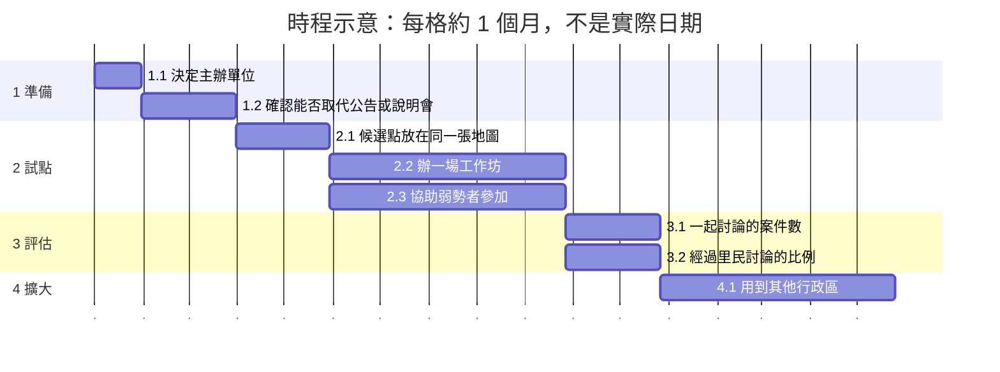

| 相依事項與現行政策的關係 | 說明 | 相關編號 |
|---|---|---|
| 以各議題的解法為基礎 | `[AI模擬]` 合併的解法不取代各議題的解法。各議題的解法可以單獨推動；合併只是在同一個地點、同一段時間一起辦。 | 解法 X-S1、解法 X-S2、解法 X-S3、解法 X-S4、解法 X-S5、解法 X-S6、解法 X-S7、解法 X-S8、解法 X-S9、解法 X-S10、解法 X-S11、解法 X-S12、解法 X-S13 |
| 現行的清潔箱做法 | `[AI模擬]` #2 的現行做法是依家戶垃圾違規棄置量評估清潔箱的裁撤或復設。合併的選址討論需要和這個做法銜接。 | #2 O04-US04、解法 X-S1 |

### 4.5.2 解法 X-S2：人行道設施帶的共同檢查清單

| 項目 | 內容 |
|---|---|
| 相關法規 | `[AI模擬]` 市區道路及附屬工程設計規範；身心障礙者權益保障法與無障礙設施相關規定（#1）；道路上設置物件的相關規定（#2）；站位與標線的設置規定（#5）；臺北市吸菸區設置及管理要點（#8）；行人交通安全設施條例第 8 條、第 9 條（妨礙通行的設施限期改善或遷移，騎樓的地平面由地方政府指定路段統一重修，#12）【待補：法務確認各規定合併成一張檢查清單時是否一致】【待補：法務與工務局確認騎樓整平的費用分擔與補助的法源（#12）】 |
| 隱私 | `[AI模擬]` 只用設施資料，不含個資（#1）；站位的現場觀察與計數不拍可以辨識的人臉與車牌（#5）；走查與照片只記錄設施，不拍可辨識的人臉與車牌，不公開個別屋主或店家的資料（#12） |
| 其他顧慮與風險 | `[AI模擬]` 設施帶的規範只適用於新做或重做的人行道，改善速度慢（#1）；人行道寬度欄位的意義未確認（#1）；清潔箱開放資料只到 2018-01（#2）；站位移動後，原本的乘客要走比較遠（#5）；機車退出騎樓後，附近如果沒有停車格，機車可能停到別的地方；騎樓整平期間屋主與店家的進出受影響；店家可能覺得被針對；管線遷移的期限與成本；施工後被擅自改建（#12） |
| 災害風險 | `[AI模擬]` 種在窄小空間的樹颱風時可能比較容易倒（#1 解法 S1）；設施帶要留下地震或土壤液化後搶修管線的空間，也要寫清楚樹穴和瓦斯管線的距離，施工時不損壞電纜（#1 解法 S4）；清潔箱避開容易積水的地點（#2 解法 S1）；候車亭與站牌在颱風時可能損壞或掉落，需要定期檢查（#5 解法 S5）；吸菸區避開加油站、瓦斯設施與易燃物（#8 解法 S1）；騎樓整平與人行道施工時，要注意騎樓柱與建築物的結構，施工不能影響耐震；人行道與騎樓的鋪面要能排水，豪雨時不積水、不濕滑（#12 解法 S2） |
| 可行性 | `[AI模擬]` #1 解法 S1：可行性高；#1 解法 S4：可行性中；#2 解法 S1：可行性高；#5 解法 S5：可行性中到高；#8 解法 S1：可行性高；#12 解法 S2：可行性中（有現行的人行道改善與機車退出騎樓計畫；騎樓整平要屋主配合） |

| 執行計畫 | 內容 |
|---|---|
| 主責單位 | `[AI模擬]` 工務局新建工程處；協作：公園路燈工程管理處、環保局、衛生局、交通局公共運輸處（站位，#5）、交通局停車管理工程處（機車停車，#12）、各管線單位、里辦公處與商圈組織（#12） |
| 需要的資料／API／資源 | `[AI模擬]` #1 解法 S1：行道樹與公園樹木（data.gov.tw 128274）、樹穴（data.gov.tw 134908）、人行道範圍圖、公園基本資料、地下管線圖資【待補：管線單位或道路管線資料的取得方式】、樹冠與地表溫度【待補：航照或衛星影像】、人口與年齡分布（判斷樹蔭公平時使用）【待補：資料來源】、結構土壤與土壤格框的規格（可參考 NParks RTN 01-2014）【待補：台北是否有相同的材料規格與施工標準】、地面管線箱的位置【待補：管線單位或新工處的設施物資料】、歷年航照【待補：取得方式與年份】、公有閒置土地與零碎土地的清單【待補：土地管理機關】、給公開樹蔭地圖用的氣溫資料【待補：資料來源】；#1 解法 S4：人行道範圍圖（含寬度欄位）、樹穴資料、地下管線圖資、樹根破壞鋪面的通報與維修紀錄【待補：新工處】；#2 解法 S1：清潔箱位置（data.gov.tw 121355）、捷運分時進出量、公車站牌位置（SHP）、1999 類別資料（目前無地點，需【待補：研考會提供有地點的去識別化資料】）、商圈範圍【待補：資料來源】、人行道寬度【待補：新工處】、民眾標記缺桶地點的表單（可以和 #2 解法 S2 的回報用同一個入口）；#5 解法 S5：站牌位置圖、智慧型公車站牌數、身心障礙者小型冷氣車輛數、現在的站位清單【待補：公共運輸處】、站位附近的事故與申訴【待補：警察局、公共運輸處】、低底盤公車的比例【待補：公共運輸處】；#8 解法 S1：指定吸菸區資料（data.gov.tw 177504，有座標）、學校、幼兒園、醫院與公車站的位置、人行道寬度【待補：新工處】、#1 的樹穴與 #2 的清潔箱位置、里界資料；#12 解法 S2：115年臺北市道路交通安全執行計畫的人行道改善與機車退出騎樓的成果、騎樓高低差的調查【待補：新工處】、路段附近機車停車格的供給與使用率【待補：停管處】、妨礙通行的管線設施清單【待補：新工處、管線單位】 |
| 成本 | `[AI模擬]` #1 解法 S1：地圖本身成本低（主要是人力與現有資料），實際種樹與養護成本【待補：公園處單價】，結構土壤與土壤格框的施工成本【待補：每平方公尺單價】，管線箱移位的成本由誰負擔【待補：管線單位與市府協商】，公開樹蔭地圖用同一份資料，成本低，口袋公園的整地與種樹成本【待補：公園處單價】；#1 解法 S4：規範修訂成本低，實際施工成本高【待補：每公尺施工單價】；#2 解法 S1：成本低（主要是人力與現有資料）；#5 解法 S5：成本低到中（標線、站牌與訓練）；#8 解法 S1：成本低到中（人力與工作坊）；#12 解法 S2：成本中到高（人行道與騎樓的工程、停車格的規劃）【待補：單價】。`[AI模擬]` 以下範圍是合併辦理的估計，不是各解法的加總，因為合併辦理共用人力與場地。以下範圍只含合成檢查清單、試點路段的走查與檢查，以及用到新做或重做的人行道與騎樓時的檢查工作，不含實際種樹與養護、結構土壤與土壤格框的施工、管線箱移位、口袋公園的整地與種樹，也不含人行道與騎樓的工程。#12 解法 S2 的範圍含第一條試點路段的工程，所以比這個範圍高很多。時間：約 15–22 個月；經費：約 NT$ 150–400 萬；人力：約 380–700 人天【待補：專業人士確認】 |

| 編號 | 工作項目 | 主責單位 | 期間 | 人天 |
|---|---|---|---|---|
| 1 | `[AI模擬]` 準備：合成一張檢查清單 | 工務局新建工程處 | 第 1–3 個月 | 約 60–110 |
| 1.1 | `[AI模擬]` 新工處和公園處、環保局、衛生局、公共運輸處、停車管理工程處把各自的距離與淨寬規定合成一張檢查清單【待補：法務確認各規定是否一致】 | 工務局新建工程處 | 第 1–3 個月 | 約 60–110 |
| 2 | `[AI模擬]` 試點：在一個行政區的幾段人行道與騎樓 | 工務局新建工程處 | 第 4–10 個月 | 約 160–280 |
| 2.1 | `[AI模擬]` 先和身障者、長者一起走查，畫出通行淨寬 | 工務局新建工程處 | 第 4–5 個月 | 約 40–70 |
| 2.2 | `[AI模擬]` 用清單檢查候選點、機車停車格與店家上下貨的位置 | 工務局新建工程處 | 第 6–10 個月 | 約 120–210 |
| 3 | `[AI模擬]` 評估：看 4.3 的成效衡量 | 工務局新建工程處 | 第 11–12 個月 | 約 40–75 |
| 3.1 | `[AI模擬]` 用 4.3 的成效衡量評估通過檢查的候選點比例 | 工務局新建工程處 | 第 11–12 個月 | 約 15–30 |
| 3.2 | `[AI模擬]` 用 4.3 的成效衡量評估留下連續淨寬的路段比例 | 工務局新建工程處 | 第 11–12 個月 | 約 15–25 |
| 3.3 | `[AI模擬]` 用 4.3 的成效衡量評估機車退出騎樓的路段數 | 工務局新建工程處 | 第 11–12 個月 | 約 10–20 |
| 4 | `[AI模擬]` 擴大：新做或重做的人行道與騎樓 | 工務局新建工程處 | 第 13–20 個月 | 約 120–235 |
| 4.1 | `[AI模擬]` 用到新做或重做的人行道與騎樓 | 工務局新建工程處 | 第 13–20 個月 | 約 120–235 |

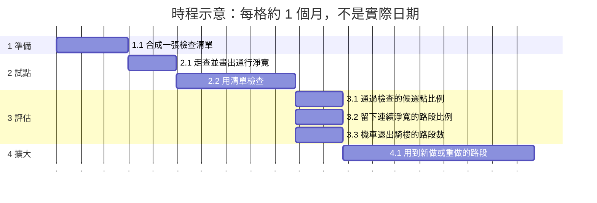

| 相依事項與現行政策的關係 | 說明 | 相關編號 |
|---|---|---|
| 以各議題的解法為基礎 | `[AI模擬]` 合併的解法不取代各議題的解法。各議題的解法可以單獨推動；合併只是在同一個地點、同一段時間一起辦。 | 解法 X-S1、解法 X-S2、解法 X-S3、解法 X-S4、解法 X-S5、解法 X-S6、解法 X-S7、解法 X-S8、解法 X-S9、解法 X-S10、解法 X-S11、解法 X-S12、解法 X-S13 |
| 現行的吸菸區設置要點 | `[AI模擬]` 解法 X-S2 的檢查清單，以 #8 的「臺北市吸菸區設置及管理要點」（115 年 10 月 1 日生效）的距離與淨寬規定為起點之一。 | #8 O22-US02、解法 X-S2 |
| 現行的機車退出騎樓、人行道2.0 | `[AI模擬]` #12 引用的「115年臺北市道路交通安全執行計畫」：重新規劃人行道設施帶的停車空間，人車動線分離；114 年完成加強整頓 11 條路段。解法 X-S2 的檢查清單也包含這些停車空間的位置。 | #12 解法 S2、O46、#12 O46-US01、解法 X-S2 |

### 4.5.3 解法 X-S3：共用的通報入口與派工

| 項目 | 內容 |
|---|---|
| 相關法規 | `[AI模擬]` 個人資料保護法（回報者聯絡方式、照片）；資通安全管理法（#2）；菸害防制法第 22 條、第 40 條與廢棄物清理法第 27 條、第 50 條（兩種稽查，#8）；傳染病防治法（個案的資料不能公開，#3）；噪音管制法第 9 條與社會秩序維護法第 72 條（噪音由環保局或警察處理，#10）；廢棄物清理法第 5 條（執行機關是環保局）與清運家戶巨大垃圾執行要點第三點（清潔隊依市民申請登錄並約定放置地點，#11）；違規停車與占用的取締依道路交通管理處罰條例（#12）【待補：法務確認噪音陳情的進度查詢可以公開的範圍（#10）】【待補：法務確認大型廢棄物線上預約收集個資的範圍與保存期間（#11）】【待補：法務確認違停與占用檢舉的進度查詢可以公開的範圍，以及人行道與騎樓占用的取締依據與主管單位（#12）】 |
| 隱私 | `[AI模擬]` 照片可能拍到人臉或車牌，需模糊處理或只收位置與狀態；回報者聯絡方式應選填，只用來回覆；清潔隊員的手機定位涉及員工監督，需和員工及工會溝通（#2、#8）；鼠患的公開數字只到里，傳染病的資料只公開彙總（#3）；噪音的陳情人看不到被陳情者的資料，被陳情者也看不到陳情人；進度查詢只給陳情人本人，公開的統計只到行政區，不公開被陳情的地址或店名（#10）；大型廢棄物的預約只收清運需要的資料，地址只給清潔隊（#11）；檢舉人的姓名與電話只給處理的單位，被檢舉的人看不到檢舉人，公開的統計只到行政區，不公開被檢舉的地址、車牌或店名（#12） |
| 其他顧慮與風險 | `[AI模擬]` 回報量可能偏向會用手機的人（#2、#3）；通報可能變成鄰里衝突（#8）；罰款對經濟弱勢者的影響較大，需要社工轉介（#8）；處理慢的地方公開後可能被批評，需要說明原因（#3）；分流規則太複雜時，1999 的話務人員難以判斷；夜間的到場目標需要稽查人力；到場時噪音已經停止，仍無法量測（#10）；線上預約增加後，如果減少電話的人力，不會上網的人更難預約（#11）；檢舉的件數多時處理人力不足，檢舉也可能被用來針對鄰居（#12） |
| 災害風險 | `[AI模擬]` 連網的回報方式可能受到資安攻擊（例如 QR code 被貼換成假網址）；連網的感測器在停電或網路中斷時無法回報，派工要能改回定時清運（#2 解法 S2）；颱風後一次移除很多倒樹時，移除紀錄要事後補登（#1 解法 S2）；亂丟的菸蒂可能引起火災，稽查可以把乾燥季節的山區步道與草地列入（#8 解法 S4）；鼠患的通報系統可能被灌入假通報或被入侵，鼠類相關傳染病發生時系統仍要能運作（#3 解法 S6）；大型災害後 1999 的案件暴增，噪音案件可能排在後面，需要事先說明災害期間的處理順序；陳情系統停電或被入侵時，可能無法受理或資料外洩（#10 解法 S1）；災後泡水的家具大量增加，大型廢棄物的預約可能塞車，需要事先說明災後的收運方式（#11 解法 S1）；檢舉系統停電或被入侵時，可能無法受理或資料外洩，需要備援與資安檢查（#12 解法 S4） |
| 可行性 | `[AI模擬]` #1 解法 S2：可行性中；#2 解法 S2：QR 回報可行性高，感測器試點（候選人構想）可行性中；#3 解法 S6：可行性高；#8 解法 S4：可行性中；#10 解法 S1：可行性中到高（有現行的 1999 與陳情系統）；#11 解法 S1：可行性中到高（有現行的 65 個分隊的電話預約與 1999）；#12 解法 S4：可行性中到高（有現行的 1999 與交通違規的檢舉系統） |

| 執行計畫 | 內容 |
|---|---|
| 主責單位 | `[AI模擬]` 1999 市民熱線與各局處的派工【待補：由哪個單位統一受理，需要市府決定】；協作：環保局（含水質病媒管制科，#3；環保稽查大隊，#10；各區清潔隊，#11）、衛生局、公園處、警察局（#10；交通警察大隊，#12）、交通局停車管理工程處與工務局新建工程處（#12）、社會局、資訊局 |
| 需要的資料／API／資源 | `[AI模擬]` #1 解法 S2：每棵樹的唯一編號（行道樹資料已有 TreeID）、移除紀錄與原因（目前未完整開放）、工程設計圖中的保留樹清單、現場標示的規格、移樹履歷查詢系統的資料匯出方式【待補：公園處】、印有樹木編號與回報方式的樹牌、回報與 1999 派工系統的介接【待補：現有系統資訊】；#2 解法 S2：每個桶子的唯一編號（目前資料沒有編號欄位，需新增）、回報表單或台北通功能、清潔隊派工系統的介接【待補：現有系統資訊】、試點感測器資料；#3 解法 S6：1999 新增的鼠患次類別（帶有地點與照片）【待補：研考會】、派工與結案的紀錄、民間通報網站的資料（需要取得同意）、各里的投藥與檢查數字【待補：環保局】、鼠類相關傳染病的監測資料【待補：衛生局】；#8 解法 S4：通報紀錄（地點、時段）、稽查與勸導紀錄、1999 派工資料【待補：研考會】；#10 解法 S1：1999 派工資料與陳情系統類別資料、到場時間與處理結果的紀錄【待補：環保局、環保稽查大隊】、分流規則的草案【待補：1999 市民熱線】、外語的說明文字【待補：外籍居民社群確認】；#11 解法 S1：1999 派工資料、陳情系統類別資料與臺北市巨大廢棄物清運的開放資料（分隊、收運的里、預約時間）、現行是否已有線上預約【待補：查證環保局現行的預約管道】、各分隊每天的預約量與收運量【待補：環保局】、外語的說明文字【待補：外籍居民社群確認】；#12 解法 S4：違停與占用的檢舉件數與處理時間【待補：1999 市民熱線、交通警察大隊】、分流規則的草案【待補：1999 市民熱線】 |
| 成本 | `[AI模擬]` #1 解法 S2：成本低到中（資料整理與系統調整），樹牌的製作與安裝成本【待補：單價】；#2 解法 S2：QR 回報成本低，感測器試點（候選人構想）成本中等【待補：市場詢價】，壓縮式智慧垃圾桶試點（候選人構想）成本【待補：市場詢價】，全面換裝成本高，在試點資料出來前不建議（對應 #2 O09-US01 列為 Won't）；#3 解法 S6：成本低（新增類別與公開頁面）；#8 解法 S4：成本中（稽查人力）；#10 解法 S1：成本低到中（分流規則、系統的進度查詢與夜間人力）；#11 解法 S1：成本低到中（線上表單、查詢功能與外語說明）；#12 解法 S4：成本低到中（分流規則與系統的進度查詢）。`[AI模擬]` 以下範圍是合併辦理的估計，不是各解法的加總，因為合併辦理共用人力與場地。以下範圍只含統一受理、分流規則、同一個入口的試點與推到全市的工作，不含感測器試點、壓縮式智慧垃圾桶試點與全面換裝、樹牌的製作與安裝，也不含推到全市之後長期的夜間人力與每年持續的稽查人力。時間：約 15–22 個月；經費：約 NT$ 500–1400 萬；人力：約 850–1600 人天【待補：專業人士確認】 |

| 編號 | 工作項目 | 主責單位 | 期間 | 人天 |
|---|---|---|---|---|
| 1 | `[AI模擬]` 準備：決定受理單位與分流規則 | 【待補：統一受理的單位】 | 第 1–4 個月 | 約 75–150 |
| 1.1 | `[AI模擬]` 市府決定由哪個單位統一受理【待補：統一受理的單位】 | 市府 | 第 1 個月 | 約 5–10 |
| 1.2 | `[AI模擬]` 環保局與衛生局先談好兩種稽查的分工 | 環保局 | 第 2–3 個月 | 約 20–40 |
| 1.3 | `[AI模擬]` 環保局與警察局依音源寫出噪音的分流規則 | 環保局 | 第 2–3 個月 | 約 20–40 |
| 1.4 | `[AI模擬]` 1999、交通警察大隊、停車管理工程處與新工處依類型寫出違停與占用的分流規則 | 1999 市民熱線 | 第 2–4 個月 | 約 30–60 |
| 2 | `[AI模擬]` 試點：在一個行政區用同一個入口受理 | 【待補：統一受理的單位】 | 第 5–12 個月 | 約 505–940 |
| 2.1 | `[AI模擬]` 在一個行政區用同一個入口受理清潔箱、菸蒂、違規吸菸、鼠患、危險樹木、噪音、違停與占用的通報 | 同上 | 第 5–12 個月 | 約 350–640 |
| 2.2 | `[AI模擬]` 也試辦大型廢棄物的線上預約與收運日期的查詢（同時保留電話） | 同上 | 第 5–12 個月 | 約 80–150 |
| 2.3 | `[AI模擬]` 陳情人與檢舉人查得到處理進度 | 同上 | 第 5–12 個月 | 約 50–100 |
| 2.4 | `[AI模擬]` 對經濟弱勢者先勸導，由社會局轉介 | 社會局 | 第 5–12 個月 | 約 25–50 |
| 3 | `[AI模擬]` 評估：看 4.3 的成效衡量 | 【待補：統一受理的單位】 | 第 13–14 個月 | 約 35–70 |
| 3.1 | `[AI模擬]` 用 4.3 的成效衡量評估處理天數、被轉派一次以上的比例 | 同上 | 第 13–14 個月 | 約 15–30 |
| 3.2 | `[AI模擬]` 用 4.3 的成效衡量評估噪音陳情到場的時間 | 同上 | 第 13–14 個月 | 約 10–20 |
| 3.3 | `[AI模擬]` 用 4.3 的成效衡量評估大型廢棄物的派工件數 | 同上 | 第 13–14 個月 | 約 10–20 |
| 4 | `[AI模擬]` 擴大：全市 | 【待補：統一受理的單位】 | 第 15–20 個月 | 約 235–440 |
| 4.1 | `[AI模擬]` 再用到全市 | 同上 | 第 15–20 個月 | 約 210–400 |
| 4.2 | `[AI模擬]` 加入外語的說明 | 同上 | 第 15–20 個月 | 約 25–40 |

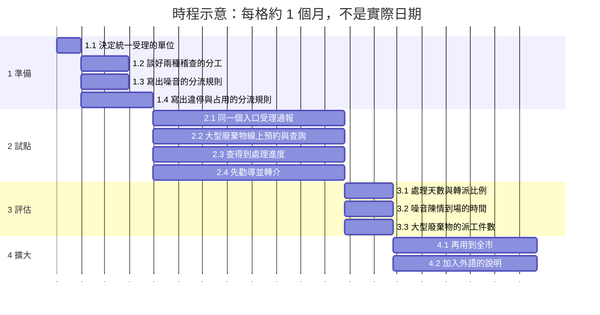

| 相依事項與現行政策的關係 | 說明 | 相關編號 |
|---|---|---|
| 以各議題的解法為基礎 | `[AI模擬]` 合併的解法不取代各議題的解法。各議題的解法可以單獨推動；合併只是在同一個地點、同一段時間一起辦。 | 解法 X-S1、解法 X-S2、解法 X-S3、解法 X-S4、解法 X-S5、解法 X-S6、解法 X-S7、解法 X-S8、解法 X-S9、解法 X-S10、解法 X-S11、解法 X-S12、解法 X-S13 |
| 現行的 1999 噪音派工 | `[AI模擬]` #10 的 1999 派工資料中，「場所與設施噪音舉發」2026 年 7 到 9 月每月 1,370 到 1,726 件，是第 2 多的派工項目，由環保局處理。解法 X-S3 的噪音分流，是在現有的派工上改善分流與回覆。 | #10 解法 S1、O13、O61、解法 X-S3 |
| 現行的大型廢棄物電話預約 | `[AI模擬]` #11 引用臺北市巨大廢棄物清運的開放資料：全市 65 個清潔隊分隊受理電話預約，預約時間都是 06:00 至 16:30；也可以打 1999 預約。1999 派工資料中，「大型廢棄物清運聯繫」2026 年 7 到 9 月是最多的派工項目。解法 X-S3 在電話預約之外增加線上預約，不取代電話。 | #11 解法 S1、O03、O13、解法 X-S3 |

### 4.5.4 解法 X-S4：街道設施、市政資料與議題分析的共同開放資料與地圖

| 項目 | 內容 |
|---|---|
| 相關法規 | `[AI模擬]` 臺北市政府資料開放相關規定與政府資料開放授權條款；身心障礙者權益保障法（資訊無障礙，#2）；政府資訊公開法（#1）；行人交通安全設施條例第 5 條與第 6 條（步行環境調查與改善計畫，#12）；臺北市政府開放資料管理規範、個人資料保護法、資通安全相關法規（#9）；傳染病防治法（#3）；電子票證的上下車紀錄與逐棟的評估結果可能是個人資料（#5、#6） |
| 隱私 | `[AI模擬]` 設施的資料只含位置與範圍，不含個資；移除紀錄公開前，確認是否涉及私人申請者的個資（#1）。議題分析的資料不開放原始意見，只開放彙總件數與改寫後的摘要，開放前去識別；摘要也可能從內容認出人，開放前要檢查（#9）。鼠患的數字只到里（#3）；車流只用路段的流量、車速與車站的人次（#4）；公車只用站與時段的彙總人次，人次很少的要合併後再公開（#5）；建物的評估結果只給屋主與住戶查詢，統計只到行政區或里（#6）；公開樹蔭地圖的市民回報只收地點與照片，照片要模糊人臉與車牌，查詢路線時不保存個人的路線（#1 解法 S1）；步行環境的開放資料只含設施與施工的位置，不含個人的資料與路線（#12 解法 S6） |
| 其他顧慮與風險 | `[AI模擬]` 各局處的資料更新時間不同，資料不更新會讓人白跑或誤會，降低信任（#2、#8、#3）；行道樹與樹穴資料沒有共同編號（#1）；由誰更新議題分析的資料還沒有決定，去識別可能不夠（#9）；同一份數字可能被用來支持不同的做法，需要說明資料的範圍與限制（#4）；公開的層級可能引起爭議（#6）；公開樹蔭地圖把樹蔭還不夠的路段標成有樹蔭時，熱天依地圖走路的人可能更曬（#1 解法 S1）；步行環境的開放資料沒有持續更新時，用它規劃的路線可能把人帶到已經損壞或正在施工的地方（#12 解法 S6） |
| 災害風險 | `[AI模擬]` 收集到的原始意見與聯絡方式如果被入侵或外洩，會傷害提供意見的人（#9 解法 S4 的資安攻擊）；颱風後的移除紀錄要事後補登，原因寫明是災害（#1 解法 S2）；鼠患的通報系統可能被灌入假通報（#3 解法 S6）；偵測器與資料系統停電時儀表板會中斷，也可能被灌入假的資料（#4 解法 S1）；疫情時搭乘的需求變化很大，用一段時期的資料可能不適用於其他時期，上下車資料外洩會影響隱私（#5 解法 S2）；大地震後查詢的需求會暴增，查詢系統也可能停電或被入侵（#6 解法 S1）；熱浪時公開樹蔭地圖的使用可能最多，地圖要說明它不能取代其他的防暑措施（#1 解法 S1）；#2 解法 S3、#8 解法 S3、#12 解法 S6 沒有明顯相關的災害風險 |
| 可行性 | `[AI模擬]` #1 解法 S1：可行性高；#1 解法 S2：可行性中；#2 解法 S3：可行性高；#3 解法 S6：可行性高；#4 解法 S1：可行性中到高（靜態資料與捷運資料已公開，歷史 VD 序列需要局處提供）；#5 解法 S2：可行性中（需要局處提供資料）；#6 解法 S1：可行性中（逐棟的評估紀錄需要局處整理）；#8 解法 S3：可行性高；#9 解法 S4：可行性中；#12 解法 S6：可行性中到高（條例已要求地方政府做） |

| 執行計畫 | 內容 |
|---|---|
| 主責單位 | `[AI模擬]` 資訊局（開放資料平台、台北通）；資料提供：公園處、環保局、衛生局、研考會（議題分析的資料，#9）、交通局與交通管制工程處（車流，#4）、公共運輸處（公車，#5）、都市發展局與建築管理工程處（建物，#6）、公園路燈工程管理處（樹蔭地圖，#1）、交通局與工務局新建工程處（步行環境調查，#12）；協作：觀光傳播局（多語言）、法務局（個資，#9） |
| 需要的資料／API／資源 | `[AI模擬]` #1 解法 S1：行道樹與公園樹木（data.gov.tw 128274）、樹穴（data.gov.tw 134908）、人行道範圍圖、公園基本資料、地下管線圖資【待補：管線單位或道路管線資料的取得方式】、樹冠與地表溫度【待補：航照或衛星影像】、人口與年齡分布（判斷樹蔭公平時使用）【待補：資料來源】、結構土壤與土壤格框的規格（可參考 NParks RTN 01-2014）【待補：台北是否有相同的材料規格與施工標準】、地面管線箱的位置【待補：管線單位或新工處的設施物資料】、歷年航照【待補：取得方式與年份】、公有閒置土地與零碎土地的清單【待補：土地管理機關】、給公開樹蔭地圖用的氣溫資料【待補：資料來源】；#1 解法 S2：每棵樹的唯一編號（行道樹資料已有 TreeID）、移除紀錄與原因（目前未完整開放）、工程設計圖中的保留樹清單、現場標示的規格、移樹履歷查詢系統的資料匯出方式【待補：公園處】、印有樹木編號與回報方式的樹牌、回報與 1999 派工系統的介接【待補：現有系統資訊】；#2 解法 S3：更新後的清潔箱資料（補齊北投區、加上編號、類型、回收分類、投入口高度、無障礙）、開放 API、多語言文字【待補：觀傳局】、#2 解法 S2 的滿溢回報與試點感測器資料；#3 解法 S6：1999 新增的鼠患次類別（帶有地點與照片）【待補：研考會】、派工與結案的紀錄、民間通報網站的資料（需要取得同意）、各里的投藥與檢查數字【待補：環保局】、鼠類相關傳染病的監測資料【待補：衛生局】；#4 解法 S1：車輛偵測器（VD）靜態資料、文湖線各站分時進出量、每 5 分鐘的 VD 動態資料與歷史序列【待補：交通管制工程處】、國道匝道的流量【待補：高速公路局，或題目列出的 TDX 平臺（需要申請金鑰）】、橋梁上的偵測器位置【待補：交通管制工程處確認成美橋與民權大橋的偵測器】、企業的上班時間與員工通勤的調查（去識別化）；#5 解法 S2：聯營公車業務的年度統計、公車路線軌跡、站牌位置圖、各站、各時段的上下車人次（去識別、彙總）【待補：公共運輸處，題目說未開放】、捷運各站的轉乘人次【待補：臺北捷運公司】、跨市路線的資料【待補：新北市交通局，或題目列出的 TDX 平臺（需要申請金鑰）】、各里人口、學校與醫院的位置（開放資料）【待補：確認使用的資料集】；#6 解法 S1：建築物棟數、土壤液化潛勢圖、消防通道清冊、逐棟的耐震評估紀錄（初步評估、詳細評估、危老的結構安全性能評估）【待補：建築管理工程處、都市發展局】、逐棟的屋齡與結構類型（題目說未開放）【待補：都市發展局】、評估等級的白話說明【待補：建築師與技師公會】、自我檢查清單的項目與說明文字【待補：建築師與技師公會確認】；#8 解法 S3：各公告的範圍圖（目前附在公告中）、轉成可以機器讀取的範圍資料、多語言文字【待補：觀傳局】；#9 解法 S4：本專案已有的 CSV 與 JSON、臺北市資料大平臺、去識別的規則、資料更新的負責人；#12 解法 S6：行人交通安全設施條例第 5 條至第 7 條與第 10 條、步行環境調查的方法與範圍【待補：交通局、工務局】、中央考評的結果【待補：內政部國土管理署】、把調查結果與施工資訊轉成開放資料的格式與更新方式【待補：資訊局】 |
| 成本 | `[AI模擬]` #1 解法 S1：地圖本身成本低（主要是人力與現有資料），實際種樹與養護成本【待補：公園處單價】，結構土壤與土壤格框的施工成本【待補：每平方公尺單價】，管線箱移位的成本由誰負擔【待補：管線單位與市府協商】，公開樹蔭地圖用同一份資料，成本低，口袋公園的整地與種樹成本【待補：公園處單價】；#1 解法 S2：成本低到中（資料整理與系統調整），樹牌的製作與安裝成本【待補：單價】；#2 解法 S3：成本低；#3 解法 S6：成本低（新增類別與公開頁面）；#4 解法 S1：成本低到中（資料整理與系統）；#5 解法 S2：成本低到中（資料分析與說明會）；#6 解法 S1：成本低到中（網頁、窗口與資料整理）；#8 解法 S3：成本低；#9 解法 S4：成本低到中；#12 解法 S6：成本低到中（調查、參與與公開）。`[AI模擬]` 以下範圍是合併辦理的估計，不是各解法的加總，因為合併辦理共用人力與場地。以下範圍不含實際種樹與養護、結構土壤與土壤格框的施工、管線箱移位、口袋公園的整地與種樹、樹牌的製作與安裝，也不含第一次公布之後每年持續的公布與資料更新。時間：約 14–20 個月；經費：約 NT$ 300–900 萬；人力：約 700–1300 人天【待補：專業人士確認】 |

| 編號 | 工作項目 | 主責單位 | 期間 | 人天 |
|---|---|---|---|---|
| 1 | `[AI模擬]` 準備：指定更新單位與去識別的規則 | 資訊局 | 第 1–3 個月 | 約 60–120 |
| 1.1 | `[AI模擬]` 資訊局和各資料提供單位為每個資料集指定由誰更新 | 資訊局 | 第 1–2 個月 | 約 40–80 |
| 1.2 | `[AI模擬]` 訂好去識別的規則 | 資訊局 | 第 3 個月 | 約 20–40 |
| 2 | `[AI模擬]` 試點：在一個行政區發布同一張地圖 | 資訊局 | 第 4–9 個月 | 約 170–310 |
| 2.1 | `[AI模擬]` 選一個行政區，把清潔箱、吸菸區與禁菸範圍放在同一張地圖 | 資訊局 | 第 4–7 個月 | 約 120–220 |
| 2.2 | `[AI模擬]` 用臺北市資料大平臺發布，上線前做資安檢查 | 資訊局 | 第 8–9 個月 | 約 50–90 |
| 3 | `[AI模擬]` 評估：看 4.3 的成效衡量 | 資訊局 | 第 10–11 個月 | 約 30–60 |
| 3.1 | `[AI模擬]` 用 4.3 的成效衡量評估資料的涵蓋時間 | 資訊局 | 第 10–11 個月 | 約 15–30 |
| 3.2 | `[AI模擬]` 用 4.3 的成效衡量評估個資或資安事件 | 資訊局 | 第 10–11 個月 | 約 15–30 |
| 4 | `[AI模擬]` 擴大：補上缺少的資料 | 資訊局 | 第 12–18 個月 | 約 440–810 |
| 4.1 | `[AI模擬]` 再補上缺少的資料，例如公車的上下車人次【待補：公共運輸處】 | 資訊局 | 第 12–18 個月 | 約 440–810 |

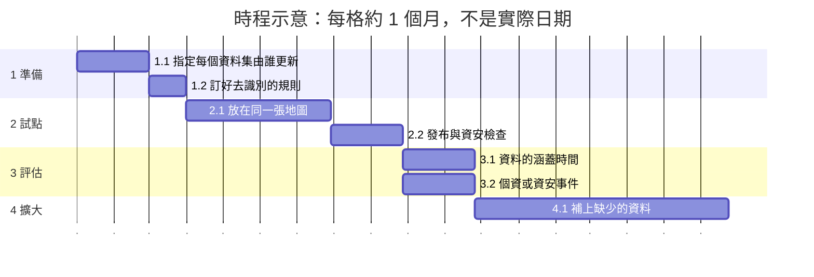

| 相依事項與現行政策的關係 | 說明 | 相關編號 |
|---|---|---|
| 以各議題的解法為基礎 | `[AI模擬]` 合併的解法不取代各議題的解法。各議題的解法可以單獨推動；合併只是在同一個地點、同一段時間一起辦。 | 解法 X-S1、解法 X-S2、解法 X-S3、解法 X-S4、解法 X-S5、解法 X-S6、解法 X-S7、解法 X-S8、解法 X-S9、解法 X-S10、解法 X-S11、解法 X-S12、解法 X-S13 |
| 開放資料的現況 | `[AI模擬]` 清潔箱開放資料只涵蓋到 2018-01，禁菸範圍沒有開放資料，行道樹與樹穴資料沒有共同編號；歷史的車流偵測序列沒有公開（#4），各站、各時段的公車上下車人次也沒有開放（#5）。整合的地圖要先處理這些缺口。#9 建議用現有的平臺（例如臺北市資料大平臺）發布，不另建系統。 | #2 O07-US01、#8 O07-US01、#1 O07-US02、#9 O28-US02、#4 解法 S1、#5 解法 S2、解法 X-S4 |

### 4.5.5 解法 X-S5：清潔箱與吸菸區分開設置、一起清運

| 項目 | 內容 |
|---|---|
| 相關法規 | `[AI模擬]` 廢棄物清理法（菸蒂、清潔箱）；臺北市吸菸區設置及管理要點；政府採購法（設備）（#2、#8） |
| 隱私 | `[AI模擬]` 量測只記錄環境數字，不拍可辨識的人臉（#8） |
| 其他顧慮與風險 | `[AI模擬]` 分開設置後，清潔箱或吸菸區可能離人多的地方遠一些；菸蒂收集設備需要維護（#8） |
| 災害風險 | `[AI模擬]` 負壓式吸菸區停電時無法排氣，封閉的吸菸室要考慮防火與排煙（#8 解法 S2）；颱風或豪雨前後，清潔箱可能被吹倒或泡水，需要有災害時的派工方式（#2 解法 S2） |
| 可行性 | `[AI模擬]` #2 解法 S1：可行性高；#2 解法 S2：QR 回報可行性高，感測器試點（候選人構想）可行性中；#8 解法 S2：可行性中 |

| 執行計畫 | 內容 |
|---|---|
| 主責單位 | `[AI模擬]` 環保局（清潔箱與清運）與衛生局（吸菸區）【待補：兩個局處在同一條清運路線上的分工，需要市府決定】；協作：吸菸區的管理單位 |
| 需要的資料／API／資源 | `[AI模擬]` #2 解法 S1：清潔箱位置（data.gov.tw 121355）、捷運分時進出量、公車站牌位置（SHP）、1999 類別資料（目前無地點，需【待補：研考會提供有地點的去識別化資料】）、商圈範圍【待補：資料來源】、人行道寬度【待補：新工處】、民眾標記缺桶地點的表單（可以和 #2 解法 S2 的回報用同一個入口）；#2 解法 S2：每個桶子的唯一編號（目前資料沒有編號欄位，需新增）、回報表單或台北通功能、清潔隊派工系統的介接【待補：現有系統資訊】、試點感測器資料；#8 解法 S2：各吸菸區的樣態與管理單位（data.gov.tw 177504）、試點前後的菸味或空氣品質量測、菸蒂清理紀錄 |
| 成本 | `[AI模擬]` #2 解法 S1：成本低（主要是人力與現有資料）；#2 解法 S2：QR 回報成本低，感測器試點（候選人構想）成本中等【待補：市場詢價】，壓縮式智慧垃圾桶試點（候選人構想）成本【待補：市場詢價】，全面換裝成本高，在試點資料出來前不建議（對應 #2 O09-US01 列為 Won't）；#8 解法 S2：負壓式成本較高【待補：每處設置與維護費用】，綠籬式成本較低。`[AI模擬]` 以下範圍是合併辦理的估計，不是各解法的加總，因為合併辦理共用人力與場地。以下範圍只含選址、試點與一起清運的工作，不含感測器試點、壓縮式智慧垃圾桶試點與全面換裝，也不含負壓式設備的設置與維護費用。時間：約 14–20 個月；經費：約 NT$ 250–700 萬；人力：約 380–700 人天【待補：專業人士確認】 |

| 編號 | 工作項目 | 主責單位 | 期間 | 人天 |
|---|---|---|---|---|
| 1 | `[AI模擬]` 準備：談好清運的分工 | 環保局與衛生局 | 第 1–3 個月 | 約 30–60 |
| 1.1 | `[AI模擬]` 環保局與衛生局談好在同一條清運路線上的分工【待補：需要市府決定】 | 環保局與衛生局 | 第 1–3 個月 | 約 30–60 |
| 2 | `[AI模擬]` 試點：在幾個捷運站出口或商圈 | 環保局與衛生局 | 第 4–11 個月 | 約 160–290 |
| 2.1 | `[AI模擬]` 在幾個捷運站出口或商圈，把清潔箱和吸菸區分開設置，菸蒂收集設備放在吸菸區內 | 環保局與衛生局 | 第 4–7 個月 | 約 100–180 |
| 2.2 | `[AI模擬]` 排入同一條清運路線 | 環保局 | 第 8–11 個月 | 約 60–110 |
| 3 | `[AI模擬]` 評估：看 4.3 的成效衡量，在現場決定距離 | 環保局與衛生局 | 第 12–13 個月 | 約 50–100 |
| 3.1 | `[AI模擬]` 用 4.3 的成效衡量評估滿溢比例 | 環保局 | 第 12–13 個月 | 約 15–30 |
| 3.2 | `[AI模擬]` 用 4.3 的成效衡量評估周邊菸味 | 衛生局 | 第 12–13 個月 | 約 15–30 |
| 3.3 | `[AI模擬]` 用 4.3 的成效衡量評估兩者的距離，在現場決定距離 | 環保局與衛生局 | 第 12–13 個月 | 約 20–40 |
| 4 | `[AI模擬]` 擴大：其他人多的地點 | 環保局與衛生局 | 第 14–17 個月 | 約 140–250 |
| 4.1 | `[AI模擬]` 再用到其他人多的地點 | 環保局與衛生局 | 第 14–17 個月 | 約 140–250 |

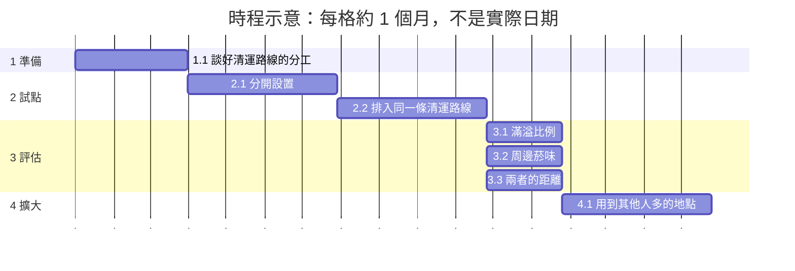

| 相依事項與現行政策的關係 | 說明 | 相關編號 |
|---|---|---|
| 以各議題的解法為基礎 | `[AI模擬]` 合併的解法不取代各議題的解法。各議題的解法可以單獨推動；合併只是在同一個地點、同一段時間一起辦。 | 解法 X-S1、解法 X-S2、解法 X-S3、解法 X-S4、解法 X-S5、解法 X-S6、解法 X-S7、解法 X-S8、解法 X-S9、解法 X-S10、解法 X-S11、解法 X-S12、解法 X-S13 |

### 4.5.6 解法 X-S6：垃圾、廚餘與大型廢棄物的收集點與放置點

| 項目 | 內容 |
|---|---|
| 相關法規 | `[AI模擬]` 廢棄物清理法第 27 條（不得污染水溝、在路旁堆置有礙衛生整潔之物）；臺北市廢棄物清理自治條例（垃圾費隨袋徵收、分類規定）；食品良好衛生規範準則（食品業者的廢棄物衛生管理）（#2、#3）；臺北市政府環境保護局清運家戶巨大垃圾執行要點、公寓大廈管理條例第 16 條第 2 項（樓梯間與共同走廊不得堆置雜物）、道路交通管理處罰條例第 82 條與廢棄物清理法第 27 條、第 50 條（道路上不得堆放或任意棄置，#11）【待補：法務確認收集點是否需要修改自治條例或公告，以及收攤後收運的責任分工】【待補：環保局確認依約定放置的大型廢棄物與任意棄置怎麼區分；工務局確認放置點在人行道或騎樓時的使用規定（#11）】 |
| 隱私 | `[AI模擬]` 收集點如果用卡片或台北通確認使用者，會產生個人的使用紀錄，需要限定目的與最小蒐集；只用專用垃圾袋或密封容器時，不需要個資（#2、#3）；大型廢棄物放置點的告示不寫預約人與住戶的姓名與門牌，收運日期只通知預約人（#11） |
| 其他顧慮與風險 | `[AI模擬]` 收集點本身可能有異味、噪音與髒亂，附近住戶可能反對（#2 C8）；收集點可能變成新的違規棄置點或髒亂點，需要有人管理（#2、#3）；費用由攤商、餐飲業者還是市府負擔，需要討論（#3）；大型廢棄物的放置點附近的住戶可能反對（#11 C1），放置點也可能被當成隨時可以丟東西的地方；當天收走需要夜間的人力；沒有不擋路的地方時，仍會占用人行道；沒有管委會的老舊公寓要靠里辦公處（#11） |
| 災害風險 | `[AI模擬]` 颱風或豪雨時垃圾車可能停收，收集點的垃圾與廚餘會累積，容易引來老鼠，需要先訂好颱風前後的收運方式（#2 解法 S5、#3 解法 S2）；收集點管理不好時，可能吸引老鼠與蚊蠅，增加病媒傳染病的風險（#2 解法 S5、#3 解法 S2）；收集點收到被混入的電池或易燃物時可能起火（#2 解法 S5）；颱風前放在戶外的大型廢棄物可能被吹動，颱風警報期間要暫停放置與收運，戶外的放置點要清空；淹水後泡水的家具大量放到路邊，需要災後的臨時收運方式（#11 解法 S2、#11 解法 S5）；大型廢棄物暫放在樓梯間或走廊時，會擋住逃生的路，也可能被引燃，所以放置點要避開這些地方（#11 解法 S5） |
| 可行性 | `[AI模擬]` #2 解法 S5：可行性中；#3 解法 S2：可行性中；#11 解法 S2：可行性高；#11 解法 S5：可行性中 |

| 執行計畫 | 內容 |
|---|---|
| 主責單位 | `[AI模擬]` 環保局（各區清潔隊）；協作：市場處、衛生局、民政局與各區公所（里）、里辦公處與公寓大廈管理委員會（大型廢棄物的放置點，#11）、工務局新建工程處（#11）【待補：家戶垃圾收運的負責單位是否一起參與，需要市府決定】 |
| 需要的資料／API／資源 | `[AI模擬]` #2 解法 S5：各區垃圾車的路線與停靠時間、試辦地區的住宅型態與人口【待補：資料來源】、收集點的使用量與清運紀錄、試辦前後清潔箱內家用垃圾量的抽查紀錄；#3 解法 S2：夜市與市場的收攤時間與攤位數【待補：市場處】、清運路線、車輛數與時間【待補：環保局】、餐飲業者的廚餘與廢油收運方式【待補：環保局】、收集點的位置與人行道淨寬；#11 解法 S2：環保局新聞稿的預約與放置方式、從預約到收運的天數【待補：環保局、清潔隊】、任意棄置的告發件數【待補：環保局】；#11 解法 S5：各分隊收運的里（臺北市巨大廢棄物清運的開放資料）、可以當放置點的地點【待補：里辦公處、管委會】、放置點的陳情件數【待補：環保局】 |
| 成本 | `[AI模擬]` #2 解法 S5：成本中到高【待補：設備、場地與管理人力的單價】，增加收運時段的人力與車輛成本【待補：環保局】；#3 解法 S2：成本中（密封容器、夜間收運的人力與車輛）【待補：單價與人力】；#11 解法 S2：成本低（說明文字與通知）；#11 解法 S5：成本低（告示與協調）。`[AI模擬]` 以下範圍是合併辦理的估計，不是各解法的加總，因為合併辦理共用人力與場地。經費中夜市與市場的部分只含一處試點，不含其他夜市與市場的密封容器與夜間收運。時間：約 15–22 個月；經費：約 NT$ 400–1000 萬；人力：約 430–800 人天【待補：專業人士確認】 |

| 編號 | 工作項目 | 主責單位 | 期間 | 人天 |
|---|---|---|---|---|
| 1 | `[AI模擬]` 準備：討論位置與管理方式 | 環保局 | 第 1–4 個月 | 約 50–95 |
| 1.1 | `[AI模擬]` 環保局和市場處、區公所、管委會與附近住戶討論收集點與大型廢棄物放置點的位置與管理方式 | 環保局 | 第 1–3 個月 | 約 40–75 |
| 1.2 | `[AI模擬]` 把放置的時間與位置寫成白話說明【待補：法務確認是否需要修改自治條例或公告】 | 環保局 | 第 4 個月 | 約 10–20 |
| 2 | `[AI模擬]` 試點：在一個行政區的幾個里與一處夜市或市場 | 環保局 | 第 5–12 個月 | 約 150–280 |
| 2.1 | `[AI模擬]` 先訂好颱風前後的收運方式 | 環保局 | 第 5 個月 | 約 10–20 |
| 2.2 | `[AI模擬]` 在一個行政區的幾個里與一處夜市或市場設置密封的收集點 | 環保局 | 第 6–12 個月 | 約 100–180 |
| 2.3 | `[AI模擬]` 在 2 到 3 個里試辦大型廢棄物的放置點與告示 | 環保局 | 第 6–12 個月 | 約 40–80 |
| 3 | `[AI模擬]` 評估：看 4.3 的成效衡量 | 環保局 | 第 13–14 個月 | 約 30–60 |
| 3.1 | `[AI模擬]` 用 4.3 的成效衡量評估使用量、收攤到清運完成的時間 | 環保局 | 第 13–14 個月 | 約 15–30 |
| 3.2 | `[AI模擬]` 用 4.3 的成效衡量評估鼠跡通報 | 環保局 | 第 13–14 個月 | 約 5–10 |
| 3.3 | `[AI模擬]` 用 4.3 的成效衡量評估預約到收運的天數、放置點的陳情件數 | 環保局 | 第 13–14 個月 | 約 10–20 |
| 4 | `[AI模擬]` 擴大：其他行政區 | 環保局 | 第 15–19 個月 | 約 200–365 |
| 4.1 | `[AI模擬]` 再用到其他行政區 | 環保局 | 第 15–19 個月 | 約 200–365 |

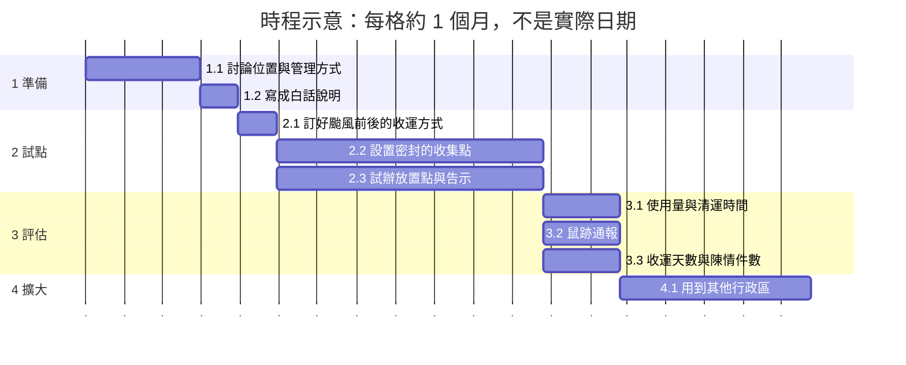

| 相依事項與現行政策的關係 | 說明 | 相關編號 |
|---|---|---|
| 以各議題的解法為基礎 | `[AI模擬]` 合併的解法不取代各議題的解法。各議題的解法可以單獨推動；合併只是在同一個地點、同一段時間一起辦。 | 解法 X-S1、解法 X-S2、解法 X-S3、解法 X-S4、解法 X-S5、解法 X-S6、解法 X-S7、解法 X-S8、解法 X-S9、解法 X-S10、解法 X-S11、解法 X-S12、解法 X-S13 |
| 現行的大型廢棄物放置方式 | `[AI模擬]` #11 引用環保局新聞稿（民國 113 年 1 月 16 日）：預約好時間與地點後，市民在約定的時間把大型廢棄物放到約定的地點，各區清潔隊多請市民在夜間 21 時以後排出。解法 X-S6 把這個做法和收集點的管理規則寫在一起。 | #11 解法 S2、#11 O04-US02、解法 X-S6 |

### 4.5.7 解法 X-S7：老舊公寓的到府診斷與協助（防鼠、耐震與大型廢棄物的搬運）

| 項目 | 內容 |
|---|---|
| 相關法規 | `[AI模擬]` 傳染病防治法第 25 條（私場所的病媒孳生源要依通知清除，#3）；食品安全衛生管理法與食品良好衛生規範準則（店家的防鼠，#3）；臺北市老屋健檢申請及補助實施計畫（沒有管委會的公寓要過半同意，#6）；清運家戶巨大垃圾執行要點第三點（家戶依指定方式及地點放置後，由各區清潔隊清運，#11）【待補：法務確認兩種服務一起申請時，申請與同意的方式】【待補：法務與勞動檢查確認清潔隊員進入住家搬運的職業安全與損壞賠償規定；社會局確認搬運協助的資格（#11）】 |
| 隱私 | `[AI模擬]` 到府診斷會看到住家內部，只記錄鼠跡、孔洞與建物的狀況，不拍可辨識的人與物品；申請者的經濟狀況與健康資料只用於核定補助，由社會局保管；公開的只有彙總的件數（#3、#6）；搬運協助的資格要用到年齡、身心障礙或經濟狀況的資料，只用於核定，不公開；進入住家的人員要有識別證（#11） |
| 其他顧慮與風險 | `[AI模擬]` 需求可能大於人力，需要排序（高齡者、沒有管委會的老舊公寓優先，#3）；診斷或評估後沒有改善與補強的經費，住戶仍無法處理（#3、#6）；沒有管委會的老公寓難以取得過半同意（#6）；搬運協助的資格認定可能有爭議；進入住家搬運時，家具或樓梯可能損壞；清潔隊員搬重物可能受傷（#11） |
| 災害風險 | `[AI模擬]` 大地震後評估的需求會暴增，建築師與技師的人力可能不夠，需要事先準備震後的評估人力與排序方式；位在液化潛勢較高地區的建物，補強的方法與費用可能不同（#6 解法 S3）；#3 解法 S5、#11 解法 S4 沒有明顯相關的災害風險 |
| 可行性 | `[AI模擬]` #3 解法 S5：可行性高（已有服務可以擴大）；#6 解法 S3：可行性中到高（有現行的計畫）；#11 解法 S4：可行性中 |

| 執行計畫 | 內容 |
|---|---|
| 主責單位 | `[AI模擬]` 環保局（防鼠診斷；各區清潔隊的搬運協助，#11）與建築管理工程處（耐震評估與補助）【待補：由哪個單位統一受理到府服務，需要市府決定】；協作：里辦公處、社會局、都市發展局、建築師與技師公會 |
| 需要的資料／API／資源 | `[AI模擬]` #3 解法 S5：現有社區鼠類偵防服務的申請與完成紀錄【待補：環保局】、沒有管委會的老舊公寓名單【待補：里辦公處、都市發展局】、餐飲業者與市場的名單【待補：衛生局、市場處】、診斷紀錄的格式；#6 解法 S3：現行的耐震評估補助金額（臺北市危險及老舊建築物加速重建辦法第 9 條）、現行評估補助有沒有受理截止日或年度預算上限【待補：建築管理工程處】、歷年的申請與補助件數【待補：建築管理工程處】、補強的費用範圍【待補：建築師與技師公會】、需要協助的弱勢屋主（彙總）【待補：社會局】；#11 解法 S4：可能需要協助的家戶數（彙總）【待補：社會局】、清潔隊的人力與搬運的安全規定【待補：環保局】 |
| 成本 | `[AI模擬]` #3 解法 S5：成本中（診斷人員）；#6 解法 S3：評估補助的成本低到中，補強補助的成本中到高【待補：單價】；#11 解法 S4：成本中（人力與搬運工具）【待補：單價】。`[AI模擬]` 以下範圍是合併辦理的估計，不是各解法的加總，因為合併辦理共用人力與場地。以下範圍不含評估補助與補強補助的補助款本身，也不含推到全市之後每年持續的搬運人力。時間：約 16–24 個月；經費：約 NT$ 350–950 萬；人力：約 480–900 人天【待補：專業人士確認】 |

| 編號 | 工作項目 | 主責單位 | 期間 | 人天 |
|---|---|---|---|---|
| 1 | `[AI模擬]` 準備：決定受理單位與同意方式 | 【待補：統一受理的單位】 | 第 1–4 個月 | 約 20–40 |
| 1.1 | `[AI模擬]` 市府決定由哪個單位統一受理到府服務【待補：統一受理的單位】 | 市府 | 第 1 個月 | 約 5–10 |
| 1.2 | `[AI模擬]` 確認兩種服務一起申請時的同意方式【待補：法務確認】 | 同上 | 第 2–4 個月 | 約 15–30 |
| 2 | `[AI模擬]` 試點：在幾個里一起到府 | 【待補：統一受理的單位】 | 第 5–13 個月 | 約 240–440 |
| 2.1 | `[AI模擬]` 在幾個里由里辦公處協助聯絡沒有管委會的老舊公寓與高齡者的住家 | 里辦公處 | 第 5–7 個月 | 約 30–60 |
| 2.2 | `[AI模擬]` 環保局與建築管理工程處一起到府 | 環保局與建築管理工程處 | 第 8–13 個月 | 約 170–300 |
| 2.3 | `[AI模擬]` 搬不動大型廢棄物的住戶也可以一起申請搬運協助【待補：社會局確認搬運協助的資格】 | 同上 | 第 8–13 個月 | 約 40–80 |
| 3 | `[AI模擬]` 評估：看 4.3 的成效衡量 | 【待補：統一受理的單位】 | 第 14–15 個月 | 約 30–60 |
| 3.1 | `[AI模擬]` 用 4.3 的成效衡量評估申請與完成數 | 同上 | 第 14–15 個月 | 約 15–30 |
| 3.2 | `[AI模擬]` 用 4.3 的成效衡量評估同時完成兩種服務的公寓數 | 同上 | 第 14–15 個月 | 約 10–20 |
| 3.3 | `[AI模擬]` 用 4.3 的成效衡量評估搬運協助的完成件數 | 同上 | 第 14–15 個月 | 約 5–10 |
| 4 | `[AI模擬]` 擴大：其他行政區 | 【待補：統一受理的單位】 | 第 16–21 個月 | 約 190–360 |
| 4.1 | `[AI模擬]` 再用到其他行政區 | 同上 | 第 16–21 個月 | 約 190–360 |

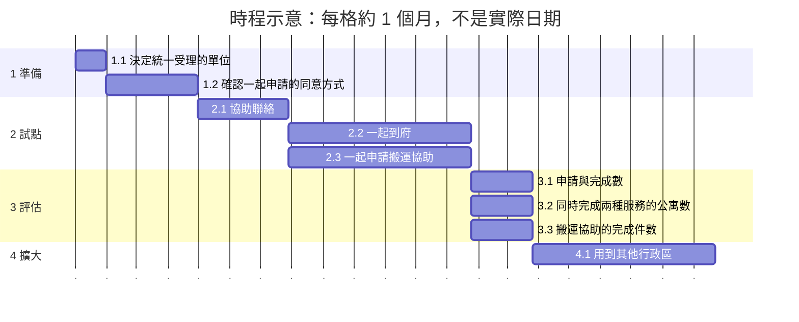

| 相依事項與現行政策的關係 | 說明 | 相關編號 |
|---|---|---|
| 以各議題的解法為基礎 | `[AI模擬]` 合併的解法不取代各議題的解法。各議題的解法可以單獨推動；合併只是在同一個地點、同一段時間一起辦。 | 解法 X-S1、解法 X-S2、解法 X-S3、解法 X-S4、解法 X-S5、解法 X-S6、解法 X-S7、解法 X-S8、解法 X-S9、解法 X-S10、解法 X-S11、解法 X-S12、解法 X-S13 |
| 現行的防鼠服務與老屋健檢補助 | `[AI模擬]` 解法 X-S7 以 #3 提到的社區鼠類偵防服務（新聞報導，需真人查證）和 #6 的臺北市老屋健檢申請及補助實施計畫為基礎，擴大到沒有管委會的老舊公寓。 | 解法 X-S7、#3 解法 S5、#6 解法 S3 |

### 4.5.8 解法 X-S8：通勤公車、接駁與跨市路線的共同規劃

| 項目 | 內容 |
|---|---|
| 相關法規 | `[AI模擬]` 公車路線的新增、刪減、改線、班表與跨市公車的核定程序；電子票證的上下車紀錄可能是個人資料，需要依個人資料保護法處理（#4、#5）【待補：法務與公共運輸處確認核定程序、可以使用的資料與去識別的方法】 |
| 隱私 | `[AI模擬]` 只用站與時段的彙總人次，不用票卡號碼或可以追蹤個人行程的資料；人次很少的站與時段要合併後再公開；到站資訊只用車輛的位置與時間（#4、#5） |
| 其他顧慮與風險 | `[AI模擬]` 刷卡資料看不到沒有搭車的人，冷區不一定代表沒有需要；路線刪減會影響原本的乘客（#5 C3）；公車沒有專用道時，仍然被塞住（#4）；控制班距與延長末班需要駕駛人力（#5 C1） |
| 災害風險 | `[AI模擬]` 捷運因地震或停電停駛時，需要公車的接駁與替代路線，重劃時要保留應變的能力（#4 解法 S4、#5 解法 S2）；豪雨、地震或颱風時公車可能停駛或改道，需要即時公告（#4 解法 S4、#5 解法 S6）；疫情時搭乘的需求變化很大（#5 解法 S2）；到站資訊系統與上下車資料可能停電、被入侵或外洩，需要備援與資安檢查（#5 解法 S2、#5 解法 S6） |
| 可行性 | `[AI模擬]` #4 解法 S4：可行性中到高；#5 解法 S2：可行性中（需要局處提供資料）；#5 解法 S6：可行性高 |

| 執行計畫 | 內容 |
|---|---|
| 主責單位 | `[AI模擬]` 交通局公共運輸處；協作：臺北捷運公司、捷運工程局、新北市政府交通局、客運業者、企業、資訊局（#4、#5） |
| 需要的資料／API／資源 | `[AI模擬]` #4 解法 S4：文湖線各站分時進出量、公車各站的上下車人次（題目 #5 說沒有開放）【待補：公共運輸處】、員工的通勤起訖、跨市公車的路線與班次【待補：新北市交通局】、新捷運線的規劃資料【待補：捷運工程局】；#5 解法 S2：聯營公車業務的年度統計、公車路線軌跡、站牌位置圖、各站、各時段的上下車人次（去識別、彙總）【待補：公共運輸處，題目說未開放】、捷運各站的轉乘人次【待補：臺北捷運公司】、跨市路線的資料【待補：新北市交通局，或題目列出的 TDX 平臺（需要申請金鑰）】、各里人口、學校與醫院的位置（開放資料）【待補：確認使用的資料集】；#5 解法 S6：臺北市預估到站時間（公車）的資料集、預估與實際到站時間的差距【待補：公共運輸處】、公車的行車位置紀錄（彙總）【待補：公共運輸處】、捷運的末班時間與轉乘人次【待補：臺北捷運公司】、跨市路線的班表【待補：新北市交通局】 |
| 成本 | `[AI模擬]` #4 解法 S4：成本中（班次與接駁車的營運）【待補：單價】；#5 解法 S2：成本低到中（資料分析與說明會）；#5 解法 S6：成本低到中（系統與資料整理）。`[AI模擬]` 以下範圍是合併辦理的估計，不是各解法的加總，因為合併辦理共用人力與場地。接駁車與班次的經費只含試點，單價還沒有確認，也不含跨市公車的營運。時間：約 15–22 個月；經費：約 NT$ 250–700 萬；人力：約 340–640 人天【待補：專業人士確認】 |

| 編號 | 工作項目 | 主責單位 | 期間 | 人天 |
|---|---|---|---|---|
| 1 | `[AI模擬]` 準備：取得資料並公開說明 | 交通局公共運輸處 | 第 1–4 個月 | 約 40–80 |
| 1.1 | `[AI模擬]` 公共運輸處取得去識別、彙總的各站各時段上下車人次【待補：公共運輸處，題目說未開放】 | 交通局公共運輸處 | 第 1–3 個月 | 約 30–60 |
| 1.2 | `[AI模擬]` 向受影響的社區公開說明 | 交通局公共運輸處 | 第 4 個月 | 約 10–20 |
| 2 | `[AI模擬]` 試點：內湖的通勤路線 | 交通局公共運輸處 | 第 5–12 個月 | 約 130–240 |
| 2.1 | `[AI模擬]` 在內湖的通勤路線，和新北市政府交通局、客運業者一起調整班次 | 交通局公共運輸處 | 第 5–12 個月 | 約 70–130 |
| 2.2 | `[AI模擬]` 和新北市政府交通局、客運業者一起調整捷運站到園區的接駁 | 交通局公共運輸處 | 第 5–12 個月 | 約 60–110 |
| 3 | `[AI模擬]` 評估：看 4.3 的成效衡量 | 交通局公共運輸處 | 第 13–14 個月 | 約 20–40 |
| 3.1 | `[AI模擬]` 用 4.3 的成效衡量評估接駁的班次與載客數 | 交通局公共運輸處 | 第 13–14 個月 | 約 10–20 |
| 3.2 | `[AI模擬]` 用 4.3 的成效衡量評估到站時間的差距 | 交通局公共運輸處 | 第 13–14 個月 | 約 10–20 |
| 4 | `[AI模擬]` 擴大：全市的路網重劃 | 交通局公共運輸處 | 第 15–19 個月 | 約 150–280 |
| 4.1 | `[AI模擬]` 再用到全市的路網重劃 | 交通局公共運輸處 | 第 15–19 個月 | 約 150–280 |

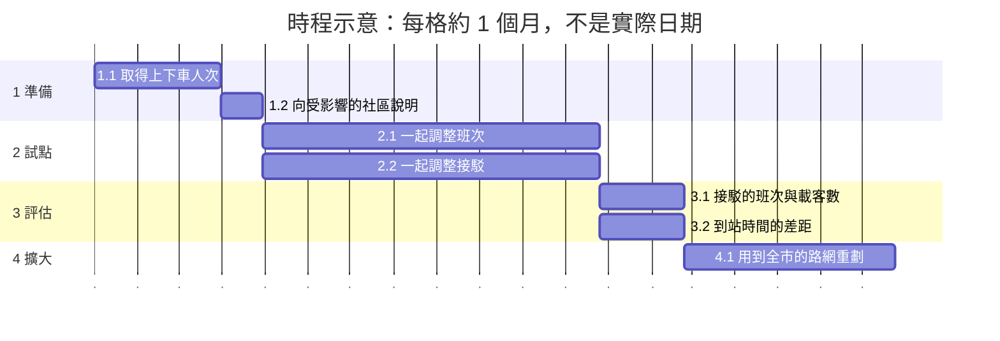

| 相依事項與現行政策的關係 | 說明 | 相關編號 |
|---|---|---|
| 以各議題的解法為基礎 | `[AI模擬]` 合併的解法不取代各議題的解法。各議題的解法可以單獨推動；合併只是在同一個地點、同一段時間一起辦。 | 解法 X-S1、解法 X-S2、解法 X-S3、解法 X-S4、解法 X-S5、解法 X-S6、解法 X-S7、解法 X-S8、解法 X-S9、解法 X-S10、解法 X-S11、解法 X-S12、解法 X-S13 |
| 跨市的公車路線 | `[AI模擬]` 解法 X-S8 的跨市路線需要新北市政府交通局一起規劃，#4 與 #5 都有這個故事。 | 解法 X-S8、O48、#4 O48-US01、#5 O48-US01 |

### 4.5.9 解法 X-S9：消防與救護路線的共同檢查

| 項目 | 內容 |
|---|---|
| 相關法規 | `[AI模擬]` 道路交通安全規則第 101 條（汽車要避讓執行緊急任務的車輛，#4）；號誌的設置與時制的相關規定（#4）。#6 解法 S6 的相關法規是增設電梯的規定，沒有寫到消防通道【待補：法務與消防局確認巷弄消防通道的相關規定】 |
| 隱私 | `[AI模擬]` 路口的偵測只計算車輛與行人的數量，不錄影保存可以辨識的人臉與車牌（#4）；為了避難協助而登記的高齡與身心障礙住戶的資料，要本人同意並只給救災單位使用（#6） |
| 其他顧慮與風險 | `[AI模擬]` 緊急車輛的號誌優先，會讓其他方向的車等比較久（#4）；巷弄的路邊停車可能擋住消防車（#6） |
| 災害風險 | `[AI模擬]` 號誌停電時路口會失去控制，需要備援電力與交通指揮；連網的號誌可能被入侵；地震後號誌可能故障，緊急車輛更需要優先通行（#4 解法 S3）；火災時消防通道不暢通就無法搶救；地震或停電時電梯會停止，長輩可能被困（#6 解法 S6） |
| 可行性 | `[AI模擬]` #4 解法 S3：可行性高（現有的號誌系統可以調整）；#6 解法 S6：可行性中 |

| 執行計畫 | 內容 |
|---|---|
| 主責單位 | `[AI模擬]` 消防局；協作：交通管制工程處、警察局交通警察大隊、都市更新處、里辦公處（#4、#6） |
| 需要的資料／API／資源 | `[AI模擬]` #4 解法 S3：主要路廊的號誌時制與路口的流量【待補：交通管制工程處】、國道匝道的流量【待補：高速公路局】、行人與學童較多的路口、救護車的路線與到達時間【待補：消防局】；#6 解法 S6：消防通道清冊、各里 65 歲以上人口、1999「消防安全管理」的件數、沒有電梯的老公寓數量【待補：都市發展局】、增設電梯補助的申請與核准件數【待補：都市更新處】、身心障礙者的避難需求（彙總）【待補：社會局】、爬梯機等輔具的補助與租借【待補：社會局】 |
| 成本 | `[AI模擬]` #4 解法 S3：成本低到中（時制調整與設備）【待補：設備的單價】；#6 解法 S6：電梯的成本高（有現行補助），逃生與消防通道的檢查成本低到中。`[AI模擬]` 以下範圍是合併辦理的估計，不是各解法的加總，因為合併辦理共用人力與場地。以下範圍只含路線的共同檢查，不含路口設備的採購，也不含電梯的工程費與補助款。時間：約 15–22 個月；經費：約 NT$ 170–520 萬；人力：約 300–560 人天【待補：專業人士確認】 |

| 編號 | 工作項目 | 主責單位 | 期間 | 人天 |
|---|---|---|---|---|
| 1 | `[AI模擬]` 準備：確認相關規定 | 消防局 | 第 1–3 個月 | 約 25–50 |
| 1.1 | `[AI模擬]` 消防局和交通管制工程處確認巷弄消防通道的相關規定【待補：法務與消防局確認】 | 消防局 | 第 1–3 個月 | 約 25–50 |
| 2 | `[AI模擬]` 試點：在一個行政區檢查整條路線 | 消防局 | 第 4–10 個月 | 約 100–190 |
| 2.1 | `[AI模擬]` 在一個行政區，從主要道路到消防通道清冊中的搶救困難巷弄，整條路線一起檢查號誌 | 消防局 | 第 4–10 個月 | 約 60–110 |
| 2.2 | `[AI模擬]` 整條路線一起檢查路邊停車 | 消防局 | 第 4–10 個月 | 約 40–80 |
| 3 | `[AI模擬]` 評估：看 4.3 的成效衡量 | 消防局 | 第 11–12 個月 | 約 25–50 |
| 3.1 | `[AI模擬]` 用 4.3 的成效衡量評估救護車到達時間【待補：消防局】 | 消防局 | 第 11–12 個月 | 約 10–20 |
| 3.2 | `[AI模擬]` 用 4.3 的成效衡量評估一起檢查過的路線比例 | 消防局 | 第 11–12 個月 | 約 15–30 |
| 4 | `[AI模擬]` 擴大：其他搶救困難的地區 | 消防局 | 第 13–18 個月 | 約 150–270 |
| 4.1 | `[AI模擬]` 再用到其他搶救困難的地區 | 消防局 | 第 13–18 個月 | 約 150–270 |

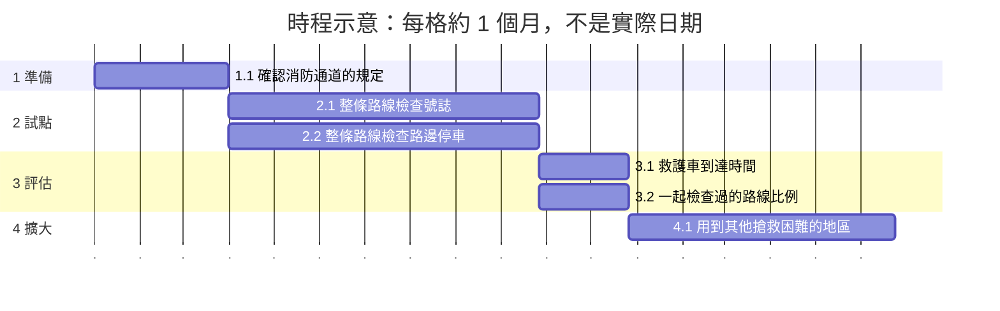

| 相依事項與現行政策的關係 | 說明 | 相關編號 |
|---|---|---|
| 以各議題的解法為基礎 | `[AI模擬]` 合併的解法不取代各議題的解法。各議題的解法可以單獨推動；合併只是在同一個地點、同一段時間一起辦。 | 解法 X-S1、解法 X-S2、解法 X-S3、解法 X-S4、解法 X-S5、解法 X-S6、解法 X-S7、解法 X-S8、解法 X-S9、解法 X-S10、解法 X-S11、解法 X-S12、解法 X-S13 |

### 4.5.10 解法 X-S10：重建與更新案的樹木規則與審查時程

| 項目 | 內容 |
|---|---|
| 相關法規 | `[AI模擬]` 臺北市樹木保護自治條例（受保護樹木的移植與公告，#1）；都市危險及老舊建築物加速重建條例與都市更新條例（同意比率與獎勵，#6）【待補：法務確認保留樹的規則能不能放進重建與更新的審查程序】 |
| 隱私 | `[AI模擬]` 審查進度只公開案件的階段與時間，不公開屋主的姓名與個人的分回條件（#6）；移除紀錄不含申請人的個資（#1） |
| 其他顧慮與風險 | `[AI模擬]` 本解法不評價任何個案，也不判斷任何實施者（#6）；責任在多個工程單位之間，施工現場的標示可能被移動或損壞（#1） |
| 災害風險 | `[AI模擬]` 拆除與重建的工地、鷹架與圍籬在颱風時可能倒塌或掉落，需要依規定加固；等待重建的期間仍要先做評估與補強（#6 解法 S4）；保留樹的修剪與健康檢查要考慮颱風、地震時斷枝與倒樹的風險（#1 解法 S2） |
| 可行性 | `[AI模擬]` #1 解法 S2：可行性中；#6 解法 S4：可行性中 |

| 執行計畫 | 內容 |
|---|---|
| 主責單位 | `[AI模擬]` 都市發展局、都市更新處（#6）與工務局公園路燈工程管理處（#1）；協作：工務局各工程處、受保護樹木的主管機關【待補：確認主管機關】、法務局 |
| 需要的資料／API／資源 | `[AI模擬]` #1 解法 S2：每棵樹的唯一編號（行道樹資料已有 TreeID）、移除紀錄與原因（目前未完整開放）、工程設計圖中的保留樹清單、現場標示的規格、移樹履歷查詢系統的資料匯出方式【待補：公園處】、印有樹木編號與回報方式的樹牌、回報與 1999 派工系統的介接【待補：現有系統資訊】；#6 解法 S4：1999「都市規劃、設計、更新、開發及管理」的件數、危老重建與都市更新的申請、核准件數與審查時間【待補：都市發展局、都市更新處】、中繼住宅的戶數與使用情形【待補：都市發展局】、整建維護的案例與費用【待補：都市更新處】、申請各種路徑要準備的文件與常見的補件原因【待補：都市更新處】 |
| 成本 | `[AI模擬]` #1 解法 S2：成本低到中（資料整理與系統調整），樹牌的製作與安裝成本【待補：單價】；#6 解法 S4：資訊與諮詢的成本低到中，中繼住宅與租金補貼的成本高【待補：單價】。`[AI模擬]` 以下範圍是合併辦理的估計，不是各解法的加總，因為合併辦理共用人力與場地。以下範圍不含樹牌的製作與安裝，也不含中繼住宅本身與租金補貼的費用。時間：約 15–22 個月；經費：約 NT$ 150–480 萬；人力：約 270–520 人天【待補：專業人士確認】 |

| 編號 | 工作項目 | 主責單位 | 期間 | 人天 |
|---|---|---|---|---|
| 1 | `[AI模擬]` 準備：確認規則能不能放進審查程序 | 都市發展局 | 第 1–4 個月 | 約 30–60 |
| 1.1 | `[AI模擬]` 都市發展局、都市更新處與公園處請法務局確認保留樹的規則能不能放進審查程序【待補：法務確認】 | 都市發展局 | 第 1–4 個月 | 約 30–60 |
| 2 | `[AI模擬]` 試點：在幾個新的重建或更新案 | 都市更新處 | 第 5–11 個月 | 約 90–170 |
| 2.1 | `[AI模擬]` 在幾個新的重建或更新案，把保留樹清單、移植規則與現場標示寫進公開的審查時程 | 都市更新處 | 第 5–11 個月 | 約 90–170 |
| 3 | `[AI模擬]` 評估：看 4.3 的成效衡量 | 都市更新處 | 第 12–13 個月 | 約 20–40 |
| 3.1 | `[AI模擬]` 用 4.3 的成效衡量評估先說明樹木規則的比例 | 都市更新處 | 第 12–13 個月 | 約 10–20 |
| 3.2 | `[AI模擬]` 用 4.3 的成效衡量評估誤砍的件數 | 都市更新處 | 第 12–13 個月 | 約 10–20 |
| 4 | `[AI模擬]` 擴大：其他重建與更新案 | 都市更新處 | 第 14–18 個月 | 約 130–250 |
| 4.1 | `[AI模擬]` 再用到其他重建與更新案 | 都市更新處 | 第 14–18 個月 | 約 130–250 |

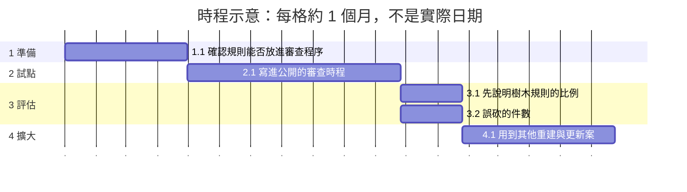

| 相依事項與現行政策的關係 | 說明 | 相關編號 |
|---|---|---|
| 以各議題的解法為基礎 | `[AI模擬]` 合併的解法不取代各議題的解法。各議題的解法可以單獨推動；合併只是在同一個地點、同一段時間一起辦。 | 解法 X-S1、解法 X-S2、解法 X-S3、解法 X-S4、解法 X-S5、解法 X-S6、解法 X-S7、解法 X-S8、解法 X-S9、解法 X-S10、解法 X-S11、解法 X-S12、解法 X-S13 |

### 4.5.11 解法 X-S11：同一段道路與路口的行人、自行車、公車與機車空間的共同設計

| 項目 | 內容 |
|---|---|
| 相關法規 | `[AI模擬]` 學校周邊的停車與接送、巷道限制轉入的相關規定（#4）；站位與標線的設置規定（#5）；身心障礙者權益保障法第 53 條（無障礙的運輸服務，#5）；道路交通管理處罰條例第 44 條（車輛不停讓行人的罰則）與第 78 條（行人不依號誌穿越道路的罰則）、行人交通安全設施條例第 7 條（在學校、醫療院所與大眾運輸場站等周邊劃定行人友善區，#12）；道路交通安全規則第 111 條（行人穿越道與交岔路口附近不得臨時停車，#12 解法 S1 的路口淨空）【待補：法務與交通工程專業人員確認】【待補：交通局確認行人專用時相、行人早開與延長秒數的設置規定，以及巷弄的速限與標線型人行道的劃設規定（#12）】 |
| 隱私 | `[AI模擬]` 現場觀察與計數不拍可以辨識的人臉與車牌；學童的資料只用彙總（#4、#5）；路口的科技執法只拍車牌與車輛，不拍可辨識的行人人臉，沒有違規的影像定期刪除；長者與學童的步行路線只用彙總的資料（#12） |
| 其他顧慮與風險 | `[AI模擬]` 自行車道或公車停靠的空間可能壓縮車道、機車道或路邊停車（#4 C1、#5 C4）；限制巷道轉入，住在巷內的人回家可能比較繞（#4）；站位移動後，原本的乘客要走比較遠（#5）；行人專用時相可能讓車輛等比較久（#12 C2）；標線型人行道可能要減少路邊停車，沿線的住戶可能反對（#12 C3）；沒有被選到的路口與地區可能覺得被忽略（#12）；路口淨空會減少路口旁的停車位，附近的店家與住戶需要停車與上下貨的地方，反光柱也要避開輪椅與嬰兒車的通行（#12 解法 S1） |
| 災害風險 | `[AI模擬]` 學校周邊、巷弄與站前是事故容易發生的地方，改動後要觀察事故數（#4 解法 S5、#5 解法 S5）；候車亭與站牌在颱風時可能損壞或掉落，需要定期檢查（#5 解法 S5）；號誌停電時長者與視障者最難過馬路，需要備援電力與警力的指揮；行人觸動秒數改成遠端設定後，系統被入侵時可能改錯秒數（#12 解法 S1）；長者在熱天走路容易中暑，行人友善區的步行路線要有遮蔭與休息的地方；巷弄的配置要保留消防車與救護車的通行寬度（#12 解法 S3） |
| 可行性 | `[AI模擬]` #4 解法 S5：可行性中到高；#5 解法 S5：可行性中到高；#12 解法 S1：可行性中到高（有現行的路口改善與號誌計畫）；#12 解法 S3：可行性中（學校周邊已有改善計畫；長者常去的地方與巷弄要和住戶協調） |

| 執行計畫 | 內容 |
|---|---|
| 主責單位 | `[AI模擬]` 交通管制工程處、交通局公共運輸處；協作：工務局新建工程處、教育局與學校、警察局交通警察大隊、客運業者、里辦公處（#4、#5）；交通局（交通安全）、身障團體、社會局的社區關懷據點、消防局（#12） |
| 需要的資料／API／資源 | `[AI模擬]` #4 解法 S5：學校周邊的上下學時段與接送的車數【待補：學校與教育局】、住宅巷道的穿越車流【待補：現場觀察或交通管制工程處】、自行車道的位置與交通事故資料【待補：警察局】、騎自行車通勤到園區的人數與起訖【待補：通勤調查】、園區企業與大樓的淋浴間與停車空間【待補：園區的產業團體】；#5 解法 S5：站牌位置圖、智慧型公車站牌數、身心障礙者小型冷氣車輛數、現在的站位清單【待補：公共運輸處】、站位附近的事故與申訴【待補：警察局、公共運輸處】、低底盤公車的比例【待補：公共運輸處】；#12 解法 S1：交通局分析報告的 30 日死亡事故的主要肇因與 65 歲以上行人的肇因、115年臺北市道路交通安全執行計畫的路口行人安全設施改善、各路口的行人量與事故類型（彙總，不公開當事人）【待補：交通局】、可以行人觸動延長秒數與有聲響號誌的路口清單【待補：交通管制工程處】；#12 解法 S3：學校周邊人行環境改善的成果、長者常去的地方與步行路線的彙總資料【待補：社會局、民政局】、巷弄的寬度與停車狀況【待補：交通局】 |
| 成本 | `[AI模擬]` #4 解法 S5：成本低到中（標線、設施與人力），跨河的自行車通道成本高【待補：工程的單價】；#5 解法 S5：成本低到中（標線、站牌與訓練）；#12 解法 S1：成本低到中（號誌時相的調整、聲響號誌與行人觸動設備；路口淨空的反光柱成本低；庇護島的工程成本中）；#12 解法 S3：成本低到中（標線、彩色鋪面、臨時材料、號誌與說明會），實體人行道的成本中到高。`[AI模擬]` 以下範圍是合併辦理的估計，不是各解法的加總，因為合併辦理共用人力與場地。以下範圍不含跨河的自行車通道的興建、由企業或大樓負擔的淋浴間與停車空間、庇護島的工程、聲響號誌與行人觸動設備的採購，也不含實體人行道的工程與之後各年的改善。時間：約 16–24 個月；經費：約 NT$ 350–900 萬；人力：約 480–900 人天【待補：專業人士確認】 |

| 編號 | 工作項目 | 主責單位 | 期間 | 人天 |
|---|---|---|---|---|
| 1 | `[AI模擬]` 準備：一起討論並選出路段 | 交通管制工程處 | 第 1–4 個月 | 約 45–90 |
| 1.1 | `[AI模擬]` 交通管制工程處和公共運輸處邀請開車、騎車與走路的人、長者、身障者、公車駕駛和店家一起討論 | 交通管制工程處 | 第 1–3 個月 | 約 35–70 |
| 1.2 | `[AI模擬]` 選出試辦路段與路口 | 交通管制工程處 | 第 4 個月 | 約 10–20 |
| 2 | `[AI模擬]` 試點：在少數路段一起設計 | 交通管制工程處 | 第 5–13 個月 | 約 300–540 |
| 2.1 | `[AI模擬]` 在少數路段一起設計自行車道、公車停靠空間、標線與路口的行人時相 | 交通管制工程處 | 第 5–13 個月 | 約 240–430 |
| 2.2 | `[AI模擬]` 學校與長者常去的地方周邊也一起看 | 交通管制工程處 | 第 5–13 個月 | 約 60–110 |
| 3 | `[AI模擬]` 評估：看 4.3 的成效衡量，公開前後的數字 | 交通管制工程處 | 第 14–15 個月 | 約 30–60 |
| 3.1 | `[AI模擬]` 用 4.3 的成效衡量評估事故數、行人的 30 日死亡人數 | 交通管制工程處 | 第 14–15 個月 | 約 15–30 |
| 3.2 | `[AI模擬]` 用 4.3 的成效衡量評估一起設計的路段與路口數 | 交通管制工程處 | 第 14–15 個月 | 約 10–20 |
| 3.3 | `[AI模擬]` 公開前後的數字 | 交通管制工程處 | 第 14–15 個月 | 約 5–10 |
| 4 | `[AI模擬]` 擴大：決定是否延伸 | 交通管制工程處 | 第 16–18 個月 | 約 105–210 |
| 4.1 | `[AI模擬]` 再決定是否延伸 | 交通管制工程處 | 第 16–18 個月 | 約 105–210 |

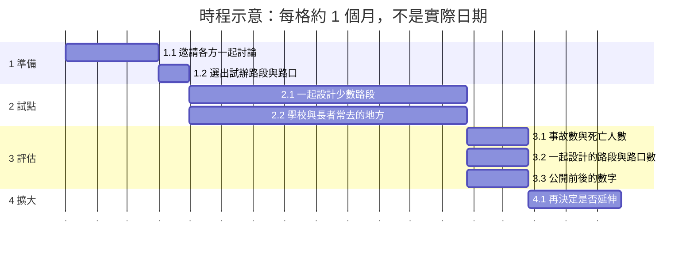

| 相依事項與現行政策的關係 | 說明 | 相關編號 |
|---|---|---|
| 以各議題的解法為基礎 | `[AI模擬]` 合併的解法不取代各議題的解法。各議題的解法可以單獨推動；合併只是在同一個地點、同一段時間一起辦。 | 解法 X-S1、解法 X-S2、解法 X-S3、解法 X-S4、解法 X-S5、解法 X-S6、解法 X-S7、解法 X-S8、解法 X-S9、解法 X-S10、解法 X-S11、解法 X-S12、解法 X-S13 |
| 現行的校園周邊暨行車安全道路改善 | `[AI模擬]` #12 引用的「115年臺北市道路交通安全執行計畫」：以學校周邊為對象，清除行人空間的障礙物、設置行人早開或行人專用時相、串接人行空間；114 年完成 112 所國小周邊的人行環境改善。解法 X-S11 的學校周邊設計以這個計畫為基礎。 | #12 解法 S3、O23、#12 O23-US01、解法 X-S11 |

### 4.5.12 解法 X-S12：鄰近工地的事先通知、鄰房鑑定與施工噪音管理

| 項目 | 內容 |
|---|---|
| 相關法規 | `[AI模擬]` 建築法第 77 條（建築物的維護與檢查申報），施工損鄰的鑑定程序待法務與建築管理工程處確認（#6 解法 S5）；噪音管制法第 9 條、第 10 條、第 24 條與第 25 條，以及環保局公告的營建工程施工時段（#10 解法 S3）【待補：法務確認鄰房鑑定的說明與施工時段的通知能不能用同一份文件】 |
| 隱私 | `[AI模擬]` 現場巡查不拍可辨識的人臉、門牌與車牌，查報的紀錄只給局處使用（#6）；通知住戶時只用里或街廓的範圍，不收集住戶的個人資料（#10） |
| 其他顧慮與風險 | `[AI模擬]` 鄰房鑑定會增加工程的時間（#6 C5）；違建與外牆的數量多，處理的速度跟不上（#6）；夜間施工的通知太多時，住戶可能不看；低噪音的機具成本較高，工期可能拉長；營造業者覺得工期無法掌握（#10） |
| 災害風險 | `[AI模擬]` 在液化潛勢較高的地區開挖，鄰房傾斜的風險可能較高，鄰房的監測要更注意；颱風與地震後，外牆、招牌要優先巡查（#6 解法 S5）；災後的搶修常要在夜間或連續施工，需要事先說明災害期間的例外與通知方式（#10 解法 S3） |
| 可行性 | `[AI模擬]` #6 解法 S5：可行性中；#10 解法 S3：可行性中 |

| 執行計畫 | 內容 |
|---|---|
| 主責單位 | `[AI模擬]` 建築管理工程處（#6）與環保局（#10）【待補：由哪個單位發出共同的通知，需要市府決定】；協作：工務局、捷運公司、營造業者、里辦公處 |
| 需要的資料／API／資源 | `[AI模擬]` #6 解法 S5：1999 的建管相關次類別（例如「施工管理及建築損鄰」）的件數、外牆與招牌掉落的事故紀錄【待補：建築管理工程處、消防局】、施工損鄰的鑑定與處理件數【待補：建築管理工程處】；#10 解法 S3：環保局常見問答中的施工時段規定、營建工程噪音的陳情與處分件數【待補：環保局】、道路與軌道夜間工程的時段【待補：工務局、捷運公司】 |
| 成本 | `[AI模擬]` #6 解法 S5：成本中（巡查與監測的人力）；#10 解法 S3：成本低到中（通知與告示），低噪音機具的成本中。`[AI模擬]` 以下範圍是合併辦理的估計，不是各解法的加總，因為合併辦理共用人力與場地。以下範圍不含營造業者更換低噪音機具的費用。時間：約 15–22 個月；經費：約 NT$ 280–720 萬；人力：約 380–720 人天【待補：專業人士確認】 |

| 編號 | 工作項目 | 主責單位 | 期間 | 人天 |
|---|---|---|---|---|
| 1 | `[AI模擬]` 準備：做一份通知的範本 | 建築管理工程處與環保局 | 第 1–3 個月 | 約 30–60 |
| 1.1 | `[AI模擬]` 建築管理工程處與環保局做一份工地告示與通知的範本，寫出鄰房鑑定的方式、損壞時的處理流程、施工的時段與陳情的方式【待補：法務確認】 | 建築管理工程處與環保局 | 第 1–3 個月 | 約 30–60 |
| 2 | `[AI模擬]` 試點：在一個行政區的幾個新工地 | 建築管理工程處與環保局 | 第 4–10 個月 | 約 130–240 |
| 2.1 | `[AI模擬]` 在一個行政區的幾個新工地，施工前用這份通知告訴周邊住戶與里辦公處 | 建築管理工程處與環保局 | 第 4–10 個月 | 約 130–240 |
| 3 | `[AI模擬]` 評估：看 4.3 的成效衡量 | 建築管理工程處與環保局 | 第 11–12 個月 | 約 20–40 |
| 3.1 | `[AI模擬]` 用 4.3 的成效衡量評估損鄰與施工噪音的陳情件數 | 建築管理工程處與環保局 | 第 11–12 個月 | 約 15–30 |
| 3.2 | `[AI模擬]` 用 4.3 的成效衡量評估使用共同通知的工地數 | 建築管理工程處與環保局 | 第 11–12 個月 | 約 5–10 |
| 4 | `[AI模擬]` 擴大：全市的新工地 | 建築管理工程處與環保局 | 第 13–18 個月 | 約 200–380 |
| 4.1 | `[AI模擬]` 再用到全市的新工地 | 建築管理工程處與環保局 | 第 13–18 個月 | 約 200–380 |

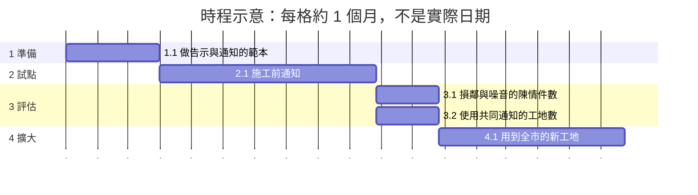

| 相依事項與現行政策的關係 | 說明 | 相關編號 |
|---|---|---|
| 以各議題的解法為基礎 | `[AI模擬]` 合併的解法不取代各議題的解法。各議題的解法可以單獨推動；合併只是在同一個地點、同一段時間一起辦。 | 解法 X-S1、解法 X-S2、解法 X-S3、解法 X-S4、解法 X-S5、解法 X-S6、解法 X-S7、解法 X-S8、解法 X-S9、解法 X-S10、解法 X-S11、解法 X-S12、解法 X-S13 |
| 現行的施工時段規定 | `[AI模擬]` #10 引用環保局常見問答：營建工程在平日晚上 10 時至翌日上午 8 時、假日中午 12 時至下午 2 時與晚上 6 時至翌日上午 8 時，不得使用動力機械或手持工具從事可能妨礙安寧的施工。解法 X-S12 把這個規定和鄰房鑑定的說明寫在同一份通知。 | #10 解法 S3、O61、O15、解法 X-S12 |

### 4.5.13 解法 X-S13：住戶之間的菸味與噪音糾紛的規約範本與調解

| 項目 | 內容 |
|---|---|
| 相關法規 | `[AI模擬]` 公寓大廈管理條例的規約，菸害防制法第 18 條、第 20 條（#8）；生活噪音依公寓大廈管理條例第 16 條向管理委員會反映（#10）【待補：法務確認規約可以約定的範圍，以及鄰里糾紛的調解程序】 |
| 隱私 | `[AI模擬]` 住戶之間的爭議不公開個人資料（#8）；調解的內容保密，只公開彙總的件數（#10） |
| 其他顧慮與風險 | `[AI模擬]` 住家內部不在公共空間的範圍，主要靠社區規約與宣導；要避免住戶之間的對立；只提供範本，效果取決於各社區（#8）；調解要雙方都願意參加，也沒有強制力；沒有管委會的公寓要靠里辦公處；孩子的聲音被當成擾鄰時，家長可能覺得被針對（#10） |
| 災害風險 | `[AI模擬]` 在住家內吸菸，可能是住宅火災的原因之一，規約範本可以一起提醒用火的安全，特別是獨居的高齡者（#8 解法 S5）；#10 解法 S5 沒有明顯相關的災害風險 |
| 可行性 | `[AI模擬]` #8 解法 S5：可行性中；#10 解法 S5：可行性高 |

| 執行計畫 | 內容 |
|---|---|
| 主責單位 | `[AI模擬]` 衛生局與都市發展局（#8）、民政局（區公所調解委員會）與里辦公處（#10）【待補：由哪個單位主辦共同的範本，需要市府決定】；協作：環保局、警察局、公寓大廈管理委員會 |
| 需要的資料／API／資源 | `[AI模擬]` #10 解法 S5：陳情系統「人與動物噪音」的件數、鄰里糾紛的調解件數【待補：民政局】、規約範本的草案【待補：法務與管委會確認】；#8 解法 S5：規約範本、社區禁菸公告的案例（衛生局公告中有社區戶外空間的例子）、戒菸服務資源 |
| 成本 | `[AI模擬]` #8 解法 S5：成本低；#10 解法 S5：成本低。`[AI模擬]` 以下範圍是合併辦理的估計，不是各解法的加總，因為合併辦理共用人力與場地。時間：約 9–15 個月；經費：約 NT$ 35–140 萬；人力：約 120–240 人天【待補：專業人士確認】 |

| 編號 | 工作項目 | 主責單位 | 期間 | 人天 |
|---|---|---|---|---|
| 1 | `[AI模擬]` 準備：寫成白話說明與規約範本 | 【待補：主辦共同範本的單位】 | 第 1–3 個月 | 約 25–50 |
| 1.1 | `[AI模擬]` 衛生局、環保局與警察局把菸味與生活噪音由誰處理寫成白話說明 | 衛生局 | 第 1–2 個月 | 約 15–30 |
| 1.2 | `[AI模擬]` 做一份規約範本【待補：法務確認規約可以約定的範圍】 | 同上 | 第 3 個月 | 約 10–20 |
| 2 | `[AI模擬]` 試點：在幾個里和管委會試用範本 | 【待補：主辦共同範本的單位】 | 第 4–7 個月 | 約 50–100 |
| 2.1 | `[AI模擬]` 在幾個里和管委會試用範本 | 同上 | 第 4–7 個月 | 約 35–70 |
| 2.2 | `[AI模擬]` 談不攏時由里辦公處轉介調解 | 里辦公處 | 第 4–7 個月 | 約 15–30 |
| 3 | `[AI模擬]` 評估：看 4.3 的成效衡量與各方意見 | 【待補：主辦共同範本的單位】 | 第 8–9 個月 | 約 15–30 |
| 3.1 | `[AI模擬]` 用 4.3 的成效衡量評估調解件數、使用範本的社區數 | 同上 | 第 8–9 個月 | 約 10–20 |
| 3.2 | `[AI模擬]` 蒐集住戶、家長的意見 | 同上 | 第 8–9 個月 | 約 5–10 |
| 4 | `[AI模擬]` 擴大：修正範本後推到全市 | 【待補：主辦共同範本的單位】 | 第 10–12 個月 | 約 30–60 |
| 4.1 | `[AI模擬]` 修正範本 | 同上 | 第 10 個月 | 約 10–20 |
| 4.2 | `[AI模擬]` 推到全市 | 同上 | 第 11–12 個月 | 約 20–40 |

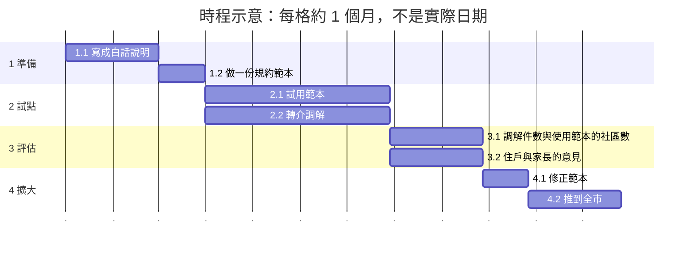

| 相依事項與現行政策的關係 | 說明 | 相關編號 |
|---|---|---|
| 以各議題的解法為基礎 | `[AI模擬]` 合併的解法不取代各議題的解法。各議題的解法可以單獨推動；合併只是在同一個地點、同一段時間一起辦。 | 解法 X-S1、解法 X-S2、解法 X-S3、解法 X-S4、解法 X-S5、解法 X-S6、解法 X-S7、解法 X-S8、解法 X-S9、解法 X-S10、解法 X-S11、解法 X-S12、解法 X-S13 |

---

## 變更紀錄

| 日期 | 內容 |
|---|---|
| 2026-10-20 | 第一版。比較 #1、#2、#8：16 位共用的利害關係人、7 個跨議題的相同需求群組、2 個跨議題的衝突、5 個合併的解法 |
| 2026-10-20 | 依 ETBlue 的決定加入 #9。共用的利害關係人變成 17 位（新增 I04）。#9 N01 與 #9 O06-US01 加入 X-N4；新增 X-N8（#2 I13-US02、#9 N02）。#9 解法 S4 加入解法 X-S4，X-S4 改名為「街道設施與議題分析的共同開放資料與地圖」。#9 沒有新的跨議題衝突。分析摘要、1.3、4.3、4.5 也加入 #9 的內容 |
| 2026-10-20 | #9 依 ETBlue 的決定，用和 #1、#2、#8 相同的特別關注族群規則，加入 I27 過敏或呼吸道疾病者與 I35 照顧孩子的家長與照顧者。I27 也在 #8，所以共用的利害關係人變成 18 位（1.1）；1.3 的呼吸道疾病列出 I27。分析摘要的呼吸道疾病與兒童與照顧者也加入 #9 的需求（#9 N06） |
| 2026-10-20 | 依 ETBlue 的決定：#9 O06-US01 不放進 X-N4（X-N4 保留 #9 N01）；#9 解法 S3、S5 不併入解法 X-S1，因為實際執行的方式很不一樣。#9 新的需求 #9 N07 沒有放進跨議題的群組（見 2.1） |
| 2026-10-21 | 檢查 ETBlue 在 #1、#2、#9 新的親身經驗（#1 I14-US05、#1 I14-US06、#2 I09-US06、#9 I31-US05、#9 I31-US06、#9 I36-US01）。都沒有放進跨議題的群組，原因見 2.1；#1 I14-US05 與 #2 I09-US06 是否是同一個需求，列為待補。新的衝突 #1 C9、#2 C10、#9 C6 都只在各自的議題之內，所以沒有新的跨議題衝突。這些故事的利害關係人（I14、I09、I31、I36）都只在一個議題，所以共用的利害關係人不變。#9 刪除本專案作者原本的故事，本專案作者離開 #9；他原本也只在 #9，所以本文件不受影響 |
| 2026-10-21 | 依 ETBlue 的決定：#1 I14-US05 與 #2 I09-US06 不是同一個需求，不放進同一個群組（見 2.1）。原本的待補項目改成這個決定的紀錄 |
| 2026-10-22 | 依 ETBlue 的決定，各議題的步驟 7 加入「災害風險」。4.5 的「主要風險」欄也加上組成解法的災害風險，只整理各議題的內容，沒有新的事實 |
| 2026-10-23 | 依 ETBlue 的決定加入 #3、#4、#5、#6，用和其他議題相同的規則。共用的利害關係人從 18 位變成 39 位（新增 21 位，見 1.1）。X-N2 加入 #3 I06-US01；X-N3 加入 #3 N04；X-N4 加入 #3 N07、#4 N05、#5 N05、#6 N10。新增 7 個跨議題的相同需求群組（X-N9–X-N15），共 15 個。新增 1 個跨議題的衝突 X-C3（#4 C1、#5 C4），共 3 個。#5 解法 S5 加入解法 X-S2；#3 解法 S6 加入解法 X-S3；#3 解法 S6、#4 解法 S1、#5 解法 S2、#6 解法 S1 加入解法 X-S4，X-S4 改名為「街道設施、市政資料與議題分析的共同開放資料與地圖」。新增 6 個合併的解法（X-S6–X-S11），共 11 個。分析摘要、1.3、4.3、4.4、4.5 也加入 #3–#6 的內容。只整理各議題的內容，沒有新的事實 |
| 2026-10-23 | 依 ETBlue 的決定，4.5 改成和各議題步驟 7 相同的格式：每個合併的解法有「評估」與「執行計畫」兩張表。舊的「主要風險」欄分成「其他顧慮與風險」與「災害風險」，「主責與協作單位」改名為「主責單位」，文字沒有改變。可行性、需要的資料與成本先寫待補項目。分析摘要「相依事項與現行政策的關係」的列都寫到合併的解法，所以都移到 4.5 該解法的「相依事項與現行政策的關係」表 |
| 2026-10-23 | 依 ETBlue 的要求，4.5 每個合併的解法寫上「執行步驟」（AI 寫的簡短計畫：第一步、試點、評估與擴大）。「可行性」「需要的資料／API／資源」「成本」列出組成解法在各議題步驟 7 寫的內容，沒有新的事實；組成解法的待補項目仍保留 |
| 2026-10-24 | 依 ETBlue 的決定加入 #10，用和其他議題相同的規則。共用的利害關係人從 39 位變成 44 位（新增 O14、O15、O44、I38、I49，見 1.1）。X-N3 加入 #10 N05；X-N13 加入 #10 N04。新增 2 個跨議題的相同需求群組：X-N16（#3 N05、#10 N02）與 X-N17（#8 O24-US01、#10 N07），共 17 個。#10 的衝突都只在 #10 之內，所以沒有新的跨議題衝突，仍是 3 個。#10 解法 S1 加入解法 X-S3。新增 2 個合併的解法：X-S12（#6 解法 S5、#10 解法 S3）與 X-S13（#8 解法 S5、#10 解法 S5），共 13 個。分析摘要、1.2、1.3、2.1、4.3、4.4、4.5 也加入 #10 的內容。只整理各議題的內容，沒有新的事實 |
| 2026-10-24 | 依 ETBlue 的決定加入 #11、#12，用和其他議題相同的規則。共用的利害關係人從 44 位變成 54 位（新增 O08、O16、O39、O46、O56、O58、O67、I11、I24、I43，見 1.1）。1.2 新增 I11（#2 I11-US01、#11 I11-US01）。X-N2 加入 #11 N03、#12 N02；X-N3 加入 #11 N05；X-N6 加入 #11 N06；X-N9 加入 #12 N06；X-N13 加入 #12 N01；X-N16 加入 #12 I69-US01，優先順序改成「各議題不同」。新增 3 個跨議題的相同需求群組：X-N18（#2 I24-US01、#11 N01）、X-N19（#10 N03、#11 N08、#12 N05）與 X-N20（#2 O08-US01、#11 N07），共 20 個。#12 C4、#12 C5 加入 X-C1；沒有新的跨議題衝突，仍是 3 個。#12 解法 S2 加入解法 X-S2；#11 解法 S1、#12 解法 S4 加入解法 X-S3；#11 解法 S2、S5 加入解法 X-S6，X-S6 改名為「垃圾、廚餘與大型廢棄物的收集點與放置點」；#11 解法 S4 加入解法 X-S7，X-S7 改名為「老舊公寓的到府診斷與協助（防鼠、耐震與大型廢棄物的搬運）」；#12 解法 S1、S3 加入解法 X-S11，X-S11 改名為「同一段道路與路口的行人、自行車、公車與機車空間的共同設計」。解法 X-S4 的需求加入 #2 O08-US01（X-N20）。沒有新增合併的解法，仍是 13 個。空間類型加入 `parking`（解法 X-S2）。分析摘要、1.3、2.1、2.2、3、4.1–4.5 也加入 #11、#12 的內容。只整理各議題的內容，沒有新的事實 |
| 2026-10-28 | 各議題在 2026-10-28 補充了一些解法，本文件跟著更新。#1 解法 S1 與 #12 解法 S6 加入解法 X-S4（公開樹蔭地圖、步行環境調查的開放資料）；X-S4 的需求加入 #1 N01、#1 N02、#12 N02、#12 N03（X-N2）。解法 X-S1、X-S3、X-S4、X-S8、X-S11 的說明加入組成解法補充的內容（移除前的通知、帶有樹木編號的樹況通報、清潔箱的滿溢狀態、塞車程度的查詢、公車的服務範圍、路口淨空、全市一致的工程做法）。4.3 加入 5 個指標，4.4、4.5.4、4.5.11 與分析摘要一起更新。#1 解法 S6 沒有併入合併的解法；沒有新增合併的解法，仍是 13 個。共用的利害關係人、跨議題的相同需求群組與衝突沒有改變。只整理各議題的內容，沒有新的事實 |
| 2026-11-09 | 依 ETBlue 的決定，4.5 的 13 個合併的解法都改用新格式：「執行步驟」改成工作分解表與甘特圖，內容沒有減少，所有待補項目都保留。「成本」保留每個組成解法的文字，再加上 `[AI模擬]` 的合併範圍（時間、經費、人力），這些範圍需要專業人士確認；範圍不是各解法的加總，因為合併辦理共用人力與場地 |
| 2026-11-11 | 依 ETBlue 的決定：(1) 合併的解法的主辦單位還沒有決定時，工作分解表只有第 1 層（階段）的列寫待補項目，第 2 層的列寫原本的執行步驟為這一步寫到的機關，沒有寫到時寫「同上」（解法 X-S1、X-S3、X-S7、X-S13；X-S13 的階段改成待補項目「主辦共同範本的單位」）；(2) 4.5 的「可行性」「需要的資料／API／資源」「成本」裡各組成解法的文字，改成和各議題檔案目前的文字相同，不包含各議題自己的範圍，「不含…」只寫格子裡提到的項目。也修正解法 X-S2、X-S3、X-S6、X-S8 的成本說明。只整理各議題的內容，沒有新的事實 |

---

## 附錄：資料來源

- 本文件**沒有新的資料來源**。所有事實、數字與其他國家的做法，都來自 #1、#2、#3、#4、#5、#6、#8、#9、#10、#11、#12 的議題分析檔案；來源連結列在各檔案的附錄。
- 4.3 的數字只重述各議題 6.3 的格子，所以沿用它們的標記與資料來源。
- 4.1 提到的其他國家的做法（美國費城、新加坡、法國巴黎）都已經列在各議題的 6.1，標記與查證狀態以各議題為準。
